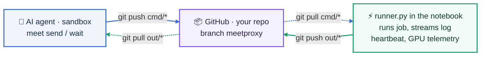

# MeetProxy — architecture

An AI coding agent (Claude Code, Codex, Aider, …) writes experiments on a laptop or in a cloud
sandbox. A GPU notebook (Google Colab with compute units, Kaggle, a local Jupyter runtime) runs them.
The two never talk directly: **a git branch is the mailbox**. The human's only job is to open the
notebook, run one cell, and later shut the runtime down.

Diagrams: [docs/HOW-IT-WORKS.md](docs/HOW-IT-WORKS.md).



The mailbox is the orphan branch `meetproxy` **of the user's own project repository** (created by
whichever side comes first: `meet init` or the notebook). One repository, one token, nothing else
to set up.

Why git and not a socket: no inbound ports, no tunnels, no proxy (all of these are restricted on
Colab), every command and every result is versioned and reviewable, and the agent side needs nothing
but `git` and a token that can write one private repository.

## 1. Mailbox protocol (branch `meetproxy`)

| path | written by | meaning |
|---|---|---|
| `cmd/<job>.sh` | client | a job: a bash script, run once |
| `cmd/STOP` | client | holds the send time; stops runners started before it (a stale STOP never blocks a new runner) |
| `out/<job>.log` | runner | stdout+stderr, pushed every `PUSH_S` seconds while running |
| `out/<job>.done` | runner | JSON: exit code, seconds, start/end time, GPU |
| `out/<job>/…` | job | any result files the job writes to `$MEET_OUT` |
| `out/<job>/gpu.csv` | runner | GPU telemetry: every sample that changed, at least one per 30 s |
| `out/<job>/report.md`, `out/<job>/charts/` | runner | human report with SVG charts (only with `# charts: on`) |
| `out/history.csv` | runner | one line per finished job, kept forever |
| `out/history.md`, `out/charts/history.svg` | runner | human view of the history (updated by charts jobs) |
| `out/runner.json` | runner | heartbeat: state, current job, GPU, last poll, version |

Rules that make it conflict-free:
- The client writes only `cmd/`, the runner writes only `out/`. Both always `pull --rebase`
  before push; rebase never conflicts because the trees are disjoint. The runner rebases with
  autostash, because the job log is still being written while new commands arrive.
- A job is identified by its file name; it runs at most once (`out/<job>.done` exists → skip).
- Jobs run in name order, one at a time (one GPU, no contention in measurements).
- Job header lines configure it: `# branch: <name>`, `# timeout: 3600` (seconds), `# gpu: A100|L4|T4|any`
  (refuse to run on the wrong GPU and report it in `.done`), `# telemetry: off`, `# charts: on`.
- Nobody merges `meetproxy` into `main`. It is a log, not code.

## 2. Runner (`meetproxy/runner.py`, notebook side)

Loop: `pull → pick next job → git pull the project → run → push`, plus a heartbeat.

- **Same code as the agent.** `meet send` adds `# commit: <full SHA of the agent's HEAD>` and
  `# branch: <its branch>` to the job and warns about unpushed or uncommitted changes. The runner
  checks out **that commit**, not whatever the branch points to when the job starts.
- **Few commits while idle.** The heartbeat is pushed every `HEARTBEAT_S` (300 s) when idle and
  with every log push while a job runs. `meet status` treats a heartbeat older than 12 minutes as
  a disconnected runtime and tells the agent what to ask the human.
- **One-call start in Colab**: `colab_start("owner/repo")` reads the token from Colab secrets,
  clones or updates the project in `/content/<repo>`, opens the mailbox, runs the loop.

- **Process isolation.** Each job runs in its own process group (`setsid`). On timeout, STOP or a
  kernel interrupt the whole group is killed — a stray GPU process silently slowing the next
  measurement is the most expensive bug we hit in practice.
- **Streaming.** Output goes to `out/<job>.log`; a background thread pushes it every `PUSH_S`
  (default 45 s), so the agent can read progress of an hour-long job.
- **Redaction.** Values of every env var whose name contains `TOKEN`, `SECRET`, `KEY` or `PASSWORD`,
  plus the runner's own git credentials, are replaced by `***` in the log and in every file copied
  from `$MEET_OUT` (binary files too) before anything is pushed.
- **Credentials.** `colab_start` hands the token to git as an `Authorization` header through
  `GIT_CONFIG_*` variables of the runner process (`use_token`): remotes are plain
  `https://github.com/owner/repo.git`, no token in URLs or `.git/config` (an old token URL is
  replaced on start). Jobs get the environment without `GH_TOKEN`, `GITHUB_TOKEN`, `GH_PAT`,
  `GIT_CONFIG_*` or any variable holding those values (`job_env`). Jobs still run as the same OS
  user as the runner, so the job code itself must be trusted: that is the README's trust model.
- **Exact commit.** Before each job the runner fetches (3 tries), fetches the requested SHA itself
  if no branch contains it, and checks it out detached. A malformed `# commit:`, a commit missing on
  the remote, a failed fetch or checkout: the job is not run, `.done` gets `exit -3` with the reason.
  `.done` records `requested_commit`, the actual `commit` and `pinned: true`. Jobs without a
  `# commit:` header (written by hand or by older versions) run the branch head at run time and are
  marked `pinned: false`.
- **Delivery.** `Mailbox.push` treats a local commit that never reached the remote as pending:
  the next push sends it, and success is reported only when nothing is left unpushed.
- **Idle limit.** No new job for `IDLE_MIN` minutes (default 120) → exit. The runner never deletes
  or disconnects the runtime: that is the human's decision.
- **Budget limit.** `MAX_HOURS` (default 12) of wall time → finish the current job and exit.
- **Environment report.** On start and in every heartbeat: `nvidia-smi` name, memory, driver, CUDA.
- **GPU telemetry** (`meetproxy/telemetry.py`): while a job runs, `nvidia-smi --query-gpu` every
  `GPU_SAMPLE_S` (1 s; doubles every 3600 samples). Collect everything, return it compactly:
  *raw* — `out/<job>/gpu.csv`, only rows that changed; *summary* — `gpu_stats` in `.done`
  (util avg/max, idle %, memory peak, SM clock and its spread under load, temperature, power,
  % of time thermal-throttled / power-capped / HW-slowed, foreign GPU processes); *flags* — one
  line at the end of the log and as `gpu_check` in `meet wait`, listing only what is off
  (`gpu WARN: idle 66% · thermal throttle 12%`) or `gpu ok: …`. Fields the driver does not know
  are dropped; a telemetry failure never costs a job its result.
- **History** (`meetproxy/history.py`): every finished job, skipped ones included, appends one line
  to `out/history.csv` (job, end, GPU, commit, branch, seconds, exit, error, util avg, memory peak,
  flags). `meet history` prints the last N as a short fixed-width table for the agent.
- **Human reports** (`meetproxy/report.py`, matplotlib): only on request — `# charts: on` in a job or
  `MEET_CHARTS=1` on the runner — the runner writes `out/<job>/report.md` with SVG charts of the
  telemetry (utilization, memory, SM clock with throttling shaded, temperature and power), the job's
  results table and log tail, and refreshes `out/history.md`. Drawn on the GPU side, so the agent
  spends no tokens; the guide tells it never to open them. GitHub renders them in place. A missing
  matplotlib or a drawing error only skips the report.
- **Runs in the notebook kernel** (`%run`), visible in the cell output, interruptible with the
  stop button. It is an experiment loop driven from the notebook, not a remote shell.

## 3. Client (`meetproxy/cli.py`, agent side)

```
meet init                       # open .meetproxy/ (branch meetproxy) in the current repo, create if needed
meet run <job> <script|->      # send + wait --follow
meet send <job> <script|->     # commit cmd/<job>.sh and push
meet wait <job> [--follow]     # poll until out/<job>.done; --follow prints new log lines
meet logs <job> [--tail N]
meet status                     # heartbeat: alive?, GPU, current job, queue
meet stop                       # write cmd/STOP
meet guide                      # print the agent guide
meet history [--last N]         # one line per finished job
meet export [job…|--all]        # copy results to <repo>/meet-runs/ (nothing committed)
meet report <job|history>       # human report into meet-runs/ (needs matplotlib locally)
```

All commands work on a local clone of the `meetproxy` branch (`MEET_DIR`, default `<repo>/.meetproxy`,
added to `.git/info/exclude`). Installed with `pip install git+https://github.com/SergeyChere/MeetProxy`.
Exit code of `wait` = exit code of the job, so an agent can chain steps in plain shell.

## 4. AI integration

The agent only needs shell and git access to the project (Claude Code already has both).
The user says one sentence pointing at this repository; the agent installs the package and reads
`meetproxy/guide.md` (`meet guide`), which tells it:
1. write the experiment as a self-contained script; every step appends a line to
   `$MEET_OUT/results.csv` and the runner pushes it — a long session yields data even if it dies;
2. `meet send`, then `meet wait --follow`; read logs, not guesses;
3. check `out/<job>.done` for the GPU name before comparing timings;
4. one long "session script" per human button press is better than many small jobs when the human
   is away.

## 5. Security

- Token: GitHub fine-grained, **one repository**, Contents read/write only, stored only in Colab
  secrets (`GH_TOKEN`). Never in the notebook text. The agent side uses its own git access.
- The runner executes whatever arrives in `cmd/` — only trusted people and agents may have write
  access to the repository. In a public repository the logs are public as well.
- Redaction of secrets in logs (above); jobs get `MEETPROXY=1` to know where they run.

## 6. Platform policy

Google Colab's FAQ restricts remote control (SSH shells, remote desktops) on runtimes used free of
charge, and disallows proxies and unrelated web services everywhere. MeetProxy opens no shell, no
port and no tunnel; it is a loop inside the notebook. Still: **use it with compute units (paid
runtimes), Colab Enterprise, a local runtime or Kaggle under their terms.** Do not market or use it
as a way around free-tier limits.

## 7. Tests

`bash tests/run_all.sh [--coverage]` runs everything; CI (`.github/workflows/tests.yml`) runs it on
Python 3.10 and 3.13 for every push.

- **Unit** (`test_runner_unit.py`, `test_telemetry_unit.py`, `test_history_report_unit.py`):
  parsing, redaction, mailbox, STOP semantics, checkout, loop exits, every `colab_start` message,
  telemetry sampling/compaction/flags, history, reports and charts, failure paths.
- **CLI** (`test_cli.py`): every command and message against a mailbox whose runner side is
  written by hand.
- **End to end** (`test_e2e.py`): the real runner in its own process with no git identity (like a
  fresh Colab VM), the real CLI, a bare repo as GitHub, `tests/fake_nvidia_smi.py` as the GPU
  (healthy, overheating, old driver, busy, broken). Stories: a new user installs the skill and runs
  a benchmark; an unhealthy GPU is reported in one line; job control (branches, exit codes,
  secrets, timeouts, STOP mid-job, queueing, restart); CPU-only runtime; idle exit; the runtime dies
  mid-job.
- **Shell journeys**: `roundtrip.sh` (no GPU) and `skill_smoke.sh` (the zip, a clean venv).

CLI knobs used by tests, harmless otherwise: `MEET_PUSH_TRIES` (12), `MEET_SILENT_S` (120 s
before `wait` checks the heartbeat).

## 8. Roadmap

See [ROADMAP.md](ROADMAP.md): what is done, what comes next and why in that order.
