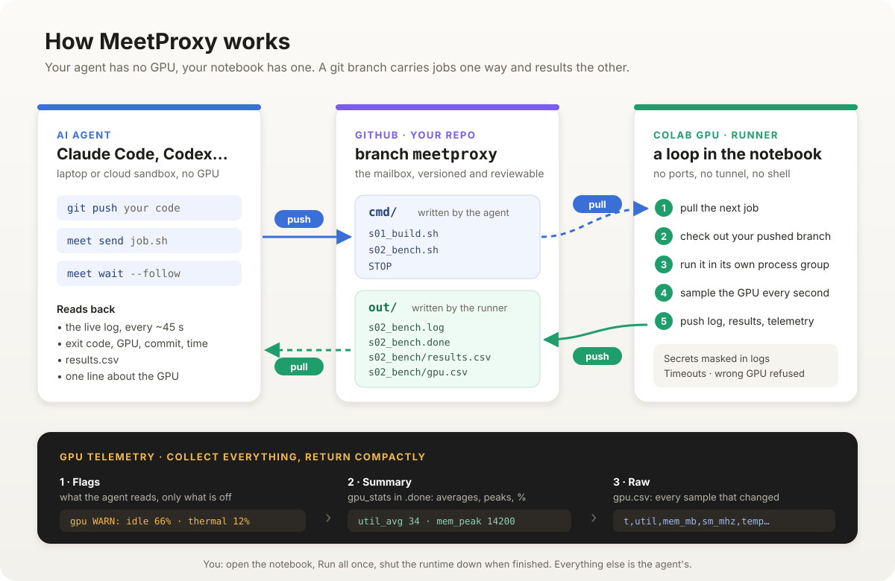

# MeetProxy

Your AI agent runs experiments on your GPU by itself. You press one button.

Today the GPU is Google Colab; other GPUs (rented machines, your own server) are on the
[roadmap](ROADMAP.md). Formerly *colab-pilot*.

[](docs/HOW-IT-WORKS.md)

## You need

- a GitHub repository with your code;
- Google Colab with compute units (paid);
- Claude Code (or another coding agent) working in that repository.

## Start

**1. Colab:** click [](https://colab.research.google.com/github/SergeyChere/MeetProxy/blob/main/colab_runner.ipynb), then:

- *Runtime → Change runtime type* → pick a GPU;
- in the notebook's `REPO` field, type **your project's** GitHub repository — the one Claude works
  in — as `owner/name`. For `https://github.com/alice/my-kernels` that is `alice/my-kernels`;
- *Runtime → Run all*.

First time only: key icon on the left → add a secret named `GH_TOKEN` with a GitHub
[fine-grained token](https://github.com/settings/personal-access-tokens/new) for that same
repository, *Contents: Read and write*.

The button opens [`colab_runner.ipynb`](colab_runner.ipynb). It is one cell; you can
also paste it into any Colab notebook yourself:

```python
REPO = "alice/my-kernels"  #@param {type:"string"}
!pip -q install git+https://github.com/SergeyChere/MeetProxy
import meetproxy.runner
meetproxy.runner.colab_start(REPO)
```

**2. Claude:** say

> Use https://github.com/SergeyChere/MeetProxy to run our benchmarks on my Colab GPU.

Done. To stop: ■ in Colab. Shut the runtime down yourself when finished.

## Logs, GPU metrics and reports

Logs and GPU metrics are **always on** — nothing to enable. Charts are made only when you ask.

| What | How to get it | Where it is |
|---|---|---|
| Job log | always | the agent reads it; you: branch `meetproxy` → `out/<job>.log` |
| GPU metrics | always | the agent gets one line (`gpu ok: util 97%, mem 41%, 68°C` or `gpu WARN: idle 66% · thermal throttle 12%`); every sample: `out/<job>/gpu.csv` |
| Run history | always | `out/history.csv`; the agent reads it with `meet history` |
| **Report with charts** | ask for it (examples below) | `out/<job>/report.md` and `out/history.md` |
| Copy next to your code | *"export the results"* | `meet-runs/` in your project, not committed |

**What you say to the agent:**

> Run the benchmark on my Colab GPU **with charts**.

> Make a **report** of the last run.

> Show me the **history** of all runs as a report.

> **Export** the results of today's runs into the project.

**What you get:** a page like [this example report](docs/example-report/report.md) (made-up
data) — the GPU graphs over time (utilization, memory, clock with throttling shaded red,
temperature and power), the job's results table and the end of its log.

**Why it costs no tokens:** the charts are drawn by matplotlib on the Colab machine and pushed to
GitHub. The agent only tells you where the report is — it is told never to open it — so it does
not spend tokens reading pictures or long tables. To see it: your repo on GitHub → switch the
branch from `main` to `meetproxy` → `out/` → `<job>/report.md`. Works on a phone.

Charts for every job without asking: in the Colab cell, add
`import os; os.environ["MEET_CHARTS"] = "1"` before `meetproxy.runner.colab_start(REPO)`.

**Or as a skill:** copy [`skill/meetproxy`](skill/meetproxy) into `.claude/skills/` (or your
agent's skills folder) and just say *"run our benchmark on my Colab GPU"*.

## Trust and security

- **The notebook runs what is pushed to the `meetproxy` branch.** Give write access to the repository
  only to people and agents you trust. Job code runs with the Colab user's rights.
- **Jobs never get your GitHub token.** The runner keeps it out of job environments, out of git
  remote URLs and out of config files; secrets are masked in logs and in every result file before
  it is pushed. Use a fine-grained token limited to this one repository.
- **Each job runs exactly the pushed commit** of its branch; if that commit cannot be fetched and
  checked out, the job does not run (`exit -3`) and `.done` says why. `.done` records the full SHA.
- **In a public repository, logs and results on branch `meetproxy` are public too.**

---

[Why it exists](docs/WHY.md) · [How it works](docs/HOW-IT-WORKS.md) · [Architecture](ARCHITECTURE.md) · [Roadmap](ROADMAP.md) · Only people you trust should have
write access to the repository: the notebook runs what is pushed to its `meetproxy` branch. · MIT
