# Roadmap

**When** things happen. It is derived from the other documents:
[PRODUCT.md](docs/PRODUCT.md) (why, for whom, requirements `PR-NN`; the product is the skill) →
[SKILL.md](skill/meetproxy/SKILL.md) (what the agent does) and
[DESIGN.md](docs/DESIGN.md) (how, sections `§N`) → this roadmap. Every milestone names the design
sections it builds and the requirements it serves. Safety, lifecycle and measurement come before new
providers; value is proven before the provider list grows.

```mermaid
flowchart LR
    D["✅ Done<br/>M0–M7<br/>telemetry · skill · history<br/>reports · hardening · tests · safety fixes"]
    DP["🤝 M8<br/>skill-first test<br/>native · B0 · B1 · 5 users"]
    S0["🧪 Stage 0 · M9<br/>spike: Colab CLI<br/>lifecycle facts"]
    A["🧱 Stage A · M10<br/>contingency: only components<br/>a failure report asks for"]
    B["🔬 Stage B · M11<br/>pilot → GO / ITERATE / STOP<br/>+ small beta"]
    C["🔌 Stage C · M12<br/>SSH + mailbox<br/>as adapter"]
    DD["📦 Stage D · M13<br/>packaging<br/>Claude Code · Codex"]
    E["🌍 Stage E · M14<br/>on demand<br/>providers · Colab API · MCP"]
    PRO["💎 Pro · M15–M16<br/>CUDA profiling"]
    V1["1.0 · M17"]
    D --> DP -- "GO C: one named<br/>component" --> A --> B
    DP -. "GO B0 / B1:<br/>ship the skill" .-> DD
    D --> S0 --> A
    B --> C --> DD --> E --> PRO --> V1
    B -. "technical + adoption GO<br/>unlock new backends" .-> C

    classDef done fill:#eefaf4,stroke:#1f9d6b,stroke-width:2px,color:#163b2c
    classDef fix fill:#fdeeee,stroke:#d64545,stroke-width:2px,color:#5a1d1d
    classDef core fill:#eef3fd,stroke:#3b6fd8,stroke-width:2px,color:#1f2a44
    classDef prove fill:#fff6e3,stroke:#e0a020,stroke-width:2px,color:#4a3510
    classDef rel fill:#f4f0ff,stroke:#7a5af0,stroke-width:2px,color:#2a2244
    classDef later fill:#f6f4ef,stroke:#9a948a,stroke-width:2px,color:#2b2925
    class D done
    class S0,A,C core
    class DP prove
    class B prove
    class DD rel
    class E,PRO,V1 later
```

Legend: ✅ done · 🔜 next · ⬜ planned.

## Done

| | Milestone | What it gave |
|---|---|---|
| ✅ | **M0 GPU telemetry** | `nvidia-smi` sampled every second: raw `gpu.csv`, `gpu_stats` in `.done`, one flags line for the agent (PR-12, PR-14) |
| ✅ | **M1 Standalone skill** | `skill/meetproxy/` and `scripts/build_skill.sh` → upload zip |
| ✅ | **M2 Diagrams in markdown** | [docs/HOW-IT-WORKS.md](docs/HOW-IT-WORKS.md), colored Mermaid |
| ✅ | **M3 Run history** | `out/history.csv`, `meet history` |
| ✅ | **M4 Human reports** | `# charts: on` → `report.md` + SVG charts, drawn on the GPU side, no agent tokens (PR-13) |
| ✅ | **M5 Export** | `meet export` → `meet-runs/`, nothing committed |
| ✅ | **M6 Hardening** | credentials handling, fetch/checkout failures stop the job, actual SHA recorded, reliable delivery, trust model |
| ✅ | **Rename to MeetProxy** | command `meet`, package `meetproxy`, mailbox branch `meetproxy`: the name no longer ties the project to Colab |
| ✅ | **Tests and CI** | unit, CLI and end-to-end suite, 99% coverage, CI on every push |

## Next

### ✅ M7 — quick fixes to the current mailbox flow (0.7.0)

Small, safe fixes to what users run today, while stage A is designed.
*Design: §7 (exact source), §6 (artifacts), §4 (status) · Requirements: PR-06, PR-08, PR-10.*

- [x] Jobs are pinned to the submitted commit (`# commit:` from `meet send`); the branch moving on
      afterwards does not change them; a malformed or missing commit refuses the job; jobs without
      the header are marked unpinned.
- [x] A bad header (`# timeout: abc`) fails that job with a clear error instead of stopping the runner.
- [x] Timeouts on every git command: a hung network cannot freeze the runner.
- [x] `meet status` / `meet wait` notice a stuck `running` (no heartbeat for ~3 min during a job).
- [x] A job's timeout never exceeds what is left of `MAX_HOURS`.
- [x] A result file that contains a known secret is withheld and reported, not rewritten.
- [x] Version tags; the notebook, skill and guide install a pinned version instead of `main`.
- [x] Resuming a job after a restart decides by a reliable marker, not by file size.
- [x] The Colab notebook cell calls the renamed package (a leftover from the rename broke it).
- [x] README states the same-user trust boundary plainly instead of a stronger promise.

## Stage 0 — demand and feasibility (in parallel)

### 🔜 M8 — skill-first: the skill alone and with helpers, against native tools

Evidence before more building, and the smallest product tested on its own. Decision rules are
written down **before** recruitment and are exploratory signals, not statistics or proof of
product–market fit. M10 starts only on a "GO C" below.
*Design: §3.1, §5.2, §18, §17 · Requirements: PR-01, PR-03, PR-07, PR-26, PR-20, PR-22, PR-23.*

**Arm B0 — the skill alone** (instructions, plain files, native execution):
- [x] Install: exact version (`meet --version` checked), isolated venv, only with the user's
      consent; never `--break-system-packages`.
- [x] Short entry `SKILL.md` derived from PRODUCT §1.2 — choose route, campaign, honest results,
      records, safety — with route references read only when that route is chosen
      (`reference/local.md`, `colab-official.md`, `mailbox.md`); mailbox setup only inside the
      mailbox reference; a test keeps route details out of the entry file.
- [x] Route consent separate from GPU consent; unavailable routes shown with the reason; owned vs
      borrowed sessions with an explicit cleanup state in every result.
- [x] README leads with the skill and a truthful route matrix (PRODUCT §1.4); mailbox as a
      separate fallback section.
- [ ] Quick start for a local-GPU campaign, tried by someone who did not write it.
- [ ] Measured: loaded skill tokens and route-selection errors; in a local-only clean folder the
      agent neither reads the mailbox reference nor runs its setup.

**Arm B1 — the same skill plus the minimal helpers** (DESIGN §3.1):
- [ ] **Local run helper** with **no GitHub and no notebook**, reusing today's runner code: actual
      source identity or an explicit *dirty / unverified* mark, exit status, deadline with
      process-group cleanup, output, an independent oracle result, pinned before comparison.
- [ ] Fault injection: a wrong answer, a failed oracle, a stale result, a dirty tree and a timed-out
      process — none may yield a verified winner. Overhead against native execution measured.
- [ ] Campaign records written and validated by the helper (JSON/JSONL); no database.
- [ ] Paid trials: provider-side limits where supported, otherwise a narrowly scoped preflight or
      manual approval per acquire; a route without a mandatory safety property is not used for
      paid compute; a denied or expired approval cannot launch through the guarded route; a
      disconnect is never shown as confirmed cancellation; cleanup evidence and residual billing
      risk recorded.

**The experiment** — safety constraints in every arm:
- [ ] **Find the pain.** Recruit 5 independent, frequent GPU experimenters (local NVIDIA GPU and/or
      Colab; note lab-server users who ask). Observe their last real experiment and their real
      notes and scripts. Signal: ≥ 3 have a recurring, meaningful pain and a real upcoming task.
- [ ] **Offer the outcome, not the architecture.** Signal: ≥ 3 volunteer a real task; every refusal
      and its reason recorded.
- [ ] Arms: **A** the user's real native workflow (never a deliberately weak baseline) · **B0** the
      skill alone · **B1** the skill + helpers · **C** B1 plus one specific component, only after a
      recurring failure B1 cannot reliably solve — the whole core is never built to create this arm.
- [ ] **Execution tests** with the same model, tests, hardware access, limits and candidate set in
      every arm; **open-ended research outcomes** reported separately. A real CUDA project with an
      existing correctness check, 3–5 variants; a cold install and a second session with fresh
      context. Record cold onboarding, verified outcome, active human minutes, elapsed time, total
      cost where known, failures, evidence validity. One expert with mature scripts, one without.
- [ ] **Repeat use.** Within two weeks, ≥ 2 independent users choose it again for a real task without
      prompting or setup help. Count everyone recruited; explain each non-activation.
- [ ] **Decide:** **GO B0** — instructions alone win safely → ship them · **GO B1** — the helpers
      remove a measured blocker and users return → ship that skill · **GO C** — only a named
      component fixes an observed recurring failure → build only it (M10) · **STOP / narrow** — the
      native workflow suffices, switching costs dominate, or users do not return; keep the mailbox as
      a specialised tool if it stays useful. No new backend on a documentation-only win.
- [ ] Opt-in records only; findings go into PRODUCT through the normal chain.

### ⬜ M9 — spike: Colab CLI lifecycle

With an explicit budget cap, fresh names and directories per scenario, and a session inventory
before and after every acquire and release: sign-in, acquire and idempotency, survival and observe
after client loss, cancel confirmed by an identity-bound acknowledgement (versus external kill and
stale evidence), idle vs wall-clock timeouts, expiry observations kept apart from documented
guarantees, bash through Python, a history-free snapshot by `git archive` + manifest, verified
download, telemetry fields, idempotent release. Every capability ends PASS / FAIL / UNKNOWN.
Scenario and results: [docs/spikes/colab-cli.md](docs/spikes/colab-cli.md). Fills the capability
table in DESIGN §12 with facts; nothing unsupported is claimed afterwards.
*Design: §12, §4.1, §5.3, §5.4, §18 · Requirements: PR-02, PR-10, PR-07, PR-18.*

## Stage A — minimal durable contract, local + Colab

### ⬜ M10 — the contract on the local GPU and on Colab, as thin slices

**Contingency (DESIGN §3.2), no blanket go-ahead.** Each item below is built only on a *GO C* from
M8 and needs its own failure report (a recurring failure B1 could not solve), the smallest
alternative considered, and a component-level acceptance test; it is kept only if it measurably
fixes that failure. Items no failure asks for stay unbuilt. Provider execution, auth, transfer and session discovery are reused from official
tools, not reimplemented.

**A1 · local vertical slice** — *Design: §9, §9.1, §7, §4, §5, §13, §14 · PR-04, PR-06, PR-09, PR-10, PR-07, PR-14, PR-15, PR-27, PR-28*
- [ ] **Quick Run** first: script + profile, nothing more; Simple and Standard telemetry levels.
- [ ] Overhead measured: cold start and steady state vs direct execution (target ≤ 5% steady state).
- [ ] RunSpec requirements block (GPU capability, dependencies, data) validated before transfer.
- [ ] One local run end to end: `RunSpec` (`runs/<run_id>/spec.json`), attempt directory, minimal
      SQLite journal (logical operations, request generations, per-operation retry policy),
      `git archive` snapshot with manifest, verified artifacts, the four verdicts (execution,
      delivery, correctness, comparison).
- [ ] Policy gate with scoped approvals, consumed with the intent in one transaction; default mode
      labeled honestly (protects against mistakes, not against the agent).

**A2 · Colab lifecycle** (only capabilities the spike marked PASS) — *Design: §12, §5.3, §4 · PR-02, PR-07, PR-10*
- [ ] `colab-cli` adapter: owned sessions, absolute expiry, bounded collection window with an
      approved disposition, early manifest/checkpoints, journaled cleanup obligations.
- [ ] Disconnect, observe, reconnect without restart, cancel with identity-bound acknowledgement.
- [ ] The regression scenarios of DESIGN §18 as fault-injection tests.

**A3 · Benchmark Mode, plans, campaigns** — *Design: §8, §9, §10.1, §10.2, §10.3, §11 · PR-05, PR-11, PR-21, PR-22, PR-23, PR-25*
- [ ] Benchmark Mode: measurement schema, synchronized CUDA timing, core-run oracle against declared
      outputs, interleaved repeats, all samples kept, comparison verdicts.
- [ ] Plans: one approval for a set of independent runs; a **single-GPU sequential plan** as a
      first-class case; two runs concurrently on two approved profiles (local + Colab, or two Colab
      sessions), recommended only when the estimated gain outweighs setup overhead; total time and
      cost reported; hardware comparison never read as a speed-up.
- [ ] **Screen on many GPUs, decide on one:** within-device speed-ups for screening; finalists and
      baseline re-run on one reference GPU for the decision; per-GPU winners or `INSUFFICIENT_DATA`
      otherwise; a three-GPU test refuses a global ranking.
- [ ] **Screening safeguards:** reference GPU declared before screening, validation reserve of
      budget and time, shortlist rule declared in advance (keeps architecture-sensitive variants);
      unfinished validation → `INSUFFICIENT_DATA`; a synthetic rank-reversal test passes.
- [ ] Comparison outcomes with a pre-declared margin: `BETTER` / `NON_INFERIOR` / `WORSE` /
      `INSUFFICIENT_DATA`.
- [ ] Oracle from the project's existing tests where possible; no oracle → no verified-winner claim.
- [ ] **Campaigns:** objective, baseline, oracle, resource envelope, rounds, stop conditions; the
      agent proposes variants, the core records and enforces; best verified result with evidence.
- [ ] **Experiment memory:** structured hypothesis identities, lineage, workload and hardware
      context, verdicts, rejection reasons; likely duplicates surfaced as suggestions (retest allowed
      with a changed context or a reason); facts apart from agent interpretations; `meet memory search`.
- [ ] Cost per correct result (compute + agent tokens where reported), sources named, unknowns
      disclosed; estimate vs actual.

**A4 · profiles and auth** (as needed) — *Design: §15 · PR-01, PR-03, PR-08, PR-17*
- [ ] `meet add / use / backends`, `--on`, `meet auth` (keychain; plain file opt-in), read-only
      `meet doctor --json`. Strict-mode broker stays out until needed.

## Stage B — proof of value

### ⬜ M11 — pre-registered pilot, then a small beta

*Design: §17, §18 · Requirements: PR-20, PR-11, PR-12, PR-17, PR-21, PR-22, PR-23, PR-26.*

- [ ] Before the first run: primary metric (**best verified improvement at a fixed budget and
      time**), **two routes to GO** with margins (better outcome; or non-inferior outcome with less
      interventions, time or cost — deciding metric named in advance), constraints (correctness never
      worse; real resource limits; manual interventions as an absolute count with a near-zero-baseline
      fallback), forced-disconnect scenario.
- [ ] Same CUDA task (ColorSplit / queens-rect variants), same agent model and prompt, same GPU and
      budget; several paired runs in randomized order: **official Colab skill alone**, **direct
      SSH** (where a host is available), **direct local agent execution** (local campaigns) and
      **SkyPilot** (wherever it supports the same resource and
      task; comparison only, no integration) vs **MeetProxy**; supported and unsupported cases
      reported separately; time to first run, setup and sign-in count; disconnect tested separately;
      hardware and price differences reported separately; all failures recorded.
- [ ] Everything published: protocol, every run, raw data, limitations.
- [ ] Decision fixed in advance: **GO / ITERATE / STOP**, recorded twice: **technical** (the
      pre-registered comparison) and **adoption** (independent repeated use, a choice over the
      incumbent workflow, inactive users and refusals counted). A technical GO alone does not unlock
      new backends.
- [ ] **Attribution:** fixed-variant execution tests are reported apart from open-ended agent
      campaigns, so a lucky hypothesis is not credited to the runner.
- [ ] **Scoped correctness:** "verified" is reported as evidence for the oracle, workload and
      environment; the pilot includes a candidate that passes a weak test and fails a stronger
      held-out check.
- [ ] Memory arm vs a fresh agent with ordinary experiment notes; no multi-GPU savings advertised
      until shown; no widening of the audience after a win on one task.
- [ ] The pilot task is a **campaign** (PRODUCT §5), so the comparison measures the promise, not a
      single job.
- [ ] **Fresh-session memory test:** close the first agent session, resume with a fresh context;
      report retrieval accuracy, avoidable repeated work, false duplicate suggestions; a justified
      retest on a changed GPU or input stays possible.
- [ ] **Sequential vs parallel** on two workloads (one where each should win), by total time and cost.
- [ ] On GO: a minimal skill package and install path to a small external beta on **local GPU +
      Colab** (target 20 users; the advertised campaign must work on their resources);
      measure, opt-in, activation and repeat use at 7 and 30 days.

**Gate:** only a technical **and** an adoption **GO** unlock new backends — publishing the pilot is not enough. Local + Colab must
also show reliable cancellation and recovery and correct results.

## Stage C — SSH and the mailbox

### ⬜ M12 — two more adapters on the same contract (only after GO)

*Design: §12, §16 · Requirements: PR-19, PR-18, PR-02.*

- [ ] `ssh` adapter on one Linux host (borrowed sessions, never released by us).
- [ ] The git mailbox behind the adapter contract (for sandboxes that reach only GitHub), with
      migration tests from today's flow; per-job cancel, job claiming, logs that do not bloat
      history.

## Stage D — packaging and release

### ⬜ M13 — the skill on more hosts

The first installable skill and real feedback already come from M8; this adds hosts.

*Design: §15, §16 · Requirements: PR-01, PR-17, PR-18, PR-16.*

- [ ] One `SKILL.md` plus thin manifests: Claude Code (skill / plugin), Codex
      (`.agents/skills`, `agents/openai.yaml`).
- [ ] Pinned releases with checksums; bootstrap installs only with permission.
- [ ] Support matrix with a smoke test per listed host; untested hosts marked as such.
- [ ] Publish the free skill on marketplaces once M8 decides GO B0, GO B1 or GO C.

## Stage E — on demand

### ⬜ M14 — only when users ask

*Design: §12, §15, §19 · Requirements: PR-19, PR-18, PR-24, PR-29.*

- RunPod / Vast.ai / Lambda provisioning through their CLIs or APIs.
- Slurm / Kubernetes / MLflow integrations.
- Colab API adapter, when access is granted.
- Hosted MCP server for chat without a shell (own auth, tenancy and billing model, own security
  review).
- Container isolation on SSH hosts.
- Resource recommendations among approved profiles.
- Documented backend contract for third-party backends.

## Pro

### ⬜ M15 — CUDA profiling (Deep telemetry)

*Design: §9 · Requirements: PR-14, PR-05.*

Nsight Compute on request: kernel duration, occupancy, L2 hit rate, branch divergence, DRAM
throughput, IPC — what GPU utilization cannot show. Comparison reports across variants.

### ⬜ M16 — Pro release

## 1.0 and after

- ⬜ **M17 — 1.0:** stable CLI and protocol, skill packages, complete documentation.
- ⬜ **M18** feedback · **M19** subscription · **M20** growth.

## Ideas, not scheduled

- Artifacts too large for git or the local store: optional upload to a GCS / Hugging Face bucket,
  link in the manifest.

---

Suggestions: open an issue. Order can change when real use shows something more important.
