# Roadmap

What is done, what comes next, and why in that order. Direction and contract:
[docs/DESIGN.md](docs/DESIGN.md) — reproducible GPU experiments for AI agents, one skill, the GPU the
user chooses. Safety, lifecycle and measurement come before new providers; value is proven before
the provider list grows.

```mermaid
flowchart LR
    D["✅ Done<br/>M0–M6<br/>telemetry · skill · history<br/>reports · hardening · tests"]
    Q["🔧 M7<br/>quick fixes<br/>current mailbox"]
    S0["🧪 Stage 0 · M8<br/>spike: Colab CLI<br/>lifecycle facts"]
    A["🧱 Stage A · M9<br/>durable contract<br/>local + Colab"]
    B["🔬 Stage B · M10<br/>pilot → GO / ITERATE / STOP<br/>+ small beta"]
    C["🔌 Stage C · M11<br/>SSH + mailbox<br/>as adapter"]
    DD["📦 Stage D · M12<br/>packaging<br/>Claude Code · Codex"]
    E["🌍 Stage E · M13<br/>on demand<br/>providers · Colab API · MCP"]
    PRO["💎 Pro · M14–M15<br/>CUDA profiling"]
    V1["1.0 · M16"]
    D --> Q --> S0 --> A --> B --> C --> DD --> E --> PRO --> V1
    B -. "only GO unlocks<br/>new backends" .-> C

    classDef done fill:#eefaf4,stroke:#1f9d6b,stroke-width:2px,color:#163b2c
    classDef fix fill:#fdeeee,stroke:#d64545,stroke-width:2px,color:#5a1d1d
    classDef core fill:#eef3fd,stroke:#3b6fd8,stroke-width:2px,color:#1f2a44
    classDef prove fill:#fff6e3,stroke:#e0a020,stroke-width:2px,color:#4a3510
    classDef rel fill:#f4f0ff,stroke:#7a5af0,stroke-width:2px,color:#2a2244
    classDef later fill:#f6f4ef,stroke:#9a948a,stroke-width:2px,color:#2b2925
    class D done
    class Q fix
    class S0,A,C core
    class B prove
    class DD rel
    class E,PRO,V1 later
```

Legend: ✅ done · 🔜 next · ⬜ planned.

## Done

| | Milestone | What it gave |
|---|---|---|
| ✅ | **M0 GPU telemetry** | `nvidia-smi` sampled every second: raw `gpu.csv`, `gpu_stats` in `.done`, one flags line for the agent |
| ✅ | **M1 Standalone skill** | `skill/meetproxy/` and `scripts/build_skill.sh` → upload zip |
| ✅ | **M2 Diagrams in markdown** | [docs/HOW-IT-WORKS.md](docs/HOW-IT-WORKS.md), colored Mermaid |
| ✅ | **M3 Run history** | `out/history.csv`, `meet history` |
| ✅ | **M4 Human reports** | `# charts: on` → `report.md` + SVG charts, drawn on the GPU side, no agent tokens |
| ✅ | **M5 Export** | `meet export` → `meet-runs/`, nothing committed |
| ✅ | **M6 Hardening** | credentials handling, fetch/checkout failures stop the job, actual SHA recorded, reliable delivery, trust model |
| ✅ | **Rename to MeetProxy** | command `meet`, package `meetproxy`, mailbox branch `meetproxy`: the name no longer ties the project to Colab |
| ✅ | **Tests and CI** | unit, CLI and end-to-end suite, 99% coverage, CI on every push |

## Next

### 🔜 M7 — quick fixes to the current mailbox flow

Small, safe fixes to what users run today, while stage A is designed.

- [x] Jobs are pinned to the submitted commit (`# commit:` from `meet send`); the branch moving on
      afterwards does not change them; a malformed or missing commit refuses the job; jobs without
      the header are marked unpinned.
- [ ] A bad header (`# timeout: abc`) fails that job with a clear error instead of stopping the runner.
- [ ] Timeouts on every git command: a hung network cannot freeze the runner.
- [ ] `meet status` / `meet wait` notice a stuck `running` (no heartbeat for ~3 min during a job).
- [ ] A job's timeout never exceeds what is left of `MAX_HOURS`.
- [ ] A result file that contains a known secret is withheld and reported, not rewritten.
- [ ] Version tags; the notebook, skill and guide install a pinned version instead of `main`.
- [ ] Resuming a job after a restart decides by a reliable marker, not by file size.

## Stage 0 — feasibility

### ⬜ M8 — spike: Colab CLI lifecycle

With an explicit budget cap, fresh names and directories per scenario, and a session inventory
before and after every acquire and release: sign-in, acquire and idempotency, survival and observe
after client loss, cancel confirmed by an identity-bound acknowledgement (versus external kill and
stale evidence), idle vs wall-clock timeouts, expiry observations kept apart from documented
guarantees, bash through Python, a history-free snapshot by `git archive` + manifest, verified
download, telemetry fields, idempotent release. Every capability ends PASS / FAIL / UNKNOWN.
Scenario and results: [docs/spikes/colab-cli.md](docs/spikes/colab-cli.md). Fills the capability
table in DESIGN §9 with facts; nothing unsupported is claimed afterwards.

## Stage A — minimal durable contract, local + Colab

### ⬜ M9 — the contract on the local GPU and on Colab, as thin slices

**A1 · local vertical slice**
- [ ] One local run end to end: `RunSpec` (`runs/<run_id>/spec.json`), attempt directory, minimal
      SQLite journal (logical operations, request generations, per-operation retry policy),
      `git archive` snapshot with manifest, verified artifacts, the four verdicts (execution,
      delivery, correctness, comparison).
- [ ] Policy gate with scoped approvals, consumed with the intent in one transaction; default mode
      labeled honestly (protects against mistakes, not against the agent).

**A2 · Colab lifecycle** (only capabilities the spike marked PASS)
- [ ] `colab-cli` adapter: owned sessions, absolute expiry, bounded collection window with an
      approved disposition, early manifest/checkpoints, journaled cleanup obligations.
- [ ] Disconnect, observe, reconnect without restart, cancel with identity-bound acknowledgement.
- [ ] The regression scenarios of DESIGN §15 as fault-injection tests.

**A3 · benchmark validation**
- [ ] Measurement schema, synchronized CUDA timing, core-run oracle against declared outputs,
      interleaved repeats, all samples kept, comparison verdicts.

**A4 · profiles and auth** (as needed)
- [ ] `meet add / use / backends`, `--on`, `meet auth` (keychain; plain file opt-in), read-only
      `meet doctor --json`. Strict-mode broker stays out until needed.

## Stage B — proof of value

### ⬜ M10 — pre-registered pilot, then a small beta

- [ ] Before the first run: primary metric (manual interventions per correct result), constraints
      (budget, wall time, correctness), success threshold, forced-disconnect scenario.
- [ ] Same CUDA task (ColorSplit / queens-rect variants), same agent model and prompt, same GPU and
      budget; several paired runs in randomized order: official Colab skill alone vs MeetProxy;
      setup and sign-in count as interventions; disconnect tested separately; all failures recorded.
- [ ] Everything published: protocol, every run, raw data, limitations.
- [ ] Decision fixed in advance: **GO / ITERATE / STOP**.
- [ ] On GO: a minimal skill package and install path to a small external beta; collect feedback.

**Gate:** only **GO** unlocks new backends — publishing the pilot is not enough. Local + Colab must
also show reliable cancellation and recovery and correct results.

## Stage C — SSH and the mailbox

### ⬜ M11 — two more adapters on the same contract (only after GO)

- [ ] `ssh` adapter on one Linux host (borrowed sessions, never released by us).
- [ ] The git mailbox behind the adapter contract (for sandboxes that reach only GitHub), with
      migration tests from today's flow; per-job cancel, job claiming, logs that do not bloat
      history.

## Stage D — packaging and release

### ⬜ M12 — the skill, where it is tested

- [ ] One `SKILL.md` plus thin manifests: Claude Code (skill / plugin), Codex
      (`.agents/skills`, `agents/openai.yaml`).
- [ ] Pinned releases with checksums; bootstrap installs only with permission.
- [ ] Support matrix with a smoke test per listed host; untested hosts marked as such.
- [ ] Quick start; publish the free skill; collect real feedback.

## Stage E — on demand

### ⬜ M13 — only when users ask

- RunPod / Vast.ai / Lambda provisioning through their CLIs or APIs.
- Colab API adapter, when access is granted.
- Hosted MCP server for chat without a shell (own auth, tenancy and billing model, own security
  review).
- Several GPUs per run; container isolation on SSH hosts.

## Pro

### ⬜ M14 — CUDA profiling

Nsight Compute on request: kernel duration, occupancy, L2 hit rate, branch divergence, DRAM
throughput, IPC — what GPU utilization cannot show. Comparison reports across variants.

### ⬜ M15 — Pro release

## 1.0 and after

- ⬜ **M16 — 1.0:** stable CLI and protocol, skill packages, complete documentation.
- ⬜ **M17** feedback · **M18** subscription · **M19** growth.

## Ideas, not scheduled

- Artifacts too large for git or the local store: optional upload to a GCS / Hugging Face bucket,
  link in the manifest.

---

Suggestions: open an issue. Order can change when real use shows something more important.
