# Roadmap

What is done, what comes next, and why in that order. Direction and contract:
[docs/DESIGN.md](docs/DESIGN.md) — reproducible GPU experiments for AI agents, one skill, the GPU the
user chooses. Safety, lifecycle and measurement come before new providers; value is proven before
the provider list grows.

```mermaid
flowchart LR
    D["✅ Done<br/>M0–M6<br/>telemetry · skill · history<br/>reports · hardening · tests"]
    Q["🔧 M7<br/>quick fixes<br/>current mailbox"]
    A["🧱 Stage A · M8<br/>core + local<br/>RunSpec · policy · lifecycle"]
    B["🔬 Stage B · M9<br/>Colab CLI<br/>+ proof of value"]
    C["🔌 Stage C · M10<br/>SSH + mailbox<br/>as adapter"]
    DD["📦 Stage D · M11<br/>packaging<br/>Claude Code · Codex"]
    E["🌍 Stage E · M12<br/>on demand<br/>providers · Colab API · MCP"]
    PRO["💎 Pro · M13–M14<br/>CUDA profiling"]
    V1["1.0 · M15"]
    D --> Q --> A --> B --> C --> DD --> E --> PRO --> V1
    B -. "gate: no new provider<br/>before this is proven" .-> E

    classDef done fill:#eefaf4,stroke:#1f9d6b,stroke-width:2px,color:#163b2c
    classDef fix fill:#fdeeee,stroke:#d64545,stroke-width:2px,color:#5a1d1d
    classDef core fill:#eef3fd,stroke:#3b6fd8,stroke-width:2px,color:#1f2a44
    classDef prove fill:#fff6e3,stroke:#e0a020,stroke-width:2px,color:#4a3510
    classDef rel fill:#f4f0ff,stroke:#7a5af0,stroke-width:2px,color:#2a2244
    classDef later fill:#f6f4ef,stroke:#9a948a,stroke-width:2px,color:#2b2925
    class D done
    class Q fix
    class A,C core
    class B prove
    class DD rel
    class E,PRO,V1 later
```

Legend: ✅ done · 🔜 next · ⬜ planned.

## Done

| | Milestone | What it gave |
|---|---|---|
| ✅ | **M0 GPU telemetry** | `nvidia-smi` sampled every second: raw `gpu.csv`, `gpu_stats` in `.done`, one flags line for the agent |
| ✅ | **M1 Standalone skill** | `skill/meetproxy/` and `scripts/build_skill.sh` → upload zip |
| ✅ | **M2 Diagrams in markdown** | [docs/HOW-IT-WORKS.md](docs/HOW-IT-WORKS.md), colored Mermaid |
| ✅ | **M3 Run history** | `out/history.csv`, `meet history` |
| ✅ | **M4 Human reports** | `# charts: on` → `report.md` + SVG charts, drawn on the GPU side, no agent tokens |
| ✅ | **M5 Export** | `meet export` → `meet-runs/`, nothing committed |
| ✅ | **M6 Hardening** | credentials isolation, exact-commit runs, reliable delivery, trust model |
| ✅ | **Rename to MeetProxy** | command `meet`, package `meetproxy`, mailbox branch `meetproxy`: the name no longer ties the project to Colab |
| ✅ | **Tests and CI** | unit, CLI and end-to-end suite, 99% coverage, CI on every push |

## Next

### 🔜 M7 — quick fixes to the current mailbox flow

Small, safe fixes to what users run today, while stage A is designed.

- [ ] A bad header (`# timeout: abc`) fails that job with a clear error instead of stopping the runner.
- [ ] Timeouts on every git command: a hung network cannot freeze the runner.
- [ ] `meet status` / `meet wait` notice a stuck `running` (no heartbeat for ~3 min during a job).
- [ ] A job's timeout never exceeds what is left of `MAX_HOURS`.
- [ ] A result file that contains a known secret is withheld and reported, not rewritten.
- [ ] Version tags; the notebook, skill and guide install a pinned version instead of `main`.
- [ ] Resuming a job after a restart decides by a reliable marker, not by file size.

## Stage A — core + local

### ⬜ M8 — the contract, on the agent's own GPU

- [ ] `RunSpec`: full SHA, job digest, parameters and seed, wrapper digest, environment
      fingerprint; clean worktree per attempt.
- [ ] Policy gate in the CLI: user policy over project wishes; paid acquisition and outbound data
      need explicit approval; default deny. Tests call the CLI directly, without the skill.
- [ ] Durable lifecycle: `run_id` / `attempt_id` before side effects, journal of intents and
      outcomes, states `CREATED … SUCCEEDED / FAILED / CANCELLED / UNKNOWN`, `meet reconcile`,
      cancel with confirmation; separate delivery and cleanup state.
- [ ] `BenchmarkSpec`: baseline vs candidate, correctness oracle, warm-up, repeats, median and
      spread; verdicts `OK / WARN / UNKNOWN / INSUFFICIENT_DATA`; time-weighted telemetry.
- [ ] Remote wrapper as a versioned zipapp from the core's modules; preflight; minimal job env.
- [ ] Run store: `.meetproxy/runs/<run_id>/`, manifest with SHA-256, atomic writes, resumable fetch.
- [ ] Backend contract with `CapabilitySet`, structured errors, contract tests on a fake backend;
      the `local` backend passes them.
- [ ] Profiles (`meet add / use / backends`, `--on`), `meet auth` (keychain; plain file opt-in),
      read-only `meet doctor --json`.

## Stage B — Colab, and proof of value

### ⬜ M9 — Colab through the official Colab CLI

- [ ] `colab-cli` adapter: owned sessions with TTL and labels, `git bundle` staging with SHA check,
      own wall-clock deadline, reconnect, cancel, cleanup after a crash.
- [ ] Everything on a real T4 / L4.
- [ ] **Value experiment** (DESIGN §14): one real CUDA case (ColorSplit / queens-rect variants), the
      official Colab skill alone vs MeetProxy, same budget; manual steps, correctness, recovery,
      time, cost, tokens. Protocol, data and result published.

**Gate:** no new provider until this stage shows reliable cancellation and recovery, correct
results and an observable advantage over the official workflow.

## Stage C — SSH and the mailbox

### ⬜ M10 — two more adapters on the same contract

- [ ] `ssh` adapter on one Linux host (borrowed sessions, never released by us).
- [ ] The git mailbox behind the adapter contract (for sandboxes that reach only GitHub), with
      migration tests from today's flow; per-job cancel, job claiming, logs that do not bloat
      history.

## Stage D — packaging and release

### ⬜ M11 — the skill, where it is tested

- [ ] One `SKILL.md` plus thin manifests: Claude Code (skill / plugin), Codex
      (`.agents/skills`, `agents/openai.yaml`).
- [ ] Pinned releases with checksums; bootstrap installs only with permission.
- [ ] Support matrix with a smoke test per listed host; untested hosts marked as such.
- [ ] Quick start; publish the free skill; collect real feedback.

## Stage E — on demand

### ⬜ M12 — only when users ask

- RunPod / Vast.ai / Lambda provisioning through their CLIs or APIs.
- Colab API adapter, when access is granted.
- Hosted MCP server for chat without a shell (own auth, tenancy and billing model, own security
  review).
- Several GPUs per run; container isolation on SSH hosts.

## Pro

### ⬜ M13 — CUDA profiling

Nsight Compute on request: kernel duration, occupancy, L2 hit rate, branch divergence, DRAM
throughput, IPC — what GPU utilization cannot show. Comparison reports across variants.

### ⬜ M14 — Pro release

## 1.0 and after

- ⬜ **M15 — 1.0:** stable CLI and protocol, skill packages, complete documentation.
- ⬜ **M16** feedback · **M17** subscription · **M18** growth.

## Ideas, not scheduled

- Artifacts too large for git or the local store: optional upload to a GCS / Hugging Face bucket,
  link in the manifest.

---

Suggestions: open an issue. Order can change when real use shows something more important.
