# Roadmap

What is done, what comes next, and why in that order. Reliability and security come before new
features; a public release comes after hardening and a real case is shown.

```mermaid
flowchart LR
    D["✅ Done<br/>M0–M5<br/>telemetry · skill · docs<br/>history · reports · export<br/>tests + CI"]
    F["🛡️ Harden<br/>M6–M8<br/>hardening · reliability<br/>job lifecycle"]
    P["🔬 Prove it<br/>M9–M10<br/>real GPU check<br/>real demo case"]
    A["🧩 Skill first, any GPU<br/>M11–M13<br/>core split · Colab CLI<br/>one skill · release"]
    R["🌍 More GPUs<br/>M14–M16<br/>SSH · rented · chat MCP<br/>Colab API"]
    PRO["💎 Pro<br/>M17–M19<br/>measurement method<br/>CUDA profiling"]
    V1["1.0<br/>M20"]
    D --> F --> P --> A --> R --> PRO --> V1

    classDef done fill:#eefaf4,stroke:#1f9d6b,stroke-width:2px,color:#163b2c
    classDef fix fill:#fdeeee,stroke:#d64545,stroke-width:2px,color:#5a1d1d
    classDef prove fill:#fff6e3,stroke:#e0a020,stroke-width:2px,color:#4a3510
    classDef auto fill:#eef3fd,stroke:#3b6fd8,stroke-width:2px,color:#1f2a44
    classDef rel fill:#f4f0ff,stroke:#7a5af0,stroke-width:2px,color:#2a2244
    classDef later fill:#f6f4ef,stroke:#9a948a,stroke-width:2px,color:#2b2925
    class D done
    class F fix
    class P prove
    class A auto
    class R rel
    class PRO,V1 later
```

Legend: ✅ done · 🔜 next · ⬜ planned.

## Done

| | Milestone | What it gave |
|---|---|---|
| ✅ | **M0 GPU telemetry** | `nvidia-smi` sampled every second: raw `gpu.csv`, `gpu_stats` in `.done`, one flags line for the agent |
| ✅ | **M1 Standalone skill** | `skill/meetproxy/` and `scripts/build_skill.sh` → upload zip |
| ✅ | **M2 Diagrams in markdown** | [docs/HOW-IT-WORKS.md](docs/HOW-IT-WORKS.md), colored Mermaid |
| ✅ | **M3 Run history** | `out/history.csv`, `meet history` |
| ✅ | **M4 Human reports** | `# charts: on` → `report.md` + SVG charts, drawn on the GPU side, no agent tokens |
| ✅ | **M5 Export** | `meet export` → `meet-runs/`, nothing committed |
| ✅ | **M6 Hardening** | credentials isolation, exact-commit runs, reliable delivery, trust model |
| ✅ | **Rename to MeetProxy** | command `meet`, package `meetproxy`, mailbox branch `meetproxy`: the name no longer ties the project to Colab |
| ✅ | **Tests and CI** | unit, CLI and end-to-end suite, 99% coverage, CI on every push |

## Fix first

### ✅ M6 — 0.5: hardening

- [x] Hardening of credentials handling and job isolation.
- [x] Stricter guarantees that each job runs exactly the pushed commit.
- [x] More robust result delivery.
- [x] A documented trust model ([README](README.md#trust-and-security)).

### 🔜 M7 — 0.5.1: quick reliability fixes

- [ ] A bad header (`# timeout: abc`) fails that job with a clear error instead of crashing the runner.
- [ ] Timeouts on every git command: a hung network cannot freeze the runner.
- [ ] `meet status` / `meet wait` notice a stuck `running` (heartbeat older than ~3 min during a job).
- [ ] A job's timeout never exceeds what is left of `MAX_HOURS`.
- [ ] Version tags; the notebook, skill and guide install a pinned version instead of `main`.
- [ ] Resuming a job after a restart decides by a reliable marker, not by file size.

### ⬜ M8 — 0.6: job lifecycle

- [ ] `meet cancel <job>` — cancel one job without stopping the runner.
- [ ] `meet retry <job>` — rerun under a new name.
- [ ] Job claiming: two runners can never run the same job.
- [ ] Logs do not bloat git history (rotation or moving old logs out).

## Prove it

### ⬜ M9 — Check on a real Colab GPU

Everything above on a real T4 / L4: `nvidia-smi` field names, charts, history, resume.

### ⬜ M10 — A real demo case

An agent tries ~10 variants of a CUDA kernel (ColorSplit / queens-rect): checks correctness,
measures, drops the slow and wrong ones, keeps the best. Its real `report.md` and `history.md`
replace the made-up example in the README.

## Skill first, any GPU

Direction from 27 Nov 2026: the product is the skill (`/meetproxy`), and it works on whatever GPU
the user has. Design: [docs/DESIGN.md](docs/DESIGN.md).

### ⬜ M11 — Core split

- [ ] `meet-wrap.py`: the job runner as one dependency-free file that runs on any GPU machine
      (process group, timeout, secret masking, GPU sampling, `.done`).
- [ ] Driver interface (`probe / acquire / put / exec / fetch / release`).
- [ ] `local` driver (the agent's own GPU) and today's flow as the `git-mailbox` driver.
- [ ] Results in `.meetproxy/runs/<job>/` for every backend; optional git sync.

### ⬜ M12 — Colab CLI, backend profiles, tokens

- [ ] Profiles: `meet add`, `meet use`, `meet backends`, `--on <profile>`; the user chooses, every
      job line names the backend; no silent fallback.
- [ ] `meet auth set / list / rm`: tokens in the OS keychain (file with mode 600 as fallback, env
      override for CI); never in chat, config or repo.
- [ ] `colab-cli` driver: `colab new / upload / exec / download / stop`.
- [ ] Exact commit on the VM via `git bundle`.
- [ ] `meet doctor`: shows what is available here and the one step each backend still needs.
- [ ] Release policy (idle minutes), never implicit for paid GPUs.

### ⬜ M13 — One skill for every agent, and release

- [ ] Skill rewritten around `meet doctor`; details in `references/`.
- [ ] `scripts/bootstrap.sh` installs a pinned `meet`.
- [ ] Packages: Claude (skills / plugin), Codex and ChatGPT (`.agents/skills`,
      `agents/openai.yaml`, plugin).
- [ ] Publish the free skill on skill marketplaces.

### ⬜ M14 — SSH and rented GPUs

- [ ] `ssh` driver and `meet add-host`: any Linux machine with an NVIDIA GPU (own, university,
      RunPod, Vast.ai, Lambda), also `colab ssh`.
- [ ] Provisioning through provider CLIs where they exist; ask before paid GPUs.
- [ ] Several GPUs: one queue, a telemetry summary per GPU.

### ⬜ M15 — Chat without a shell

A hosted MCP server with the same contract, for ChatGPT / Claude chat that has no terminal. Needs
its own security review before it exists.

### ⬜ M16 — Colab API

`colab-api` driver (`create_runtime`, `execute_code`, `delete_runtime`) when access is granted.

## Pro

### ⬜ M17 — Measurement method

Correctness against a reference, warm-up and repeated runs with median and spread, A/B comparison
of variants. Telemetry: time-weighted averages, and "no data" instead of "fine" when a metric is
missing.

### ⬜ M18 — 0.8: CUDA profiling

Nsight Compute on request: kernel duration, occupancy, L2 hit rate, branch divergence, DRAM
throughput, IPC — what GPU utilization cannot show. Comparison reports across variants.

### ⬜ M19 — Pro release

## 1.0 and after

- ⬜ **M20 — 1.0:** stable CLI, skill, an MCP server, complete documentation.
- ⬜ **M21** feedback · **M22** subscription · **M23** growth.

## Ideas, not scheduled

- `meet bench`: repeat a job N times, report median and spread.
- Artifacts too large for git: optional upload to a GCS / Hugging Face bucket, link in `.done`.

---

Suggestions: open an issue. Order can change when real use shows something more important.
