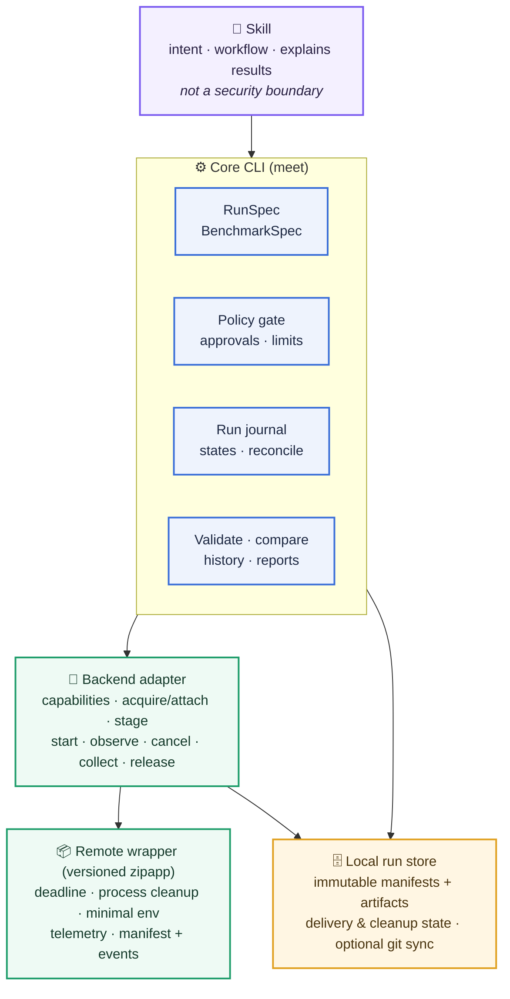

# MeetProxy design: reproducible GPU experiments for AI agents

Status: revised proposal, 27 Nov 2026 (v2.1). v2 incorporated the first external design review;
v2.1 applies the contract refinements of the second review (approval scope, session expiry,
recovery states, journal guarantees, RunSpec vs AttemptManifest, delivery outcome, benchmark and
evaluation protocol, a feasibility spike first). The contract is agreed **before** production code
changes; nothing here describes existing code unless it says so.

## 1. What MeetProxy is, and what it is not

**Is:** a small, deterministic core that lets an AI agent run GPU experiments that are
**correct, measured fairly, recoverable after failures, cheap to observe and remembered** — on the
GPU the user chose.

**Is not:** a replacement for the official Colab CLI, a universal cloud manager, a scheduler, or a
set of instructions that the model is trusted to follow. Moving code to a GPU is solved by official
tools (Colab CLI, `ssh`); MeetProxy uses them.

**The product surface is a skill** (`/meetproxy` in Claude Code, `$meetproxy` in Codex). The skill
explains intent and results; the core enforces everything that matters.

**Value must be proven, not assumed** (section 14): MeetProxy is worth building only if, on a real
CUDA experiment, it beats the official Colab skill alone on at least one target metric — manual
interventions, correctness, recovery, tokens or wall time — without hurting correctness.

## 2. Principles

1. **Core enforces, skill explains — against mistakes, not against the agent.** Approvals, limits,
   backend choice and data transfer are checked by the CLI, whoever calls it; instructions in
   `SKILL.md` are not a security boundary. An agent with a shell under the same user could still
   call `meet approve`, edit policy or call a provider directly: the default mode protects against
   wrong operations, not a malicious agent. A **strict mode** requires confirmation outside the
   agent's process (host-native UI or a separate trusted broker) — see section 5.
2. **User policy dominates project wishes.** A committed project file can ask for a GPU; it can
   never raise a limit, approve spending or send code to a new host.
3. **The user chooses the backend and always sees it.** No silent fallback.
4. **Every external action is journaled before it happens.** An unclear outcome becomes `UNKNOWN`
   and is reconciled; it is never blindly retried.
5. **Honest isolation.** Jobs are trusted code running as the same user unless a real boundary
   (container, separate user) is configured. We do not claim more.
6. **Reproducible by construction.** A run is an immutable `RunSpec`: exact source, job digest,
   environment fingerprint.
7. **A speed-up is a claim that needs evidence.** Correctness first; comparisons only between
   compatible environments; "not enough data" is a valid verdict.
8. **Official tools for transport, contract tests for adapters.** Same contract, explicitly
   different capabilities.
9. **Few tokens.** The agent gets one verdict line per run; details only on request.
10. **MVP scope:** Linux + NVIDIA + Python ≥ 3.8 on the GPU side; local Claude Code and Codex on the
    agent side.

## 3. Components



| Component | Responsible for |
|---|---|
| Skill | User intent, the workflow, explaining results. Never trusted to enforce anything. |
| Core CLI | RunSpec, policy gate, run journal, validation, history, reports, comparison. Owns the history index. |
| Backend adapter | Declares capabilities; implements the lifecycle operations it supports; structured errors for the rest. |
| Remote wrapper | Isolation within available limits, wall-clock deadline, process cleanup, telemetry, manifest. |
| Local run store | Immutable manifests and artifacts, delivery and cleanup state, recovery; optional git sync. |

No central server, scheduler or queue in the MVP.

## 4. Run lifecycle

**Protocol:** `validate → approve → acquire/attach → stage → start → observe → collect → release → compare`

Three things are tracked separately: the **operation journal** (what MeetProxy tried to do), the
**remote outcome** (what happened to the job) and **delivery / cleanup** (did the results arrive,
was the session released). Each has its own states.

### 4.1 Remote outcome

```mermaid
stateDiagram-v2
    [*] --> CREATED
    CREATED --> APPROVED: policy gate passes
    CREATED --> REJECTED: policy gate refuses
    APPROVED --> ACQUIRING: acquire or attach
    ACQUIRING --> STAGING: session known
    ACQUIRING --> FAILED: provider refused
    ACQUIRING --> UNKNOWN: no answer
    STAGING --> RUNNING: wrapper started, identity recorded
    STAGING --> FAILED: stage error, e.g. SHA mismatch
    STAGING --> UNKNOWN: connection lost
    RUNNING --> FINISHED_OK: remote manifest says exit 0
    RUNNING --> FINISHED_ERR: job failed or deadline
    RUNNING --> CANCELLED: cancel confirmed by backend
    RUNNING --> UNKNOWN: connection lost
    UNKNOWN --> RUNNING: reconcile finds the wrapper alive
    UNKNOWN --> FINISHED_OK: reconcile finds a manifest, exit 0
    UNKNOWN --> FINISHED_ERR: reconcile finds a manifest, failure
    UNKNOWN --> LOST: no evidence; closed explicitly by the user
    FINISHED_OK --> [*]
    FINISHED_ERR --> [*]
    CANCELLED --> [*]
    FAILED --> [*]
    REJECTED --> [*]
    LOST --> [*]

    classDef ok fill:#eefaf4,stroke:#1f9d6b,color:#163b2c
    classDef bad fill:#fdeeee,stroke:#d64545,color:#5a1d1d
    classDef unk fill:#fff6e3,stroke:#e0a020,color:#4a3510
    classDef work fill:#eef3fd,stroke:#3b6fd8,color:#1f2a44
    class FINISHED_OK ok
    class FINISHED_ERR,FAILED,CANCELLED,REJECTED bad
    class UNKNOWN,LOST unk
    class CREATED,APPROVED,ACQUIRING,STAGING,RUNNING work
```



- **Absence is not evidence.** A process that is gone without a manifest is never declared
  `CANCELLED` or successful; it stays `UNKNOWN` until reconcile finds evidence or the user closes
  it as `LOST`.
- `CANCELLED` only when the backend confirms the cancel; a failed cancel leaves the run where it was
  and says so.
- After a reconnect a live run returns to `RUNNING` and is observed again — never started again.

### 4.2 Delivery, cleanup and what the user sees

| Track | States |
|---|---|
| delivery | `PENDING → FETCHING → VERIFIED` · `PARTIAL` (some required files missing) · `BLOCKED` (a required file withheld, e.g. it contains a secret) · `CORRUPT` (checksum mismatch, retried) |
| cleanup | `KEPT` · `RELEASING → RELEASED` · `BORROWED` (never touched) · `ORPHAN_SUSPECTED` (reported, see section 5) |

The user-facing result is **`READY`** only when the remote outcome is final *and* every required
artifact is `VERIFIED`. Otherwise it is `PARTIAL`, `BLOCKED` or `UNKNOWN` — the execution facts are
kept either way. Checksums prove the transfer, not that the measurement is right.

### 4.3 Operation journal: what at-most-once means here

- A local **SQLite** journal (standard library, no server). Every external action is an operation
  with a unique key `(run_id, attempt_id, operation)`; the intent row is committed **before** the
  action, under a lock, and the outcome row after it.
- Two `meet` processes trying the same start: the unique key lets exactly one proceed.
- Crash between intent and outcome: the operation is *ambiguous*. It is resolved by evidence
  (provider lookup by label or session ID, remote manifest) or left ambiguous and reported. **An
  ambiguous operation is never repeated automatically.**
- **Wrapper identity**, not a bare PID: a random nonce written by the wrapper plus host boot ID and
  process start time; a reused PID can never be mistaken for our job or cancelled by us.
- Whether a provider supports idempotent requests or lookup by label is a **capability**; where it
  does not, an ambiguous acquire is reported as a possible orphan instead of guessed.
- A new attempt is an explicit action with a new `attempt_id`; replaying an old journal changes
  nothing.

No distributed scheduler or central database: a local journal with a clear contract, and a safe
refusal when reconciliation is impossible.

## 5. Policy gate and money

Enforced in the core for every call, with or without the skill. Threat model: section 2.1.

### 5.1 Policy layers

User policy `~/.config/meetproxy/policy.toml` (limits, allowed profiles and hosts) dominates project
wishes `.meetproxy/config.toml` (GPU wanted, profile preferred). A project file naming a host or
profile the user never approved is rejected.

### 5.2 Approvals

- **Default deny** for paid acquisition.
- An approval is **bound to its scope**: operation, profile, the resolved configuration (host, GPU,
  region — stored as a digest), budget / maximum runtime, expiry and number of uses. Changing any of
  them after the approval invalidates it.
- Approvals are **checked and consumed atomically** in the journal: two parallel operations cannot
  spend a single-use approval twice.
- **Default mode:** approvals are created by `meet approve …` (or a profile-level standing approval
  with `max_hours`). This prevents mistakes; it does not stop a same-user agent from approving
  itself.
- **Strict mode:** approvals can only be created outside the agent's process — a host-native
  confirmation where the host offers one, or a small trusted broker the agent cannot drive. In strict
  mode a headless `meet approve` is refused.

### 5.3 Session expiry is not a job deadline

- **Job deadline:** enforced by the wrapper on the GPU machine; ends the job.
- **Session expiry:** ends the paid session. It is a **hard TTL** only when the provider enforces it
  server-side or an independent watchdog (not the user's laptop) does; this is a backend capability,
  confirmed by the spike (section 15) before it is claimed.
- Otherwise cleanup is **best-effort** (reconcile on the next `meet` run), the residual risk — a
  session left running if the controlling machine disappears — is stated, and automatic paid
  acquisition needs a separate consent to that risk.
- **Owned vs borrowed:** owned sessions (created by MeetProxy) carry labels with `run_id` where the
  provider supports labels, and are released after **confirmed delivery** of the required artifacts
  or an explicit "discard the results". Borrowed sessions (created by the user) are never released or
  deleted, in any scenario.
- **Cost is the session**, including upload, idle time and download. Unknown price → consent or
  refusal. No monetary cap is promised where the provider cannot enforce one.

### 5.4 Outbound data

- Consent to send code is bound to **repository, destination identity and data kind**; a new
  repository to an already-approved host is not sent silently.
- Transfer scope is explicit: by default a **snapshot of the one commit without history** (a git
  bundle limited to that commit's tree, or an archive with the SHA recorded), never the full
  history unless approved. Size quotas are checked before the transfer.

## 6. Trust model and credentials

- **Trusted-code mode (default, stated plainly):** a job runs as the same OS user as the wrapper. It
  could reach anything that user can — files, keyring session, provider sign-ins. MeetProxy reduces
  accidental exposure; it does not stop deliberate access. `meet doctor` reports the isolation level
  in effect.
- **Real boundaries when available:** run jobs in a container or as a separate user where the
  backend supports it; then the claims grow accordingly.
- **Minimal job environment:** an allowlist of variables (plus the user's explicit additions), never
  `SSH_AUTH_SOCK`, provider tokens, `GIT_CONFIG_*`, cloud SDK credentials.
- **Tokens:** providers without their own sign-in store tokens in the OS keychain (`keyring`).
  Plain-text file storage is **opt-in only**, with owner and mode checked on every read. Tokens are
  entered by the human in a terminal (`meet auth set <name>`), never in chat, never in config or the
  repository. Colab CLI, `ssh`, `gcloud` keep their own credentials; MeetProxy only checks them.
- **Artifacts are published by allowlist** (default: `results.csv`, manifest, logs, telemetry). A
  file found to contain a known secret is **withheld, not rewritten** (rewriting can corrupt binary
  data); the run says so and its delivery becomes `BLOCKED` if the file was required. An allowlist
  does not catch unknown secrets — the trusted-code model applies.
- **Safe reading:** artifacts are read only from the run directory **after the job finalized**, opened
  without following symlinks (`O_NOFOLLOW`, checked against the run root), with size limits.
  Publishing results to git needs its own consent.
- **Logs and results are data, never instructions:** nothing read back from a run is executed or
  treated as a command by the core.

## 7. RunSpec and AttemptManifest

Two objects, because some facts exist only after a machine was obtained.

**`RunSpec`** — what was requested; immutable from submit on, shared by every attempt:

| Field | |
|---|---|
| repository + full commit SHA, transfer scope | required |
| job script digest (SHA-256), parameters, seed | required |
| requested backend profile and GPU | required |
| policy snapshot (limits and approval in force) | required |
| benchmark spec and oracle digest | when comparing |
| declared dependencies (lock / image digest) and datasets (ID / hash) | when declared |

**`AttemptManifest`** — what actually ran; one per attempt:

| Field | |
|---|---|
| actual SHA checked out, verified against the RunSpec | required |
| wrapper version and digest, protocol version | required |
| GPU model, driver, CUDA, toolchain versions, Python | required (recorded by the wrapper) |
| clocks / power limit at start, other processes on the GPU | when available |
| dependency and dataset evidence (hashes found on the machine) | when declared |
| artifact list with sizes and SHA-256 | required |

- Changing the branch after submit does not change the run. Two attempts share one `RunSpec` and keep
  their own fingerprints.
- A **clean workspace** per attempt; a mismatch with a required declared dependency stops the
  attempt before the job starts. Git LFS and submodules: explicit refusal in the MVP.
- **No promise of full reproducibility** beyond what is declared: undeclared dependencies, data and
  compiler flags are recorded where visible, not guaranteed.

## 8. BenchmarkSpec and verdicts

Required for any "faster / slower" claim.

- **Measurement schema** (stable JSON / CSV): `metric, unit, phase, direction (lower/higher is
  better), variant, repeat, value, valid`. Comparisons only between identical metric, unit and phase.
- **CUDA timing** synchronizes the measured region (events or explicit synchronize); the measured
  phase is declared (e.g. kernel only, end-to-end).
- **Correctness oracle** fixed independently of the candidate, its digest stored in the RunSpec; a
  changed oracle is detected and the comparison refused. A wrong output is rejected even if faster.
- **Protocol:** declared warm-up, baseline and candidate **interleaved** (not all baseline, then all
  candidate), every repeat and outlier stored, exclusion rules declared in advance, uncertainty
  reported (median and spread / interval).
- **Verdicts:** `OK`, `WARN`, `UNKNOWN` (no telemetry), `INSUFFICIENT_DATA` (too short, too few
  repeats, too few valid samples). Short or empty samples never give `gpu ok`. Different hardware
  fingerprints never produce an automatic speed-up claim.
- Telemetry averages are time-weighted. `nvidia-smi` stays coarse (busy, throttled, near OOM), not a
  measure of kernel efficiency; Nsight Compute is a later opt-in.

## 9. Backends: one contract, declared capabilities

Each adapter publishes a `CapabilitySet`; the core checks a run's requirements against it **before
acquire** and fails with a structured error (`unsupported: cancel`) otherwise.

| Capability | local | colab-cli | ssh | git-mailbox |
|---|---|---|---|---|
| acquire GPU | – (attach) | yes (owned) | – (attach, borrowed) | – (human opens notebook) |
| arbitrary bash | yes | via the Python wrapper | yes | yes |
| wall-clock deadline | wrapper | wrapper (CLI timeout is an *idle* limit) | wrapper | wrapper |
| cancel | yes | yes | yes | `STOP` / per-job cancel |
| observe after connection loss | journal + pid | session list + remote manifest | remote manifest | branch state |
| storage between runs | yes | until release | yes | branch |
| release | – | `colab stop` (owned only) | – | – |
| server-side session expiry | – | to be confirmed by the spike | – | – |
| find session after client loss (by name / label) | – | to be confirmed by the spike | host is known | branch state |
| idempotent acquire | – | to be confirmed by the spike | – | – |

Adapters pass shared **contract tests** against a fake backend (supported and unsupported
operations, connection loss, timeout, duplicate requests, orphan sessions) and a real smoke test per
backend before they are declared supported.

## 10. Remote wrapper

- **Built, not hand-written twice:** a versioned zipapp generated from the same modules the core
  uses (process group, deadline, telemetry, masking). Its digest is part of the RunSpec; a protocol
  version mismatch stops the run before the job starts.
- **Writes a manifest and an event stream** (`started`, `heartbeat`, `finished`), never the history
  index — the core owns history.
- **Identity:** on start it writes a random nonce, host boot ID and its process start time; observe
  and cancel act only on a process that matches all three.
- **Preflight on the GPU machine:** Python version, `nvidia-smi`, disk space, `git`; missing tools are
  reported before the job, not as a mysterious failure.

## 11. Artifacts and the run store

- `.meetproxy/runs/<run_id>/` with an immutable `manifest.json` (files, sizes, SHA-256), the
  RunSpec, the journal and the artifacts. `.meetproxy/` is excluded from git.
- Atomic writes (temp file + rename); idempotent, resumable fetch; a checksum mismatch is a delivery
  failure (`CORRUPT`), never success. Delivery states: section 4.2.
- Retention and quota settings; large binaries stay local.
- **Git sync is opt-in** and limited to an allowlisted set of small artifacts (results, manifest,
  verdict, reports). The git mailbox keeps its own branch as today.

## 12. Profiles, `doctor`, `auth`, bootstrap

- **Profiles** (`meet add / use / backends`, `--on <profile>`) live in user config; the project
  file only *prefers* one. First use of the skill: `meet doctor` shows what is possible and the user
  chooses what to set up.

  ```toml
  # ~/.config/meetproxy/config.toml — no secrets here
  [profiles.colab]
  kind = "colab-cli"
  gpu = "T4"

  [profiles.lab]
  kind = "ssh"
  host = "me@gpu.uni.edu"

  [profiles.pod]
  kind = "runpod"
  gpu = "A100"
  credential = "meetproxy/runpod"   # keychain entry name, not the key
  ask_before_start = true
  ```

- **`meet doctor` is read-only:** bounded timeouts, never waits on a TTY, never creates a GPU session,
  never prints secrets, `--json` for the agent. It reports per backend what works and the one step a
  human must do.
- **`meet auth set / list / rm`:** keychain storage as in section 6.
- **Bootstrap** installs a pinned release (tag + checksum), only with the user's permission; never an
  unverified branch. Interactive sign-ins (`colab auth login`) are done by the human in a terminal.

## 13. Hosts: what is supported is what is tested

One shared `SKILL.md` plus thin host manifests (Claude: skill folder / plugin; Codex:
`.agents/skills`, `agents/openai.yaml`). A support matrix lists host and version, shell and network,
install, auth and cancellation, each backed by a smoke test.

| Host | Status |
|---|---|
| Claude Code (local) | first target |
| Codex CLI / IDE (local) | first target |
| Cloud sandboxes (Claude Code web, Codex cloud) | git-mailbox only; after the first two |
| Chat without a shell (ChatGPT, Claude chat) | not supported; a hosted MCP server needs its own auth, tenancy and billing model and is considered only on proven demand |

## 14. Proving value

An exploratory pilot, not a statistical proof — and planned before it is run:

1. **Pre-registered** before the first run: primary metric (proposal: manual interventions per
   correct result), constraints (same budget and wall-time cap, correctness required), the success
   threshold, and the forced-disconnect scenario.
2. **Same task, same conditions:** one real CUDA experiment (ColorSplit / queens-rect variants), the
   same agent model and version, the same prompt, the same GPU type and budget — **official Colab
   skill alone** vs **MeetProxy**.
3. **Several paired runs**, not one session each.
4. **Everything published:** protocol, every run (not only the best), raw data, limitations.

No token, time or reliability savings are claimed before this.

## 15. Stages and acceptance gates

| Stage | Done when |
|---|---|
| **0. Spike: Colab CLI lifecycle** | On a real session: identity, start, disconnect, observe, reconnect, cancel, session discovery, provider-side expiry and release are tried; commands, CLI version, results and limits are published ([docs/spikes/colab-cli.md](spikes/colab-cli.md)); the capability table (section 9) is filled with facts. Nothing unsupported is claimed. |
| **A. Minimal durable contract, local + Colab** | RunSpec/AttemptManifest, policy gate with scoped approvals, SQLite journal, outcome/delivery/cleanup tracks, wrapper identity, benchmark schema and oracle; the local backend and the Colab adapter pass contract and fault-injection tests (below). |
| **B. Proof of value** | The pre-registered pilot of section 14 published. |
| **C. SSH + mailbox** | SSH on one Linux host; the git mailbox behind the adapter contract with migration tests. |
| **D. Packaging** | Claude Code and Codex packages, pinned releases, support matrix, quick start; real user feedback. |
| **E. On demand** | RunPod / Vast / Lambda provisioning, Colab API, hosted MCP, multi-GPU. |

**Regression scenarios** every adapter must pass before it is declared supported: duplicate starts;
crash before / after remote acquire; lost connection with the job still running; process gone
without a manifest; failed cancel; interrupted transfer; withheld required artifact; provider cannot
enforce expiry; reused approval; branch changed after submit.

**Gate:** no new backend until local + Colab show reliable cancellation and recovery, correct
results and the pilot of section 14.

## 16. Non-goals and open questions

**Non-goals:** a hosted MCP service (until proven demand), a central scheduler, universal cloud
provisioning, protection against malicious code under the same user, a guaranteed monetary cap
without provider support, exactly-once execution.

**Open questions** (most answered by the spike):

- Can the skill start the Colab CLI sign-in and wait, or must the user run it?
- Wrapper on Colab via `colab exec` (Python) vs `colab ssh`: which gives reliable observe, cancel
  and reconnect?
- Does Colab enforce a session expiry server-side, and can sessions be found by name after the
  client is gone?
- Host-native confirmation for strict mode in Claude Code / Codex, or a separate broker?
- Container isolation on SSH hosts: Docker/Podman when present, or out of MVP scope?

