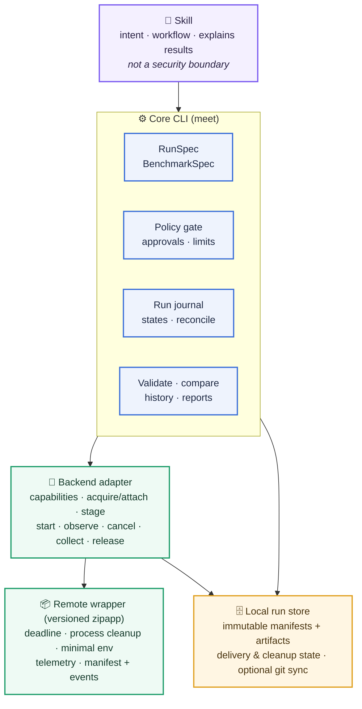

# MeetProxy design: how the product requirements are met

**Derived from [PRODUCT.md](PRODUCT.md)** (why, for whom, requirements `PR-NN`); the
[ROADMAP](../ROADMAP.md) is derived from this document. Every design decision below names the
requirements it serves.

Status: revised proposal, 27 Nov 2026 (v2.5). v2 incorporated the first external design review;
v2.1 applies the contract refinements of the second review (approval scope, session expiry,
recovery states, journal guarantees, RunSpec vs AttemptManifest, delivery outcome, benchmark and
evaluation protocol, a feasibility spike first); v2.2 applies the third review (bounded collection
window, per-operation retry policy, history-free snapshots by archive, per-attempt storage, separate
execution / delivery / correctness / comparison verdicts, a GO / ITERATE / STOP pilot, beta before
new adapters); v2.3 derives the design from PRODUCT.md and adds Quick Run / Benchmark modes,
telemetry levels, parallel independent jobs under one plan, and cost estimates; v2.4 follows
PRODUCT rev. 2 (campaigns and experiment memory, agent cost, overhead budget, portable definitions,
consented adoption metrics); v2.5 follows PRODUCT rev. 3 (screen on many GPUs, decide on one;
memory suggests instead of banning; oracle reuse; first beta on local GPU + Colab; outcome-based
pilot metric with SkyPilot as a comparison arm). The contract is agreed **before** production code
changes; nothing here describes existing code unless it says so.

## 1. What MeetProxy is, and what it is not

**Is:** a small, deterministic core behind the product promise (PRODUCT §1): *your agent finishes
more correct GPU experiments, with less of your time, on the GPUs you already have.* It runs
**experiment campaigns** whose runs are **correct, measured fairly, recoverable after failures,
cheap to observe and remembered** — on the GPUs the user chose.

**Is not:** a replacement for the official Colab CLI, a universal cloud manager, a scheduler, or a
set of instructions that the model is trusted to follow. Moving code to a GPU is solved by official
tools (Colab CLI, `ssh`); MeetProxy uses them.

**The product surface is a skill** (`/meetproxy` in Claude Code, `$meetproxy` in Codex). The skill
explains intent and results; the core enforces everything that matters.

**Value must be proven, not assumed** (section 17): MeetProxy is worth building only if, on a real
CUDA experiment, it beats the official Colab skill alone on at least one target metric — manual
interventions, correctness, recovery, tokens or wall time — without hurting correctness.

### 1.1 Requirements → design

| Requirement (PRODUCT) | Where it is met |
|---|---|
| PR-01 one entry point | §16 hosts, §15 profiles and `doctor` |
| PR-02 official tools underneath | §12 backends, §15 bootstrap |
| PR-03 user chooses the GPU | §5.1 policy layers, §15 profiles |
| PR-04 Quick Run | §9 run modes |
| PR-05 Benchmark Mode | §8 BenchmarkSpec, §9 run modes |
| PR-06 exact source | §7 RunSpec, §5.4 snapshots |
| PR-07 paid compute safe by default | §5.2 approvals, §5.3 session expiry |
| PR-08 no new credential burden | §6 trust model and credentials |
| PR-09 code stays where it is | §5.4 outbound data |
| PR-10 failures visible and recoverable | §4 lifecycle, §4.3 journal |
| PR-11 parallel independent jobs | §10 plans and parallel jobs |
| PR-12 few tokens | §4.2 verdicts, §9 telemetry levels |
| PR-13 readable results | §14 run store (reports) |
| PR-14 telemetry levels | §9 run modes and telemetry levels |
| PR-15 existing projects unchanged | §7 RunSpec (any script, clean worktree) |
| PR-16 no lock-in | §14 run store, §3 components (no server) |
| PR-17 minutes to first run | §15 `doctor`, §9 Quick Run |
| PR-18 honest support | §16 hosts, §12 capabilities and contract tests |
| PR-19 integrate, don't replace | §12 SSH backend, §14 export |
| PR-20 evidence before claims | §17 proving value, §18 gates |
| PR-21 cost per correct result | §11 cost estimates |
| PR-22 experiment campaigns | §10.2 campaigns |
| PR-23 experiment memory | §10.3 experiment memory |
| PR-24 resource recommendations | §15 profiles (recommendations) |
| PR-25 total cost includes the agent | §11 cost estimates |
| PR-26 adoption and retention, with consent | §17 proving value (measurement) |
| PR-27 low overhead | §9.1 overhead budget |
| PR-28 portable experiment definitions | §7 RunSpec (requirements block) |
| PR-29 extensible backends | §12 backend contract |

## 2. Principles

1. **Core enforces, skill explains — against mistakes, not against the agent.** Approvals, limits,
   backend choice and data transfer are checked by the CLI, whoever calls it; instructions in
   `SKILL.md` are not a security boundary. An agent with a shell under the same user could still
   call `meet approve`, edit policy or call a provider directly: the default mode protects against
   wrong operations, not a malicious agent. A **strict mode** requires confirmation outside the
   agent's process (host-native UI or a separate trusted broker) — see section 5.
2. **User policy dominates project wishes.** A committed project file can ask for a GPU; it can
   never raise a limit, approve spending or send code to a new host.
3. **The user chooses the backend and always sees it.** No silent fallback.
4. **Every external action is journaled before it happens.** An unclear outcome becomes `UNKNOWN`
   and is reconciled; it is never blindly retried.
5. **Honest isolation.** Jobs are trusted code running as the same user unless a real boundary
   (container, separate user) is configured. We do not claim more.
6. **Reproducible by construction.** A run is an immutable `RunSpec`: exact source, job digest,
   environment fingerprint.
7. **A speed-up is a claim that needs evidence.** Correctness first; comparisons only between
   compatible environments; "not enough data" is a valid verdict.
8. **Official tools for transport, contract tests for adapters.** Same contract, explicitly
   different capabilities.
9. **Few tokens.** The agent gets one verdict line per run; details only on request.
10. **MVP scope:** Linux + NVIDIA + Python ≥ 3.8 on the GPU side; local Claude Code and Codex on the
    agent side.

## 3. Components



| Component | Responsible for |
|---|---|
| Skill | User intent, the workflow, explaining results. Never trusted to enforce anything. |
| Core CLI | RunSpec, policy gate, run journal, validation, history, reports, comparison. Owns the history index. |
| Backend adapter | Declares capabilities; implements the lifecycle operations it supports; structured errors for the rest. |
| Remote wrapper | Isolation within available limits, wall-clock deadline, process cleanup, telemetry, manifest. |
| Local run store | Immutable manifests and artifacts, delivery and cleanup state, recovery; optional git sync. |

No central server, scheduler or queue in the MVP.

## 4. Run lifecycle

*Serves PR-10, PR-06.*

**Protocol:** `validate → approve → acquire/attach → stage → start → observe → collect → release → compare`

Three things are tracked separately: the **operation journal** (what MeetProxy tried to do), the
**remote outcome** (what happened to the job) and **delivery / cleanup** (did the results arrive,
was the session released). Each has its own states.

### 4.1 Remote outcome

```mermaid
stateDiagram-v2
    [*] --> CREATED
    CREATED --> APPROVED: policy gate passes
    CREATED --> REJECTED: policy gate refuses
    APPROVED --> ACQUIRING: acquire or attach
    ACQUIRING --> STAGING: session known
    ACQUIRING --> FAILED: provider refused
    ACQUIRING --> UNKNOWN: no answer
    STAGING --> RUNNING: wrapper started, identity recorded
    STAGING --> FAILED: stage error, e.g. SHA mismatch
    STAGING --> UNKNOWN: connection lost
    RUNNING --> FINISHED_OK: remote manifest says exit 0
    RUNNING --> FINISHED_ERR: job failed or deadline
    RUNNING --> CANCELLED: cancel confirmed by backend
    RUNNING --> UNKNOWN: connection lost
    UNKNOWN --> STAGING: reconcile finds the acquired session, nothing started
    UNKNOWN --> RUNNING: reconcile finds the wrapper alive
    UNKNOWN --> CANCELLED: reconcile finds a cancel acknowledgement
    UNKNOWN --> FINISHED_OK: reconcile finds a manifest, exit 0
    UNKNOWN --> FINISHED_ERR: reconcile finds a manifest, failure
    UNKNOWN --> LOST: no evidence; closed explicitly by the user
    FINISHED_OK --> [*]
    FINISHED_ERR --> [*]
    CANCELLED --> [*]
    FAILED --> [*]
    REJECTED --> [*]
    LOST --> [*]

    classDef ok fill:#eefaf4,stroke:#1f9d6b,color:#163b2c
    classDef bad fill:#fdeeee,stroke:#d64545,color:#5a1d1d
    classDef unk fill:#fff6e3,stroke:#e0a020,color:#4a3510
    classDef work fill:#eef3fd,stroke:#3b6fd8,color:#1f2a44
    class FINISHED_OK ok
    class FINISHED_ERR,FAILED,CANCELLED,REJECTED bad
    class UNKNOWN,LOST unk
    class CREATED,APPROVED,ACQUIRING,STAGING,RUNNING work
```



- **Absence is not evidence.** A process that is gone without a manifest is never declared
  `CANCELLED` or successful; it stays `UNKNOWN` until reconcile finds evidence or the user closes
  it as `LOST`.
- `CANCELLED` only with positive evidence: the backend confirms, or the wrapper wrote a cancel
  acknowledgement carrying the job's identity. A failed cancel leaves the run where it was and says
  so.
- A recovered acquire goes back to `STAGING` without acquiring again.
- After a reconnect a live run returns to `RUNNING` and is observed again — never started again.

### 4.2 Delivery, cleanup and what the user sees

| Track | States |
|---|---|
| delivery | `PENDING → FETCHING → VERIFIED` · `PARTIAL` (some required files missing) · `BLOCKED` (a required file withheld, e.g. it contains a secret) · `CORRUPT` (checksum mismatch, retried) |
| cleanup | `KEPT` · `RELEASING → RELEASED` · `BORROWED` (never touched) · `ORPHAN_SUSPECTED` (reported, see section 5) |

Four verdicts are kept apart, because each answers a different question:

| Verdict | Question | Values |
|---|---|---|
| execution | what happened to the job? | the remote outcome above |
| delivery | did its artifacts arrive intact? | `READY` (every required artifact `VERIFIED`) · `PARTIAL` · `BLOCKED` · `UNKNOWN` |
| correctness | is the output right? | `CORRECT` · `INCORRECT` · `NOT_CHECKED` (no oracle) |
| comparison | is the candidate faster? | `FASTER` / `SLOWER` / `NO_DIFFERENCE` · `INSUFFICIENT_DATA` · `NOT_COMPARABLE` |

`READY` means delivery only — not success, not correctness. **Required artifacts depend on the
outcome:** a finished job requires its manifest, log and declared outputs; a failed job requires its
manifest and log (so the failure is visible and diagnosable, never mistaken for success). Checksums
prove the transfer, not the measurement.

**Live diagnostics vs finalized artifacts.** Heartbeat and log streaming while a job runs are
bounded, untrusted diagnostic streams (size-capped, shown as text, never parsed into results).
Results come only from artifacts read after the job finalized.

### 4.3 Operation journal: what at-most-once means here

- A local **SQLite** journal (standard library, no server; WAL mode, file mode 600, synchronous
  commits). Every external action is a **logical operation** `(run_id, attempt_id, operation)` with
  numbered **request generations**: the intent row of a generation is committed **before** the
  action, under a lock, and its outcome row after it. Consuming an approval and recording the intent
  happen in one transaction.
- **Retry policy per operation:**

  | Operation | Repeatable? |
  |---|---|
  | observe, fetch status | always (read-only) |
  | download | yes, after a *verified* failure (checksum mismatch, interrupted); never restarts the computation |
  | upload / stage | yes, into a fresh attempt directory |
  | acquire | only when the provider proves the previous one did not happen, or supports idempotent requests |
  | start | never within the same attempt |
  | cancel | yes (idempotent by identity) |
  | release | yes if the provider reports it idempotent; otherwise after checking the session is still there |
- Two `meet` processes trying the same start: the unique key lets exactly one proceed.
- Crash between intent and outcome: the operation is *ambiguous*. It is resolved by evidence
  (provider lookup by label or session ID, remote manifest) or left ambiguous and reported. **An
  ambiguous operation is never repeated automatically.**
- **Wrapper identity**, not a bare PID: a random nonce written by the wrapper plus host boot ID and
  process start time; a reused PID can never be mistaken for our job or cancelled by us.
- Whether a provider supports idempotent requests or lookup by label is a **capability**; where it
  does not, an ambiguous acquire is reported as a possible orphan instead of guessed.
- A new attempt is an explicit action with a new `attempt_id`; replaying an old journal changes
  nothing.
- **Scope of the guarantee:** one local run store. A copied or second journal cannot prevent a second
  start elsewhere; across stores only backend capabilities help (exclusive remote claims, named
  sessions, the mailbox's single branch). This is stated, not hidden.

No distributed scheduler or central database: a local journal with a clear contract, and a safe
refusal when reconciliation is impossible.

## 5. Policy gate and money

*Serves PR-07, PR-03, PR-09.*

Enforced in the core for every call, with or without the skill. Threat model: section 2.1.

### 5.1 Policy layers

User policy `~/.config/meetproxy/policy.toml` (limits, allowed profiles and hosts) dominates project
wishes `.meetproxy/config.toml` (GPU wanted, profile preferred). A project file naming a host or
profile the user never approved is rejected.

### 5.2 Approvals

- **Default deny** for paid acquisition.
- An approval is **bound to its scope**: operation, profile, the resolved configuration (host, GPU,
  region — stored as a digest), budget / maximum runtime, expiry and number of uses. Changing any of
  them after the approval invalidates it.
- Approvals are **checked and consumed atomically** in the journal: two parallel operations cannot
  spend a single-use approval twice.
- **Default mode:** approvals are created by `meet approve …` (or a profile-level standing approval
  with `max_hours`). This prevents mistakes; it does not stop a same-user agent from approving
  itself.
- **Strict mode:** approvals can only be created outside the agent's process — a host-native
  confirmation where the host offers one, or a small trusted broker the agent cannot drive. In strict
  mode a headless `meet approve` is refused.

### 5.3 Session expiry is not a job deadline

- **Job deadline:** enforced by the wrapper on the GPU machine; ends the job.
- **Session expiry:** ends the paid session. It is a **hard TTL** only when the provider enforces it
  server-side or an independent watchdog (not the user's laptop) does; this is a backend capability,
  confirmed by the spike (section 18) before it is claimed.
- Otherwise cleanup is **best-effort** (reconcile on the next `meet` run), the residual risk — a
  session left running if the controlling machine disappears — is stated, and automatic paid
  acquisition needs a separate consent to that risk.
- **Owned vs borrowed:** owned sessions (created by MeetProxy) carry labels with `run_id` where the
  provider supports labels. Borrowed sessions (created by the user) are never released or deleted,
  in any scenario.
- **Bounded hold, not "until delivered":** every owned session has an **absolute expiry** set at
  approval. After the job ends a **collection window** starts (default 30 min); the session is
  released after confirmed delivery or, at the latest, when the window or the expiry ends — with the
  **disposition the user approved in advance** (default: release and keep whatever was delivered;
  the run stays `PARTIAL` / `BLOCKED`, never `READY`). A withheld or corrupt required file never
  keeps a paid session alive indefinitely.
- **Early persistence:** the manifest and small checkpoints are fetched while the job runs (when
  allowed), so an expiry loses as little as possible.
- **Cleanup obligations are journaled** and survive a restart of `meet`; unattended paid acquire is
  refused unless the residual risk (best-effort cleanup) was approved.
- **Cost is the session**, including upload, idle time and download. Unknown price → consent or
  refusal. No monetary cap is promised where the provider cannot enforce one.

### 5.4 Outbound data

- Consent to send code is bound to **repository, destination identity and data kind**; a new
  repository to an already-approved host is not sent silently.
- Transfer scope is explicit: by default a **snapshot of the one commit without history** —
  `git archive` of the commit plus a manifest (source commit ID, tree listing with blob hashes,
  archive digest) that the wrapper verifies file by file. A normal `git bundle` carries history and
  is never called history-free; a shallow transfer is used only when declared and disclosed. Size
  quotas are checked before the transfer.

## 6. Trust model and credentials

*Serves PR-08.*

- **Trusted-code mode (default, stated plainly):** a job runs as the same OS user as the wrapper. It
  could reach anything that user can — files, keyring session, provider sign-ins. MeetProxy reduces
  accidental exposure; it does not stop deliberate access. `meet doctor` reports the isolation level
  in effect.
- **Real boundaries when available:** run jobs in a container or as a separate user where the
  backend supports it; then the claims grow accordingly.
- **Minimal job environment:** an allowlist of variables (plus the user's explicit additions), never
  `SSH_AUTH_SOCK`, provider tokens, `GIT_CONFIG_*`, cloud SDK credentials.
- **Tokens:** providers without their own sign-in store tokens in the OS keychain (`keyring`).
  Plain-text file storage is **opt-in only**, with owner and mode checked on every read. Tokens are
  entered by the human in a terminal (`meet auth set <name>`), never in chat, never in config or the
  repository. Colab CLI, `ssh`, `gcloud` keep their own credentials; MeetProxy only checks them.
- **Artifacts are published by allowlist** (default: `results.csv`, manifest, logs, telemetry). A
  file found to contain a known secret is **withheld, not rewritten** (rewriting can corrupt binary
  data); the run says so and its delivery becomes `BLOCKED` if the file was required. An allowlist
  does not catch unknown secrets — the trusted-code model applies.
- **Safe reading:** artifacts are read only from the attempt directory **after the job finalized**,
  resolving **every path component** relative to that directory without following symlinks (directory
  file descriptors with `O_NOFOLLOW` at each step, not only on the last name), with size and count
  quotas; a missing manifest blocks delivery. Publishing results to git needs its own consent.
- **Logs and results are data, never instructions:** nothing read back from a run is executed or
  treated as a command by the core.

## 7. RunSpec and AttemptManifest

*Serves PR-06, PR-15.*

Two objects, because some facts exist only after a machine was obtained.

**`RunSpec`** — what was requested; immutable from submit on, shared by every attempt:

| Field | |
|---|---|
| repository + full commit SHA, transfer scope | required |
| job script digest (SHA-256), parameters, seed | required |
| requested backend profile and GPU | required |
| wrapper version + digest and protocol version (pinned) | required |
| policy snapshot (limits in force at submit) | required |
| benchmark spec and oracle digest | when comparing |
| declared dependencies (lock / image digest) and datasets (ID / hash) | when declared |

**`AttemptManifest`** — what actually ran; one per attempt:

| Field | |
|---|---|
| actual SHA checked out, verified against the RunSpec | required |
| wrapper version and digest, protocol version | required |
| GPU model, driver, CUDA, toolchain versions, Python | required (recorded by the wrapper) |
| clocks / power limit at start, other processes on the GPU | when available |
| dependency and dataset evidence (hashes found on the machine) | when declared |
| approval evidence for this attempt (each attempt is re-authorized) | required |
| artifact list with sizes and SHA-256 | required |

- Changing the branch after submit does not change the run. Two attempts share one `RunSpec` and keep
  their own fingerprints.
- **Storage:** `.meetproxy/runs/<run_id>/spec.json` and `.meetproxy/runs/<run_id>/attempts/<attempt_id>/`
  (manifest, journal extract, artifacts) — attempts never overwrite each other.
- A retry with a different wrapper, or after the approval expired, is rejected — or explicitly becomes
  a new `RunSpec`.
- *Today's mailbox flow already pins the submitted commit (`# commit:` header, since 0.6.x); a job
  without one is marked unpinned.*
- A **clean workspace** per attempt; a mismatch with a required declared dependency stops the
  attempt before the job starts. Git LFS and submodules: explicit refusal in the MVP.
- **Requirements block (portable definitions, PR-28):** a RunSpec may declare what it needs — GPU
  capability (compute capability, memory), dependencies, data. Moving a run to another profile
  validates these before any transfer and refuses an incompatible destination.
- **No promise of full reproducibility** beyond what is declared: undeclared dependencies, data and
  compiler flags are recorded where visible, not guaranteed.

## 8. BenchmarkSpec and verdicts

*Serves PR-05.*

Required for any "faster / slower" claim.

- **Measurement schema** (stable JSON / CSV): `metric, unit, phase, direction (lower/higher is
  better), variant, repeat, value, valid`. Comparisons only between identical metric, unit and phase.
- **CUDA timing** synchronizes the measured region (events or explicit synchronize); the measured
  phase is declared (e.g. kernel only, end-to-end).
- **Oracle sources, in order of preference:** the project's existing unit / regression tests, a
  reference implementation, recorded fixtures, known exact results; writing a new oracle is the last
  resort and its preparation time is recorded (PR-17). Without an adequate oracle a run can be
  executed and timed, but correctness is `NOT_CHECKED` and **no verified winner is claimed**.
- **Correctness oracle** fixed independently of the candidate, its digest stored in the RunSpec; the
  check is run by **core-controlled code** against the job's declared outputs (not by the job
  itself); a changed oracle is detected and the comparison refused. A wrong output is rejected even
  if faster. In trusted-code mode this guards against mistakes, not against a job that deliberately
  forges its outputs — no tamper resistance is claimed.
- **Protocol:** declared warm-up, baseline and candidate **interleaved** (not all baseline, then all
  candidate), every repeat and outlier stored, exclusion rules declared in advance, uncertainty
  reported (median and spread / interval).
- **Verdicts:** `OK`, `WARN`, `UNKNOWN` (no telemetry), `INSUFFICIENT_DATA` (too short, too few
  repeats, too few valid samples). Short or empty samples never give `gpu ok`. Different hardware
  fingerprints never produce an automatic speed-up claim.
- Telemetry averages are time-weighted. `nvidia-smi` stays coarse (busy, throttled, near OOM), not a
  measure of kernel efficiency; Nsight Compute is a later opt-in.

## 9. Run modes and telemetry levels

*Serves PR-04, PR-05, PR-12, PR-14, PR-17.*

Two modes, one safety contract:

| | **Quick Run** (default) | **Benchmark Mode** |
|---|---|---|
| Asked as | "run this on my GPU" | "which variant is faster?" |
| Required input | the script, a profile | + `BenchmarkSpec` (§8): baseline, candidate, oracle, repeats |
| Always kept | exact source (§7), policy gate (§5), journal (§4.3), verified delivery (§4.2) | the same |
| Verdicts | execution, delivery | + correctness, comparison |
| Default telemetry | Standard | Standard (Deep on request) |

Telemetry levels, chosen per run (`# telemetry: simple | standard | deep`):

| Level | What is collected | What the agent gets |
|---|---|---|
| **Simple** | exit code, duration, GPU name | one line: `exit 0 · 41 s · T4` |
| **Standard** | + `nvidia-smi` sampling (utilization, memory, clocks, temperature, power, throttling), time-weighted | one verdict line: `gpu ok …` / `gpu WARN …` / `UNKNOWN` / `INSUFFICIENT_DATA` |
| **Deep** (opt-in) | + kernel profiling (Nsight Compute) | a short table of the top kernels; full profile as a file |

Nothing is acquired and nothing runs until the user asks (PR-04): there is no resident service.

### 9.1 Overhead budget

*Serves PR-27.*

- **Cold start** (snapshot, transfer, wrapper start) and **steady state** (sampling, journal writes,
  log streaming) are measured separately against running the same script directly on the same GPU.
- Target from PRODUCT §9: steady-state overhead ≤ 5%; cold start reported, not hidden.
- Sampling interval and log streaming are bounded so that a short Quick Run is not dominated by
  bookkeeping; Simple telemetry adds no sampling at all.
- Overhead is part of every adapter's contract tests and of the pilot report.

## 10. Plans, campaigns and parallel independent jobs

### 10.1 Plans and parallel jobs

*Serves PR-11, PR-07, PR-03, PR-21.*

- A **plan** groups runs the user approves once: the variants, the profiles they may use, the
  maximum concurrency, the time and budget limits. The approval (§5.2) is scoped to the plan; a run
  outside it needs a new approval.
- **Independent jobs only:** each run is a separate RunSpec with its own attempts, journal entries
  and artifacts; runs of a plan never share state. Different profiles may run concurrently
  (e.g. local + Colab, or two Colab sessions); each run states its backend (PR-03).
- **Scheduling is simple and local:** the core starts runs up to the plan's concurrency on the
  approved profiles, in the plan's order, and stops starting new runs when a limit is reached. No
  queue service, no work stealing across providers.
- **Comparison inside a plan** follows §8: only runs with compatible environment fingerprints are
  compared for speed; runs on different GPU types are reported side by side as a hardware
  comparison, never as an algorithm speed-up.
- **Screen on many GPUs, decide on one.** Heterogeneous GPUs are used for *screening* (each variant
  compared with the baseline **on the same device**: a within-device speed-up, plus correctness).
  The finalists and the baseline are then re-run as a **matched final benchmark on one reference
  GPU**, and only that benchmark names the winner. If no common GPU is available, the result is a
  **winner per GPU type**, or `INSUFFICIENT_DATA`. A test with three GPU types must refuse a global
  ranking from mixed hardware.
- **Out of scope:** distributed training, collective communication, automatic partitioning of a
  single workload across machines.

### 10.2 Campaigns

*Serves PR-22, PR-05, PR-07.*

A campaign is the product's unit of value (PRODUCT §5): a sequence of plans aimed at one objective.

| Field | Meaning |
|---|---|
| objective | metric, unit, direction (e.g. kernel time, lower is better) |
| baseline | the reference variant (commit + job) |
| oracle | the correctness check (§8), digest pinned |
| resource envelope | approved profiles, concurrency, time and budget limits (one approval, §5.2) |
| stop conditions | target reached, envelope exhausted, N rounds without improvement, user stop |
| rounds | each round is a plan (§10.1) of independent variants |
| reference GPU | the profile on which finalists and baseline are re-run for the decision (§10.1) |
| result | best verified variant from the matched final benchmark (or per-GPU winners / insufficient evidence), its evidence, every rejected variant with its reason, and the verified improvement per dollar and per hour — zero if nothing improved |

- **The agent reasons, the core records and enforces.** The agent proposes the next variants; the
  core checks each new plan against the envelope, runs it, applies the oracle and the comparison
  rules, and stops at a stop condition. The core never generates variants.
- A campaign can be paused and resumed; its state lives in the run store (§14) and the memory
  (§10.3), not in the agent's context.

### 10.3 Experiment memory

*Serves PR-23, PR-16.*

- Per project, in the run store: each **hypothesis** with a **structured identity** — change kind
  (e.g. tiling, memory layout, launch configuration, precision), target (kernel / function), key
  parameters — plus a short statement and its author (user or agent); its **variants** with lineage
  (parent variant, commit, diff summary, configuration); the **context** of every test (workload /
  input size, GPU model, driver, CUDA); the runs, their verdicts, and the **rejection reason**.
- **Suggestions, not bans.** Before a new plan the core surfaces likely duplicates (same structured
  identity, or similar statement) with their evidence and context. A retest is allowed when the
  context differs (another GPU, input, toolchain) or the agent states a reason; combinations of
  earlier changes are new hypotheses with both parents in their lineage.
- **Facts and interpretations are kept apart:** measured values and verdicts (written by the core)
  are separate from explanations (written by the agent, labeled as such).
- **Searchable** by the agent through the CLI (`meet memory search kernel tiling`): compact answers,
  one line per hypothesis, evidence on request (PR-12).
- Plain JSON/CSV files, exportable, with configurable retention (PR-16); nothing leaves the machine
  unless the user syncs it.

## 11. Cost estimates

*Serves PR-21, PR-25, PR-07.*

- An estimate is **per correct result**, not per hour: start-up, staging, the expected number of
  repeats and failed attempts, idle time inside the collection window (§5.3), and the provider's
  billing unit.
- Sources are named (provider price list, the user's own figures, past runs in history); a missing
  price is shown as **unknown** and triggers consent or refusal (§5.3), never a guess presented as
  fact.
- After a plan, the report shows estimate vs actual where the provider exposes actual usage, and
  "estimate only" where it does not.
- **Agent cost:** where the agent host reports token usage and model, the campaign report adds it
  next to compute cost (PR-25); where it does not, agent cost is shown as unknown, never estimated
  silently.
- A plan's budget is a **requested** limit: MeetProxy enforces time limits and stops starting new
  runs; it does not promise a monetary cap the provider cannot enforce.

## 12. Backends: one contract, declared capabilities

*Serves PR-02, PR-18, PR-19.*

Each adapter publishes a `CapabilitySet`; the core checks a run's requirements against it **before
acquire** and fails with a structured error (`unsupported: cancel`) otherwise. **Every `colab-cli`
entry below is provisional** until the spike ([docs/spikes/colab-cli.md](spikes/colab-cli.md)) marks
it PASS.

| Capability | local | colab-cli | ssh | git-mailbox |
|---|---|---|---|---|
| acquire GPU | – (attach) | yes (owned) | – (attach, borrowed) | – (human opens notebook) |
| arbitrary bash | yes | via the Python wrapper | yes | yes |
| wall-clock deadline | wrapper | wrapper (CLI timeout is an *idle* limit) | wrapper | wrapper |
| cancel | yes | yes | yes | `STOP` / per-job cancel |
| observe after connection loss | journal + pid | session list + remote manifest | remote manifest | branch state |
| storage between runs | yes | until release | yes | branch |
| release | – | `colab stop` (owned only) | – | – |
| server-side session expiry | – | to be confirmed by the spike | – | – |
| find session after client loss (by name / label) | – | to be confirmed by the spike | host is known | branch state |
| idempotent acquire | – | to be confirmed by the spike | – | – |

The backend contract (capabilities, operations, structured errors) is documented so that a new
backend can be written outside the core (PR-29); it is supported only after it passes the same
contract tests. Adapters pass shared **contract tests** against a fake backend (supported and unsupported
operations, connection loss, timeout, duplicate requests, orphan sessions) and a real smoke test per
backend before they are declared supported.

## 13. Remote wrapper

- **Built, not hand-written twice:** a versioned zipapp generated from the same modules the core
  uses (process group, deadline, telemetry, masking). Its digest is part of the RunSpec; a protocol
  version mismatch stops the run before the job starts.
- **Writes a manifest and an event stream** (`started`, `heartbeat`, `finished`), never the history
  index — the core owns history.
- **Identity:** on start it writes a random nonce, host boot ID and its process start time; observe
  and cancel act only on a process that matches all three.
- **Preflight on the GPU machine:** Python version, `nvidia-smi`, disk space, `git`; missing tools are
  reported before the job, not as a mysterious failure.

## 14. Artifacts and the run store

*Serves PR-13, PR-16, PR-19.*

- `.meetproxy/runs/<run_id>/` with an immutable `manifest.json` (files, sizes, SHA-256), the
  RunSpec, the journal and the artifacts. `.meetproxy/` is excluded from git.
- Atomic writes (temp file + rename); idempotent, resumable fetch; a checksum mismatch is a delivery
  failure (`CORRUPT`), never success. Delivery states: section 4.2.
- Retention and quota settings; large binaries stay local.
- **Git sync is opt-in** and limited to an allowlisted set of small artifacts (results, manifest,
  verdict, reports). The git mailbox keeps its own branch as today.

## 15. Profiles, `doctor`, `auth`, bootstrap

*Serves PR-01, PR-03, PR-17, PR-08.*

- **Profiles** (`meet add / use / backends`, `--on <profile>`) live in user config; the project
  file only *prefers* one. First use of the skill: `meet doctor` shows what is possible and the user
  chooses what to set up.

  ```toml
  # ~/.config/meetproxy/config.toml — no secrets here
  [profiles.colab]
  kind = "colab-cli"
  gpu = "T4"

  [profiles.lab]
  kind = "ssh"
  host = "me@gpu.uni.edu"

  [profiles.pod]
  kind = "runpod"
  gpu = "A100"
  credential = "meetproxy/runpod"   # keychain entry name, not the key
  ask_before_start = true
  ```

- **Recommendations** (later, PR-24): for a run, `meet` may suggest which *approved* profile fits
  (capability, availability, estimated cost per correct result); a new profile is only ever added
  with the user's approval.
- **`meet doctor` is read-only:** bounded timeouts, never waits on a TTY, never creates a GPU session,
  never prints secrets, `--json` for the agent. It reports per backend what works and the one step a
  human must do.
- **`meet auth set / list / rm`:** keychain storage as in section 6.
- **Bootstrap** installs a pinned release (tag + checksum), only with the user's permission; never an
  unverified branch. Interactive sign-ins (`colab auth login`) are done by the human in a terminal.

## 16. Hosts: what is supported is what is tested

*Serves PR-01, PR-18.*

One shared `SKILL.md` plus thin host manifests (Claude: skill folder / plugin; Codex:
`.agents/skills`, `agents/openai.yaml`). A support matrix lists host and version, shell and network,
install, auth and cancellation, each backed by a smoke test.

| Host | Status |
|---|---|
| Claude Code (local) | first target |
| Codex CLI / IDE (local) | first target |
| Cloud sandboxes (Claude Code web, Codex cloud) | git-mailbox only; after the first two |
| Chat without a shell (ChatGPT, Claude chat) | not supported; a hosted MCP server needs its own auth, tenancy and billing model and is considered only on proven demand |

## 17. Proving value

*Serves PR-20.*

An exploratory pilot, not a statistical proof — and planned before it is run:

1. **Pre-registered** before the first run: primary metric — **best verified improvement at a fixed
   budget and time** (PRODUCT §9) —, constraints (correctness never worse; manual interventions as an
   absolute count, with a fallback rule when a baseline is already near zero), the success threshold,
   and the forced-disconnect scenario.
2. **Same task, same conditions:** the smallest campaign of PRODUCT §5 on a real CUDA project
   (ColorSplit / queens-rect variants), the same agent model and version, the same prompt, the same
   GPU types, budget and wall-time cap. Arms: **official Colab skill alone**, **direct SSH** (where a
   host is available), **SkyPilot** wherever it supports the same resource and task, and
   **MeetProxy**. Supported and unsupported cases are reported separately.
3. **Several paired runs** in **randomized order**, not one session each. Time to first run,
   setup and sign-in steps count (as time and as manual interventions); hardware and price
   differences across providers are reported separately; the forced-disconnect test is run separately from the main
   comparison. Every failure is recorded.
4. **Everything published:** protocol, every run (not only the best), raw data, limitations.
5. **Decision, fixed in advance:**
   - **GO** — the primary metric meets the threshold and no constraint is violated (correctness not
     worse, budget and wall time within limits);
   - **ITERATE** — a partial advantage or a fixable failure: change the design, run the pilot again;
   - **STOP** — no advantage, or worse correctness: MeetProxy does not grow beyond what exists.
   Publishing results does not unlock anything; only GO does.

No token, time or reliability savings are claimed before this.

**Adoption measurement (PR-26):** with design partners and the beta, time to first run,
activation, repeat use at 7 and 30 days and reasons for leaving are collected **opt-in only**: a
local file the user can inspect, sent only if they choose to share it. No telemetry leaves the
machine by default.

## 18. Stages and acceptance gates

| Stage | Done when |
|---|---|
| **0. Design partners** (in parallel with everything below) | 5 people from the initial segment (PRODUCT §3) observed in their real workflow and trying a campaign with today's tool; interventions, objections and repeat use recorded (opt-in, §17). |
| **0. Spike: Colab CLI lifecycle** | On a real session: identity, start, disconnect, observe, reconnect, cancel, session discovery, provider-side expiry and release are tried; commands, CLI version, results and limits are published ([docs/spikes/colab-cli.md](spikes/colab-cli.md)); the capability table (section 12) is filled with facts. Nothing unsupported is claimed. |
| **A1. Local vertical slice** | One local **Quick Run** end to end (§9): immutable RunSpec with requirements block, minimal journal, verified artifacts, execution and delivery verdicts, Simple and Standard telemetry, overhead measured (§9.1). |
| **A2. Colab lifecycle** | The same on Colab, using only capabilities the spike marked PASS: disconnect, observe, cancel, bounded expiry, cleanup. With A1 this gives the first beta's two profiles: local GPU + Colab. |
| **A3. Benchmark Mode, plans, campaigns** | Measurement schema, core-run oracle, interleaved repeats, comparison verdicts (§8); a plan with two independent concurrent runs on two approved profiles (§10.1); a campaign with rounds and stop conditions (§10.2), screening on several GPUs with a matched final benchmark on one reference GPU (§10.1), and experiment memory with duplicate suggestions (§10.3); compute and agent cost (§11). |
| **A4. Profiles and auth** (as needed) | `meet add / use / backends`, `meet auth`; strict-mode broker and provider token framework stay out until needed. |
| **B. Proof of value** | The pre-registered pilot of section 17 (vs the official Colab skill and direct SSH, including a parallel plan) ends in **GO**; a minimal skill package and install path go to a small external beta; time to first run measured. |
| **C. SSH + mailbox** | Only after GO: SSH on one Linux host; the mailbox behind the adapter contract, migration versioned separately. |
| **D. Packaging** | Claude Code and Codex packages, pinned releases, tested support matrix, quick start. |
| **E. On demand** | RunPod / Vast / Lambda provisioning, Colab API, hosted MCP, Slurm / Kubernetes / MLflow integrations, Deep telemetry (Nsight). |

**Regression scenarios** every adapter must pass before it is declared supported: duplicate starts;
crash before / after remote acquire; lost connection with the job still running; process gone
without a manifest; failed cancel; interrupted transfer; withheld required artifact; provider cannot
enforce expiry; reused approval; branch changed after submit.

**Gate:** no new backend until local + Colab show reliable cancellation and recovery, correct
results, and the pilot of section 17 ends in GO. Fault injection and real-backend tests count more
than a coverage percentage.

## 19. Non-goals and open questions

**Non-goals** (as in [PRODUCT.md §11](PRODUCT.md#11-non-goals)): competing with multi-cloud
orchestrators on breadth, a general-purpose autonomous research agent, distributed training and tightly
coupled multi-GPU workloads, automatic parallelization of arbitrary code, a hosted MCP service (until
proven demand), a central scheduler, universal cloud provisioning, protection against malicious code
under the same user, a guaranteed monetary cap without provider support, exactly-once execution.

**Open questions** (most answered by the spike):

- Can the skill start the Colab CLI sign-in and wait, or must the user run it?
- Wrapper on Colab via `colab exec` (Python) vs `colab ssh`: which gives reliable observe, cancel
  and reconnect?
- Does Colab enforce a session expiry server-side, and can sessions be found by name after the
  client is gone?
- Host-native confirmation for strict mode in Claude Code / Codex, or a separate broker?
- Container isolation on SSH hosts: Docker/Podman when present, or out of MVP scope?

