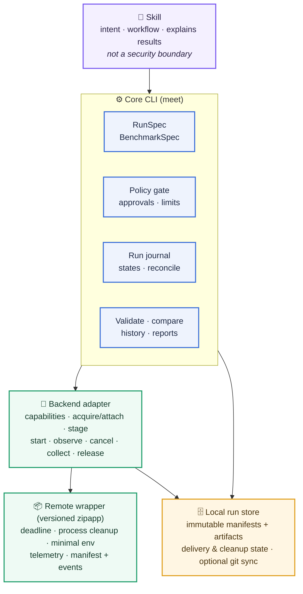
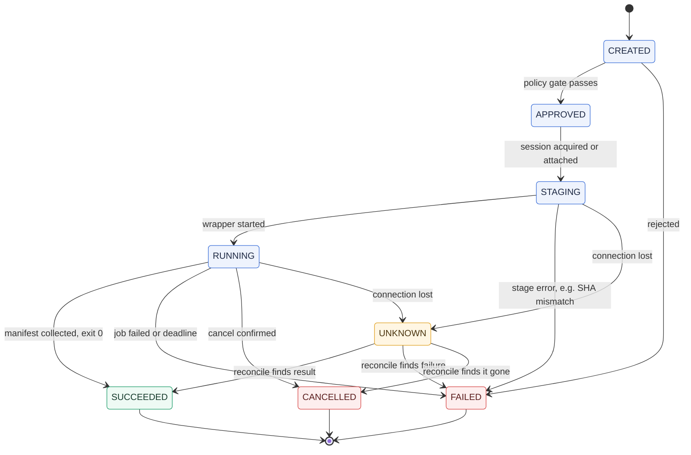

# MeetProxy design: reproducible GPU experiments for AI agents

Status: revised proposal, 27 Nov 2026 (v2). Incorporates the external design review of the same
day. The contract below is agreed **before** production code changes; nothing here describes
existing code unless it says so.

## 1. What MeetProxy is, and what it is not

**Is:** a small, deterministic core that lets an AI agent run GPU experiments that are
**correct, measured fairly, recoverable after failures, cheap to observe and remembered** — on the
GPU the user chose.

**Is not:** a replacement for the official Colab CLI, a universal cloud manager, a scheduler, or a
set of instructions that the model is trusted to follow. Moving code to a GPU is solved by official
tools (Colab CLI, `ssh`); MeetProxy uses them.

**The product surface is a skill** (`/meetproxy` in Claude Code, `$meetproxy` in Codex). The skill
explains intent and results; the core enforces everything that matters.

**Value must be proven, not assumed** (section 14): MeetProxy is worth building only if, on a real
CUDA experiment, it beats the official Colab skill alone on at least one target metric — manual
interventions, correctness, recovery, tokens or wall time — without hurting correctness.

## 2. Principles

1. **Core enforces, skill explains.** Approvals, limits, backend choice and data transfer are
   checked by the CLI, whoever calls it. Instructions in `SKILL.md` are not a security boundary.
2. **User policy dominates project wishes.** A committed project file can ask for a GPU; it can
   never raise a limit, approve spending or send code to a new host.
3. **The user chooses the backend and always sees it.** No silent fallback.
4. **Every external action is journaled before it happens.** An unclear outcome becomes `UNKNOWN`
   and is reconciled; it is never blindly retried.
5. **Honest isolation.** Jobs are trusted code running as the same user unless a real boundary
   (container, separate user) is configured. We do not claim more.
6. **Reproducible by construction.** A run is an immutable `RunSpec`: exact source, job digest,
   environment fingerprint.
7. **A speed-up is a claim that needs evidence.** Correctness first; comparisons only between
   compatible environments; "not enough data" is a valid verdict.
8. **Official tools for transport, contract tests for adapters.** Same contract, explicitly
   different capabilities.
9. **Few tokens.** The agent gets one verdict line per run; details only on request.
10. **MVP scope:** Linux + NVIDIA + Python ≥ 3.8 on the GPU side; local Claude Code and Codex on the
    agent side.

## 3. Components



| Component | Responsible for |
|---|---|
| Skill | User intent, the workflow, explaining results. Never trusted to enforce anything. |
| Core CLI | RunSpec, policy gate, run journal, validation, history, reports, comparison. Owns the history index. |
| Backend adapter | Declares capabilities; implements the lifecycle operations it supports; structured errors for the rest. |
| Remote wrapper | Isolation within available limits, wall-clock deadline, process cleanup, telemetry, manifest. |
| Local run store | Immutable manifests and artifacts, delivery and cleanup state, recovery; optional git sync. |

No central server, scheduler or queue in the MVP.

## 4. Run lifecycle

**Protocol:** `validate → approve → acquire/attach → stage → start → observe → collect → release → compare`



- **Identity first.** `run_id` (unique per submission, also for the same label) and `attempt_id`
  are written to the journal before any external action.
- **Intent and outcome.** For every external action (acquire, upload, start, cancel, download,
  release) the journal records the intent, then the outcome. A crash between the two is detected on
  the next start.
- **`UNKNOWN` means reconcile.** `meet reconcile <run>` asks the backend (session list, process
  status, remote manifest) and moves the run to a terminal state. Nothing is restarted
  automatically; a new attempt is an explicit user/agent action with a new `attempt_id`.
- **Three separate states per run:** computation (above), delivery (artifacts fetched and
  verified), session cleanup (released / kept / borrowed). A failed `release` never hides a result;
  an interrupted download never marks the run successful.
- **Cancel** is an operation with its own outcome: `CANCELLED` only when the backend confirms.
- **Exactly-once is not promised.** At-most-once start per attempt is: an ambiguous start is never
  retried silently.

## 5. Policy gate and money

Enforced in the core for every call, with or without the skill:

- **Two layers.** User policy `~/.config/meetproxy/policy.toml` (limits, allowed profiles, allowed
  hosts) dominates project wishes `.meetproxy/config.toml` (GPU wanted, profile preferred). A
  project file naming a host or profile the user never approved is rejected.
- **Paid acquisition needs an approval** bound to profile, GPU type, maximum runtime and expiry.
  Default: deny. In the MVP an approval is given by the human in a terminal
  (`meet approve pod --gpu A100 --max 2h`), or per profile (`ask_before_start = false` plus
  `max_hours`).
- **Outbound data needs consent once per host/profile:** sending the repository snapshot to a new
  machine is a data transfer.
- **Owned vs borrowed sessions.** A session MeetProxy created is *owned*: it gets a TTL, a maximum
  runtime, labels with `run_id`, and is found and released by reconcile after a crash. A session
  the user created (an existing Colab runtime, their own server) is *borrowed* and is never released
  or deleted by MeetProxy.
- **Cost is the session, not the job:** upload, idle time and download count. Unknown price →
  explicit consent or refusal. No hard money cap is promised where the provider API cannot enforce
  one; we enforce time limits and report what we know.

## 6. Trust model and credentials

- **Trusted-code mode (default, stated plainly):** a job runs as the same OS user as the wrapper. It
  could reach anything that user can — files, keyring session, provider sign-ins. MeetProxy reduces
  accidental exposure; it does not stop deliberate access. `meet doctor` reports the isolation level
  in effect.
- **Real boundaries when available:** run jobs in a container or as a separate user where the
  backend supports it; then the claims grow accordingly.
- **Minimal job environment:** an allowlist of variables (plus the user's explicit additions), never
  `SSH_AUTH_SOCK`, provider tokens, `GIT_CONFIG_*`, cloud SDK credentials.
- **Tokens:** providers without their own sign-in store tokens in the OS keychain (`keyring`).
  Plain-text file storage is **opt-in only**, with owner and mode checked on every read. Tokens are
  entered by the human in a terminal (`meet auth set <name>`), never in chat, never in config or the
  repository. Colab CLI, `ssh`, `gcloud` keep their own credentials; MeetProxy only checks them.
- **Artifacts are published by allowlist** (default: `results.csv`, manifest, logs, telemetry). A
  file found to contain a known secret is **withheld, not rewritten** (rewriting can corrupt binary
  data), and the run says so. Paths are validated: no symlinks or `..` escaping the run directory.
- **Logs and results are data, never instructions:** nothing read back from a run is executed or
  treated as a command by the core.

## 7. RunSpec: what a run is

Immutable, written before staging, stored with the run:

| Field | Required |
|---|---|
| repository + full commit SHA | yes |
| job script digest (SHA-256), parameters, seed | yes |
| wrapper digest and protocol version | yes |
| backend profile, requested GPU | yes |
| environment fingerprint after start: GPU model, driver, CUDA, Python | yes (recorded by the wrapper) |
| dependency lock or image digest | when present |
| dataset ID / hash | when declared |

- **Clean workspace per attempt:** a fresh worktree of the SHA, never a directory with earlier
  outputs.
- **Snapshot transfer:** a minimal `git bundle` of the SHA, verified on arrival; changing the branch
  after submit does not change the run. Git LFS and submodules: explicit refusal in the MVP (or a
  declared manifest later), never silently missing.
- A digest mismatch or a missing declared dependency stops the run before the job starts.

## 8. BenchmarkSpec and verdicts

For comparisons (optional per run, required for "faster/slower" claims):

- baseline and candidate, **correctness oracle** (reference output or check command), warm-up count,
  repeats, the measured phase, and the device/environment fingerprint;
- results: median and spread; wall time separated from kernel time where the job reports it;
- telemetry averages **weighted by time** (samples are irregular);
- verdicts: `OK`, `WARN`, `UNKNOWN` (no telemetry), `INSUFFICIENT_DATA` (too short, too few
  repeats). One line for the agent, details on request.
- A wrong output is rejected even if it is faster. Different hardware fingerprints never produce an
  automatic speed-up claim.

`nvidia-smi` telemetry stays coarse: it tells whether the GPU was busy, throttled or near OOM, not
whether a kernel is efficient. Kernel-level profiling (Nsight Compute) is a later, opt-in feature.

## 9. Backends: one contract, declared capabilities

Each adapter publishes a `CapabilitySet`; the core checks a run's requirements against it **before
acquire** and fails with a structured error (`unsupported: cancel`) otherwise.

| Capability | local | colab-cli | ssh | git-mailbox |
|---|---|---|---|---|
| acquire GPU | – (attach) | yes (owned) | – (attach, borrowed) | – (human opens notebook) |
| arbitrary bash | yes | via the Python wrapper | yes | yes |
| wall-clock deadline | wrapper | wrapper (CLI timeout is an *idle* limit) | wrapper | wrapper |
| cancel | yes | yes | yes | `STOP` / per-job cancel |
| observe after connection loss | journal + pid | session list + remote manifest | remote manifest | branch state |
| storage between runs | yes | until release | yes | branch |
| release | – | `colab stop` (owned only) | – | – |

Adapters pass shared **contract tests** against a fake backend (supported and unsupported
operations, connection loss, timeout, duplicate requests, orphan sessions) and a real smoke test per
backend before they are declared supported.

## 10. Remote wrapper

- **Built, not hand-written twice:** a versioned zipapp generated from the same modules the core
  uses (process group, deadline, telemetry, masking). Its digest is part of the RunSpec; a protocol
  version mismatch stops the run before the job starts.
- **Writes a manifest and an event stream** (`started`, `heartbeat`, `finished`), never the history
  index — the core owns history.
- **Preflight on the GPU machine:** Python version, `nvidia-smi`, disk space, `git`; missing tools are
  reported before the job, not as a mysterious failure.

## 11. Artifacts and the run store

- `.meetproxy/runs/<run_id>/` with an immutable `manifest.json` (files, sizes, SHA-256), the
  RunSpec, the journal and the artifacts. `.meetproxy/` is excluded from git.
- Atomic writes (temp file + rename); idempotent, resumable fetch; a checksum mismatch is a delivery
  failure, never success.
- Retention and quota settings; large binaries stay local.
- **Git sync is opt-in** and limited to an allowlisted set of small artifacts (results, manifest,
  verdict, reports). The git mailbox keeps its own branch as today.

## 12. Profiles, `doctor`, `auth`, bootstrap

- **Profiles** (`meet add / use / backends`, `--on <profile>`) live in user config; the project
  file only *prefers* one. First use of the skill: `meet doctor` shows what is possible and the user
  chooses what to set up.

  ```toml
  # ~/.config/meetproxy/config.toml — no secrets here
  [profiles.colab]
  kind = "colab-cli"
  gpu = "T4"

  [profiles.lab]
  kind = "ssh"
  host = "me@gpu.uni.edu"

  [profiles.pod]
  kind = "runpod"
  gpu = "A100"
  credential = "meetproxy/runpod"   # keychain entry name, not the key
  ask_before_start = true
  ```

- **`meet doctor` is read-only:** bounded timeouts, never waits on a TTY, never creates a GPU session,
  never prints secrets, `--json` for the agent. It reports per backend what works and the one step a
  human must do.
- **`meet auth set / list / rm`:** keychain storage as in section 6.
- **Bootstrap** installs a pinned release (tag + checksum), only with the user's permission; never an
  unverified branch. Interactive sign-ins (`colab auth login`) are done by the human in a terminal.

## 13. Hosts: what is supported is what is tested

One shared `SKILL.md` plus thin host manifests (Claude: skill folder / plugin; Codex:
`.agents/skills`, `agents/openai.yaml`). A support matrix lists host and version, shell and network,
install, auth and cancellation, each backed by a smoke test.

| Host | Status |
|---|---|
| Claude Code (local) | first target |
| Codex CLI / IDE (local) | first target |
| Cloud sandboxes (Claude Code web, Codex cloud) | git-mailbox only; after the first two |
| Chat without a shell (ChatGPT, Claude chat) | not supported; a hosted MCP server needs its own auth, tenancy and billing model and is considered only on proven demand |

## 14. Proving value

Before any new provider:

1. Pick one real CUDA experiment (ColorSplit / queens-rect kernel variants).
2. Run it twice with the same budget on the same GPU type: **official Colab skill alone** vs
   **MeetProxy**.
3. Measure: manual interventions, correctness of the chosen variant, recovery from a forced
   disconnect, wall time, cost, tokens.
4. Publish the protocol, raw data and result. No token or time savings are claimed before this.

## 15. Stages and acceptance gates

| Stage | Done when |
|---|---|
| **A. Core + local** | Immutable RunSpec, policy gate, durable lifecycle with `UNKNOWN`/reconcile, correctness oracle and baseline, contract tests; the local backend passes them. |
| **B. Colab CLI** | One real T4/L4: approval, bundle staging, reconnect, cancel, cleanup of owned sessions; the value experiment of section 14 published. |
| **C. SSH + mailbox** | SSH on one Linux host; the git mailbox moved behind the adapter contract with migration tests. |
| **D. Packaging** | Claude Code and Codex packages, pinned releases, support matrix, quick start; real user feedback. |
| **E. On demand** | RunPod / Vast / Lambda provisioning, Colab API, hosted MCP, multi-GPU. |

**Gate:** no new provider until local + Colab show reliable cancellation and recovery, correct
results and an observable advantage over the official workflow.

## 16. Open questions

- Can the skill start the Colab CLI sign-in and wait, or must the user run it? (Test on a real
  machine.)
- Wrapper on Colab via `colab exec` (Python) vs `colab ssh`: which gives reliable cancel and
  reconnect?
- Approval UX in Claude Code / Codex: a terminal command the human runs (`! meet approve …`) is the
  MVP; is there a better host-native confirmation?
- Container isolation on SSH hosts: Docker/Podman when present, or out of MVP scope?
