# MeetProxy design: one skill, any GPU

Status: proposal, 27 Nov 2026. Replaces the "Colab only" direction.

## 1. What changed

People no longer set tools up by hand: they ask their agent. The product is therefore **the
skill**. A user types `/meetproxy` in Claude Code (or `$meetproxy` in Codex, `@meetproxy` in
ChatGPT) and says *"run my benchmark on a GPU"* — and nothing else: no notebook to open, no script
to copy.

Moving code to a GPU is no longer the hard part. Google now ships an official **Colab CLI**
(`colab new --gpu T4`, `colab exec`, `colab run`, `colab ssh`, keep-alive, its own agent skill), an
official **Colab MCP server** (drives a notebook open in the browser) and a **Colab API**
(beta, allowlist). Rented GPUs and own servers are reachable over SSH. What nobody provides is the
layer on top: **one way of running GPU experiments that is correct, measured fairly, observed
cheaply and remembered — on whatever GPU the user has.** That is MeetProxy.

## 2. Principles

1. **The skill is the product.** Everything is reachable from `/meetproxy`. The skill installs and
   configures what it needs; the user only answers a sign-in prompt once per backend.
2. **Any GPU, one contract.** The same job script, the same `results.csv`, the same one-line GPU
   verdict, the same history — whether the GPU is Colab, a rented box, a university server or the
   laptop's own card.
3. **Use the official tool for each backend, never re-implement it.** Colab CLI for Colab, `ssh`
   for servers, provider CLIs/APIs for rented GPUs. MeetProxy adds discipline, not transport.
4. **Few tokens.** The agent reads one line per job (`gpu ok …` / `gpu WARN …`) and one line per run
   in history. Raw telemetry and charts are for humans.
5. **Credentials stay with their tools.** MeetProxy never stores tokens or keys: Colab CLI keeps
   its own sign-in, `ssh` its keys. Jobs never see the runner's credentials.
6. **No tunnels or open ports of our own.** Where a backend offers SSH (including `colab ssh`), we
   use it as a client.

## 3. Architecture

```mermaid
flowchart TB
    U["👤 User<br/>/meetproxy run my benchmark on a GPU"]

    subgraph HOSTS["🤖 Agents"]
        direction LR
        CC["Claude Code<br/>Claude Desktop"]
        CX["Codex CLI / IDE<br/>ChatGPT desktop"]
        WEB["Cloud sandboxes<br/>Claude Code web, Codex cloud"]
    end

    SK["📘 Skill meetproxy<br/>SKILL.md · scripts/ · references/<br/>one folder for every agent"]

    subgraph CORE["⚙️ meet — the core (local CLI)"]
        direction LR
        DOC["meet doctor<br/>finds a backend"]
        JOB["job contract<br/>headers · results.csv"]
        OBS["telemetry · flags<br/>history · reports"]
    end

    subgraph BACK["🔌 Backends (drivers)"]
        direction LR
        LOC["local<br/>this machine's GPU"]
        COL["colab-cli<br/>official Colab CLI"]
        SSH["ssh<br/>any Linux GPU<br/>RunPod · Vast · Lambda<br/>own / uni server"]
        API["colab-api<br/>(allowlist)"]
        MB["git-mailbox<br/>when only GitHub<br/>is reachable"]
    end

    W["📦 meet-wrap.py on the GPU<br/>process group · timeout · secrets masked<br/>GPU sampling · .done"]

    U --> HOSTS --> SK --> CORE --> BACK --> W

    classDef user fill:#fff6e3,stroke:#e0a020,stroke-width:2px,color:#4a3510
    classDef agent fill:#eef3fd,stroke:#3b6fd8,stroke-width:2px,color:#1f2a44
    classDef skill fill:#f4f0ff,stroke:#7a5af0,stroke-width:2px,color:#2a2244
    classDef core fill:#f6f4ef,stroke:#9a948a,stroke-width:2px,color:#2b2925
    classDef gpu fill:#eefaf4,stroke:#1f9d6b,stroke-width:2px,color:#163b2c
    class U user
    class CC,CX,WEB agent
    class SK skill
    class DOC,JOB,OBS core
    class LOC,COL,SSH,API,MB,W gpu
```



### 3.1 The skill

One folder, valid for Claude (`.claude/skills/`, Claude plugins) and for Codex / ChatGPT
(`.agents/skills/`, `agents/openai.yaml`, OpenAI plugin directory) — both follow the open agent
skills standard (`SKILL.md` with `name` and `description`, plus `scripts/`, `references/`).

```
meetproxy/
  SKILL.md                 short: the workflow, the rules, when to read which reference
  scripts/bootstrap.sh     installs `meet` (pinned version) if missing, runs `meet doctor`
  references/
    backends.md            how each backend is set up and what to tell the user
    measuring.md           fair measurement: warm-up, repeats, correctness, same GPU
    reading-results.md     what each flag means and what to check next
  templates/job.sh         job with headers and results.csv
  agents/openai.yaml       Codex / ChatGPT metadata
```

`SKILL.md` stays short (progressive disclosure: hosts load names and descriptions first, the full
file only when the skill is used). Backend details live in `references/` and are read only when
needed.

### 3.2 `meet doctor`: choosing a backend

The skill's first step is always `meet doctor`. It probes, in order, and stops at the first that
works (an explicit choice in `.meetproxy/config.toml` wins):

| Order | Backend | Probe | If it fails, the user is told |
|---|---|---|---|
| 1 | configured | `.meetproxy/config.toml` | — |
| 2 | `local` | `nvidia-smi` works here | — |
| 3 | `colab-cli` | `colab` installed and signed in | "Run `colab auth login` once" (or: "install the Colab CLI?" — the skill can install it) |
| 4 | `ssh` | hosts in config respond, `nvidia-smi` over ssh | "Add a GPU host: `meet add-host user@host`" |
| 5 | `colab-api` | API token present | — (allowlist) |
| 6 | `git-mailbox` | repo has a GitHub origin | "Open this notebook and press Run all" (today's flow) |

Output is one line for the agent and, if needed, one instruction for the human, e.g.
`backend: colab-cli (T4 available) · ready` or
`no GPU backend · ask the user: run "colab auth login" in a terminal, then retry`.

### 3.3 The core contract (unchanged)

Everything already built stays and becomes backend-independent:

- job = bash script with headers `# timeout:`, `# gpu:`, `# charts:`, `# telemetry:`;
- `$MEET_OUT/results.csv`, `.done` with exit code, full commit SHA, GPU, seconds, `gpu_stats`;
- the one-line GPU verdict, `meet history`, `meet report`, `meet export`.

### 3.4 Drivers

Each backend implements the same small interface:

```python
class Backend:
    def probe(self) -> Status            # available? which GPUs? what must the human do?
    def acquire(self, gpu) -> Session    # get a machine with that GPU (may be a no-op)
    def put(self, session, commit)       # make the exact commit present on the machine
    def exec(self, session, job) -> Run  # start meet-wrap.py with the job; stream the log
    def fetch(self, session, run)        # bring out/<job>/ back: .done, results, gpu.csv
    def release(self, session)           # give the machine back (policy-controlled)
```

| Driver | acquire | put | exec / fetch | release |
|---|---|---|---|---|
| `local` | — | checkout in a worktree | subprocess | — |
| `colab-cli` | `colab new -s meet --gpu T4` | `colab upload` of a `git bundle` (or `git clone` on the VM) | `colab exec`, `colab download` | `colab stop` (after idle, by policy) |
| `ssh` | host from config | `git fetch` on the host, or `git bundle` over `scp` | `ssh host meet-wrap.py …`, `scp` back | — |
| `colab-api` | `create_runtime` | `execute_code` (clone) | `execute_code`, files API | `delete_runtime` |
| `git-mailbox` | human opens notebook | runner checks out the pushed commit | `cmd/` → `out/` (today's runner) | human / idle exit |

**`meet-wrap.py`** is today's `run_job` extracted into a single file with no dependencies: it is
copied to the GPU machine with every job and runs the job in its own process group, enforces the
timeout, masks secrets, samples `nvidia-smi`, writes `.done` and the history line. The same file is
used by every driver, so measurements are comparable across backends.

### 3.5 Where results live

- Every backend: `.meetproxy/runs/<job>/` locally (log, `.done`, `results.csv`, `gpu.csv`, reports),
  plus `.meetproxy/history.csv`.
- Optional `sync: git` (default for `git-mailbox`, off for others): results are also pushed to
  branch `meetproxy` so history is shared and visible on GitHub.

### 3.6 Which agent environment can use which backend

| Agent runs in | Network | Usable backends |
|---|---|---|
| Claude Code / Codex on the user's machine | full | all |
| Claude Code web, Codex cloud, other cloud sandboxes | usually GitHub and package registries only | `git-mailbox` (this is why it stays) |
| ChatGPT / Claude chat without a shell | no shell at all | none today; later a hosted MCP server (phase 5) |

## 4. Security

- No MeetProxy secrets store: Colab CLI, `ssh`, provider CLIs keep their own credentials.
- Jobs get no backend credentials; secrets are masked in logs and result files (as in 0.5).
- Each job runs exactly the requested commit, or does not run (exit -3).
- `release` never happens implicitly for paid resources unless the user set a policy.
- The skill tells the agent to ask before acquiring paid GPUs (A100/H100, rented hosts).

## 5. Phases

| Phase | Result |
|---|---|
| **1. Core split** | `meet-wrap.py` extracted; driver interface; `local` and `git-mailbox` drivers on it; `.meetproxy/runs/` |
| **2. Colab CLI** | `colab-cli` driver; `meet doctor`; bootstrap installs pinned `meet` (and offers the Colab CLI) |
| **3. Skill for every agent** | skill rewritten around `doctor`; `references/`; Claude plugin; Codex/ChatGPT package (`agents/openai.yaml`, OpenAI plugin) |
| **4. SSH and rented GPUs** | `ssh` driver, `meet add-host`; RunPod / Vast provisioning via their CLIs |
| **5. Chat without a shell** | hosted MCP server exposing the same contract (needs its own security review) |
| **6. Colab API** | `colab-api` driver when access is granted |

## 6. Open questions

- Colab CLI on the agent's machine needs a one-time browser sign-in: can the skill trigger it and
  wait, or must the user run it? (Test on a real machine.)
- `put` for Colab CLI: upload a `git bundle` (exact commit, works for private repos without a token
  on the VM) vs clone on the VM (needs a token there). Bundle is the default proposal.
- Keep-alive and idle release on Colab CLI: rely on its daemon, plus our `release` policy.
- Naming inside Codex/ChatGPT: `$meetproxy` / `@meetproxy`; the CLI command stays `meet`.
