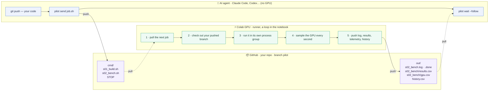
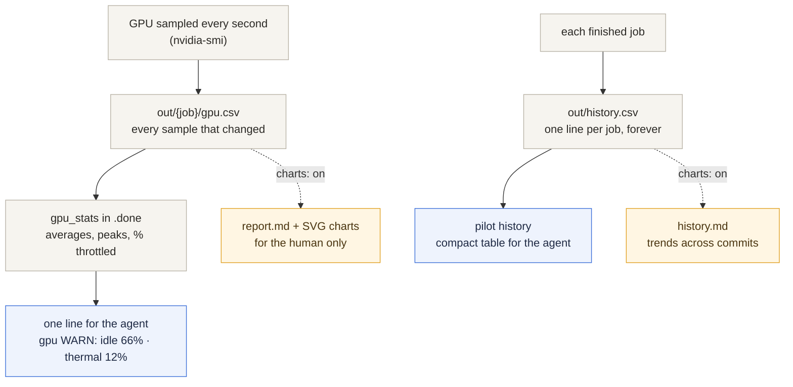

# How colab-pilot works

Your agent has no GPU, your notebook has one. They never talk directly: a branch of **your own
repository**, `pilot`, carries jobs one way and results the other.

**You:** open the notebook, *Run all* once, shut the runtime down when finished. Everything else is
the agent's.

## What comes back, and who reads it

The rule: **collect everything, give the agent only what it needs, give the human something
pleasant to look at.**

| Level | Where | Who reads it |
|---|---|---|
| Flags | last line of the log, `gpu_check` in `pilot wait` | the agent, always |
| Summary | `gpu_stats` in `out/<job>.done` | the agent, when a flag needs a closer look |
| Raw | `out/<job>/gpu.csv` | anyone digging |
| History | `out/history.csv`, `pilot history` | the agent, to compare runs |
| Reports | `out/<job>/report.md`, `out/history.md` | **the human only** — made on the GPU side, the agent never opens them, they cost no tokens |

## Where to look on GitHub

Everything lives in branch `pilot` of your repository: switch the branch selector to `pilot` and
open `out/`. `report.md` and `history.md` render with their charts right there, on a phone too.

To keep results next to your code: `pilot export <job>` copies them to `pilot-runs/<job>/` in your
working tree. Nothing is committed for you.

More detail: [ARCHITECTURE.md](../ARCHITECTURE.md).
