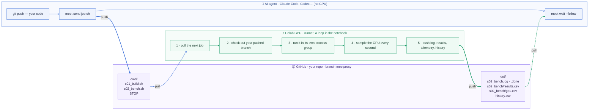
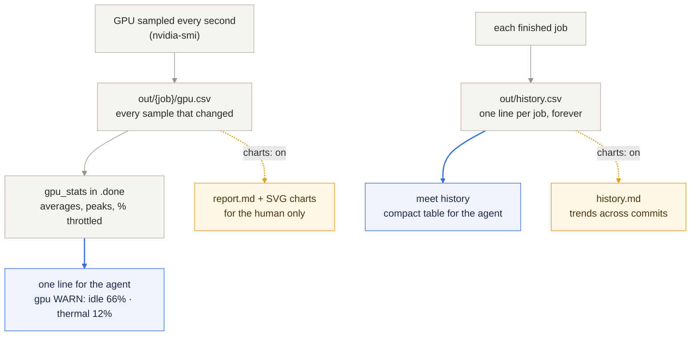
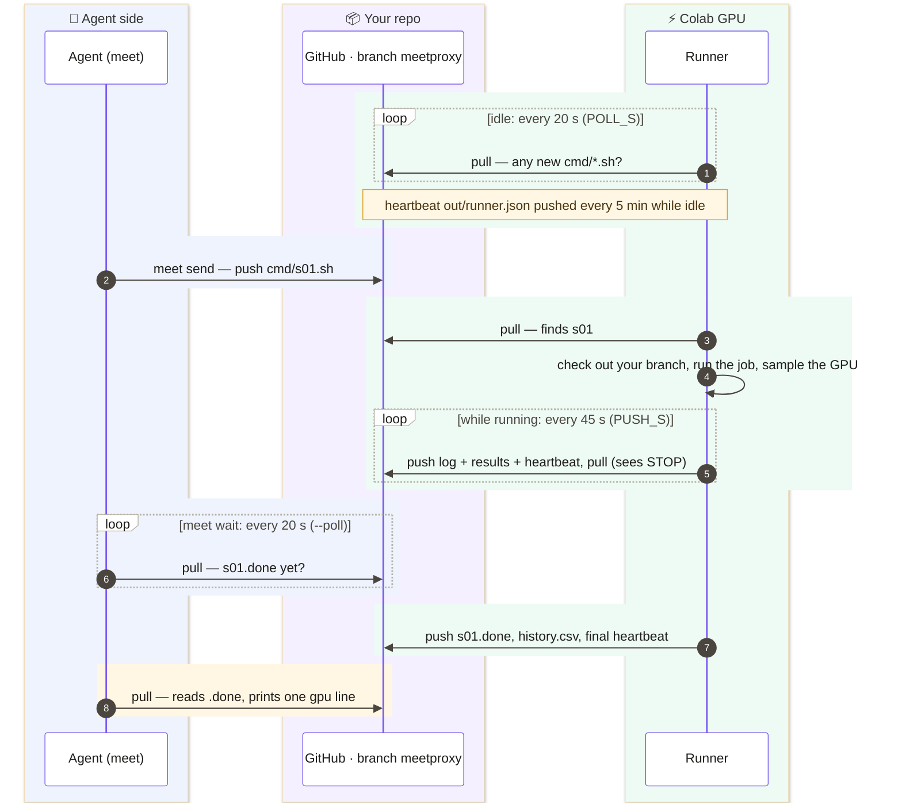
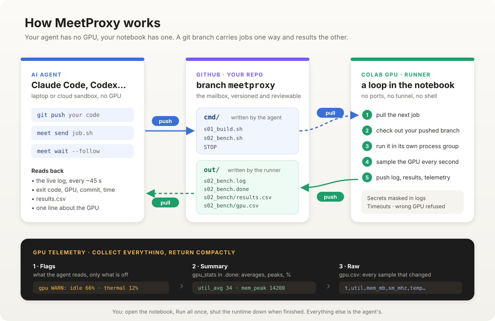

# How MeetProxy works

Your agent has no GPU, your notebook has one. They never talk directly: a branch of **your own
repository**, `meetproxy`, carries jobs one way and results the other.

**You:** open the notebook, *Run all* once, shut the runtime down when finished. Everything else is
the agent's.

## What comes back, and who reads it

The rule: **collect everything, give the agent only what it needs, give the human something
pleasant to look at.**

| Level | Where | Who reads it |
|---|---|---|
| Flags | last line of the log, `gpu_check` in `meet wait` | the agent, always |
| Summary | `gpu_stats` in `out/<job>.done` | the agent, when a flag needs a closer look |
| Raw | `out/<job>/gpu.csv` | anyone digging |
| History | `out/history.csv`, `meet history` | the agent, to compare runs |
| Reports | `out/<job>/report.md`, `out/history.md` | **the human only** — made on the GPU side, the agent never opens them, they cost no tokens |

## What the `meet` command is, and the heartbeat

`meet` is the small command-line tool from this package (`pip install
git+https://github.com/SergeyChere/MeetProxy`). The agent could drive the mailbox with plain
`git`, but every job would then cost it a dozen commands and their output. `meet` does the git
work and answers in one short line:

| Command | What it does inside |
|---|---|
| `meet init` | clones branch `meetproxy` of your repo into `.meetproxy/` (git-excluded), creates the branch if missing |
| `meet send job sh` | adds `# branch: <your branch>`, warns if the code is not pushed, writes `cmd/job.sh`, commits, pushes; if the runner pushed meanwhile — pulls and retries with backoff |
| `meet wait job` | pulls every 20 s until `out/job.done` appears; exit code = the job's; prints `.done` without the bulky stats, plus one `gpu_check` line |
| `meet status` | reads the heartbeat: alive or not, GPU, current job, queue |
| `meet history` | one line per finished job |

Neither side ever waits on the other: both just pull and push on timers.

**Heartbeat** is the file `out/runner.json` on branch `meetproxy`, written only by the runner:
`state` (starting / idle / running / stopped / idle-exit / budget / interrupted), current `job`,
`gpu`, `time`, `version`. It is pushed every 5 min while idle (few commits), with every log push
while a job runs, and once more on exit with the reason. The agent never reads it directly:

- `meet status` turns it into one line — `runner: idle | gpu: Tesla T4 | last seen 2 min ago` —
  or a plain instruction for the human: no runner yet → *run the notebook*; heartbeat older than
  12 min → *the runtime was probably disconnected, reconnect*; exited → *run the cell again*;
- `meet wait` checks it once if a job has produced no log for 2 minutes, so the agent learns the
  runtime is gone instead of waiting forever.

## Where the agent saves tokens

Everything the agent reads costs tokens; the design keeps that to the minimum it needs to decide.
Rough sizes (≈ 4 characters per token):

| Instead of… | the agent gets… | ≈ tokens |
|---|---|---|
| a dozen git commands and their output per job (add, commit, push, conflict, pull, retry, poll) | `meet send` / `meet wait`: one line each | ~2 000 → ~50 |
| `gpu.csv` of a one-hour job (up to 3 600 rows) | one flags line: `gpu ok: util 97%, mem 41%, 68°C` | ~40 000 → ~20 |
| the full `gpu_stats` in every `wait` | `.done` without it, plus that line; stats only when a flag needs a look | ~150 → ~20 |
| reopening old logs to compare runs | `meet history`: one line per run | ~5 000 → ~150 |
| charts and `report.md` | nothing: drawn on the GPU side for the human, the guide forbids opening them | ~30 000 → 0 |
| polling `meet status` while the human is away | `meet wait` checks the heartbeat itself after 2 min of silence | many calls → 1 line |
| many small jobs, each with its own round trip | one session script per button press, results appended to `results.csv` as they come | n round trips → 1 |

Tip for long jobs: `meet wait <job>` **without** `--follow`, then `meet logs <job> --tail 50` —
`--follow` streams the whole log into the conversation.

## Colab API: what will remove the last manual step

Today the human opens the notebook and presses *Run all*. Google now has a Colab API for managing
runtimes programmatically — **beta, by allowlist** (access is requested from the Colab team). Its
MCP server lists these tools: `list_runtime_specs`, `create_runtime` (accelerator `T4`, `L4`,
`A100`…), `get_runtime`, `list_runtimes`, `delete_runtime`, `create_session`, `list_sessions`,
`delete_session`, `execute_code`, `get_subscription`.

With access, MeetProxy could:

1. `create_runtime` with the GPU a job asks for (`# gpu: L4`);
2. `execute_code` the one-cell runner — no notebook, no button;
3. run the jobs over the same git mailbox (history and review stay in your repo);
4. `delete_runtime` after the queue is empty, so compute units are not burnt while idle;
5. `get_subscription` to warn before the compute units run out.

Until then: inside a running notebook `from google.colab import runtime; runtime.unassign()`
releases the runtime — planned as an opt-in "release after N idle minutes". **Colab Enterprise**
(Google Cloud, pay as you go) already has `gcloud colab runtimes create / start / stop / delete`.

## Where to look on GitHub

Everything lives in branch `meetproxy` of your repository: switch the branch selector to `meetproxy` and
open `out/`. `report.md` and `history.md` render with their charts right there, on a phone too.

To keep results next to your code: `meet export <job>` copies them to `meet-runs/<job>/` in your
working tree. Nothing is committed for you.

More detail: [ARCHITECTURE.md](../ARCHITECTURE.md).
