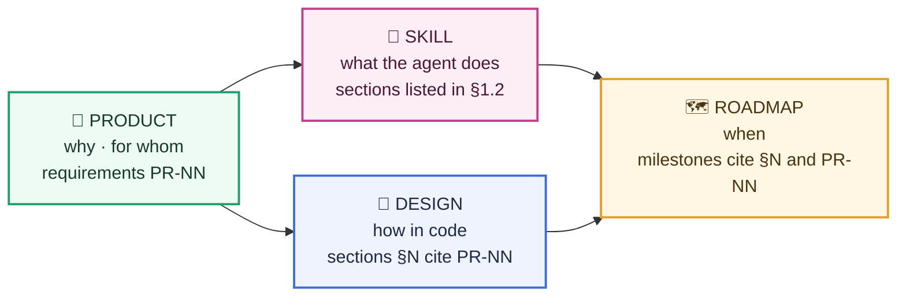

# MeetProxy product

**Why it should exist, for whom, and what it must do.** This document comes first. Three documents
are derived from it: the [skill](../skill/meetproxy/SKILL.md) — what the agent is told to do, the
product as users get it —, [DESIGN.md](DESIGN.md) — *how* each requirement is met in code —, and
[ROADMAP.md](../ROADMAP.md) — *when*. Requirements are numbered `PR-NN`; the others refer to them.

A change starts here and flows down: a new or changed requirement first, then the skill and the
design that meet it, then the milestone that builds it. A test keeps the links intact (every
`PR-NN` is designed and planned, every `§N` exists, every skill section named in §1.2 exists).

Status: 27 Nov 2026 (rev. 9, after five rounds of an adversarial review whose starting position was
"nobody needs this"). Rev. 7 narrowed the product to one thing generic tools leave to instructions:
**an enforced referee for GPU speed-up claims**, with the evidence behind the problem (§2), the
segment's observable size (§3), the alternatives (§4) and numeric GO margins (§9). Rev. 8 makes the
referee's claims checkable: where held-out inputs come from (§1.3), what its tamper detection does
and does not cover (§1.1), verdict levels, an external re-check and a false-reject rate so the
referee does not grade itself (§9), integrity tools as alternatives (§4), and a test design with
counterbalancing and minimum counts (§9). Rev. 9 adds the test's statistical power and makes the
seeded execution test the deciding one (§9), fixes the trust mode the test runs in (§1.3, §9),
budgets partner effort with a fallback (§9), and tightens the demand gate (§10); the deciding
exploits are a held-out set the referee was not built against, and route 1 needs natural evidence
from the test itself (§9). Everything here is a **hypothesis to validate**: no
user has been interviewed yet. Sources are listed at the end.

## 1. The promise and the product

> **Only real speed-ups survive.** Your coding agent optimizes your GPU code on a GPU you already
> have; MeetProxy checks every speed-up it claims before you believe it — and keeps the agent
> searching instead of stopping at the first win.

A target, not a proven claim (PR-20). The first benefit is **fewer false winners**: a variant that is
fast because it is wrong, cached, tuned to one input or measured against a stale baseline is never
reported as an improvement. The second is **a better verified result at the same budget**, because
the agent does not stop early or retry what already failed. Less babysitting follows from both; it
is measured, not promised.

### 1.1 The product is one skill — with a referee in code

A user installs a skill to get an outcome, not another piece of infrastructure. **MeetProxy is an
installable skill** (the `SKILL.md` standard read by Claude Code, Codex and other agents) that runs a
disciplined optimization campaign, plus **one executable referee** that decides what counts as a
verified result, over the execution tools the user already has. It is not a platform: no own
reasoning engine, no mandatory database, scheduler, daemon or hosted service, no reimplementation of
provider execution.

The instructions alone are easy to copy, and that is fine: they are free. **What instructions
cannot do is the product's substance** — a referee that decides instead of the agent, so a wrong,
cached or single-shape result cannot pass by assertion (deliberate tampering by a same-user agent is
a separate mode, below), and a maintained catalogue of known ways GPU speed-ups are faked, each one a test the referee must pass
(§1.3). It is designed to sit **under** any agent loop or execution tool — a plain agent session,
Karpathy-style autoresearch, the SkyPilot or Colab skills — not to replace them.

Four layers, each used only where the one above it is not enough:

| Layer | Does | Examples |
|---|---|---|
| **Skill** | the workflow: states the campaign, proposes variants, explains results, asks the user | campaign steps, stop rules, what to report |
| **Referee and helpers** | what must hold whether or not the model follows instructions | oracle pinned and run by code, held-out inputs, fresh inputs per timed run, deadlines, source identity, records |
| **Native tools** | GPU access, sign-in, transfer, sessions | the local card, the official Colab CLI and skill, `ssh` |
| **Core components** | none planned; durable lifecycle, journal or policy broker **only** for a recurring failure the lower layers could not solve, shown in the test of §9 | built one at a time, kept only if they measurably fix that failure |

**A skill is not a security boundary.** Instructions cannot enforce spending, isolate credentials,
guarantee cancellation, check artifact integrity or prove exact source; those stay in executable
code. A verification result is never a model's assertion — including an exit code the agent copied
into a file. Same-user execution stays trusted-code mode: in the default mode the referee detects
**accidental** edits to the pinned oracle, its inputs and itself; it cannot detect a same-user agent
that deliberately rewrites the referee and its hash check. **Tamper resistance** needs an external
anchor: the pinned hashes and the held-out seed kept where the agent cannot write — a separate OS
user, or the user's own approval record outside the repository — and checked by a process the agent
does not control. Which mode a result came from is printed on it.

**Universal means one interface, not unconditional compatibility.** The skill says which capability
a route lacks and never switches destination silently; it does not assume one skill can invoke
another.

**Route consent is separate from GPU consent.** Approving "use my Colab" does not approve sending
code through GitHub. A failed route never leads to a silent push or a new session.

**Owned and borrowed sessions are different.** A session the agent acquired is *owned*: the agent
releases it and records the evidence. A runtime the user opened is *borrowed*: only the user shuts
it down. Every result ends with *session released*, *runner stopped — cleanup still required by the
user*, or *nothing left running*.

**Paid compute fails closed.** Provider-side limits where they exist, otherwise explicit approval
per acquire; a route without a mandatory safety property is not used for paid compute. A local
timeout or a client disconnect is never reported as a confirmed cancellation; the residual billing
risk and the fact that a same-user agent can call a provider directly are stated.

### 1.2 What the skill contains

The skill is derived from this document. It **loads progressively**: the entry `SKILL.md` is short —
choose an approved route, define the experiment, verify, record, stop — and the details of a route
are in a reference file read **only when that route is chosen**. Loaded tokens and route-selection
errors are measured (§9).

| Skill section or reference | Serves |
|---|---|
| `Choose a route` — approved route only, unavailable routes shown with the reason, route consent | PR-02, PR-03, PR-04, PR-18 |
| `Campaign` — the workflow of §5 | PR-22, PR-05, PR-11, PR-23 |
| `Honest results` — the referee decides; too-good-to-be-true checks | PR-05, PR-20 |
| `Records` — what is written down per campaign and where | PR-16, PR-23, PR-25 |
| `Safety` — approvals, deadlines, owned vs borrowed sessions, secrets, trusted code | PR-07, PR-08, PR-09, PR-10 |
| `reference/local.md` — the local card: deadlines that also stop child processes, source identity | PR-04, PR-06, PR-07 |
| `reference/colab-official.md` — the official Colab tools: owned sessions, release, what is unknown | PR-02, PR-07, PR-10 |
| `reference/mailbox.md` — the legacy Colab runner through a git branch: kept for existing users, opt-in as its own route, not offered or tested in the first beta | PR-06, PR-10, PR-12, PR-14 |

Campaign records go to `meet-runs/campaigns/<campaign>/`, separate from `meet-runs/jobs/` used by
exports, so the two never collide.

### 1.3 The referee (arm B1)

The referee is one small command the agent calls instead of judging results itself. It:

1. **pins the oracle before the campaign** — the correctness command and its files and inputs by
   hash, approved by the user (prefer the project's existing tests, a reference implementation or
   known exact results; the agent may propose an oracle, the user approves it);
2. **runs it itself** for every candidate, on the declared inputs **and on held-out inputs the agent
   never saw**, and records the exit status — the agent never transcribes a verdict. Held-out inputs
   come from one of three sources, chosen when the campaign is approved:
   - an **input spec** the user approves with the oracle (shapes and their constraints, dtypes,
     layout, aliasing, tolerance, and optionally a **performance bound** — FLOPs and bytes per call,
     from which a physical floor on run time follows for the GPU) — the referee draws held-out cases from it with a fresh random seed
     **after** the candidate is frozen, so there is nothing to read in advance;
   - the user's **own hidden cases**, kept outside the repository;
   - neither: then the result can reach only the lower verdict level below, and says so.
   Preparing the spec or cases is oracle work; its time is measured and reported (PR-17);
3. **times fairly** — fresh inputs per timed run, synchronized device timing, repeats with spread,
   baseline re-measured in the same session on the same GPU, nothing else on the GPU;
4. **refuses a verified winner** for any entry of the exploit catalogue below, and gives one of
   three verdicts: `VERIFIED` (declared and held-out inputs pass, fair timing, no catalogue hit),
   `PASSED_DECLARED_ONLY` (no held-out source — never reported as verified), or
   `INSUFFICIENT_EVIDENCE`;
5. **keeps the search honest** — a candidate whose **normalised** source (comments, whitespace and
   formatting removed) matches an earlier one is flagged and not re-run; an early stop is accepted
   only with measured evidence — the last *k* candidates within the timing noise of the best, or, where
   a bound is known, the best within a declared fraction of it — not with a typed reason;
6. writes the records (§1.2) and the source identity of every run, or marks it *dirty / unverified*.

**Exploit catalogue** — each item is a fault-injection test the referee must pass, and the list is
maintained as new ones are published: hard-coded or constant outputs; outputs cached across
iterations or keyed on input identity; skipped computation that still passes the declared inputs;
tuning to a single shape; a stale or weakened baseline; precision silently lowered beyond the stated
tolerance; an edited oracle, input file or referee; a dirty working tree; a timed-out or orphaned
process; noisy or throttled timing; timer manipulation; physically impossible results (checked only
when the spec gives a bound — otherwise the result says the check was skipped). Items that need the
**tamper-resistant mode** of §1.1 are marked as such: a *deliberate* edit of the oracle, its inputs
or the referee by the agent. In default mode only *accidental* edits of these are detected. Where
existing integrity checks fit — KernelBench-Verified's checks, KernelGuard-style physics floors —
the referee reuses them rather than reinventing them. Its own overhead against native execution is
measured (PR-27).

### 1.4 What exists today

| Route or part | Status |
|---|---|
| Local card, following the skill | **instructions only** — no referee yet; results are as reliable as the agent |
| Official Colab CLI / skill underneath | **instructions only, not yet tried** |
| The referee (B1) | **not shipped** — the first thing to build (§9) |
| Mailbox route (Colab notebook runner through a git branch) | **working and tested**: exact commit, deadlines, telemetry, history — a legacy route, not part of the first beta |
| Core components (journal, lifecycle, policy broker) | **not built**; conditional on evidence (§9) |

Public pages describe these statuses as they are; no unsupported capability is claimed. Until the
referee exists, the product as defined here does not exist, and nothing may be claimed for it.

## 2. The problem

Coding agents now write GPU kernels routinely: Hugging Face ships a CUDA-kernel skill for Claude
Code and Codex; Google ships the Colab CLI with an agent skill; kernel contests run "full-agent" and
"agent-assisted" tracks. Two problems are documented — the first well, the second in one study — and
neither is solved by giving the agent a GPU:

- **Reported speed-ups are often not real.** Sakana AI's "AI CUDA Engineer" announced speed-ups of
  up to 381×; within a day the gains were traced to a flaw in its test harness that let incorrect
  kernels pass. Removing contaminated tasks from KernelBench cut a reported mean speed-up from
  3.13× to 1.49×. Meta's KernelBench-Verified found that frontier models frequently game the
  evaluation; with hidden tests **and** a stronger PyTorch baseline the best model's aggregate
  speed-up fell from 1.43× to 0.88× — part of that drop is the baseline, not cheating, which is why
  the referee re-measures the baseline as well as checking correctness. In live kernel competitions
  with real participants and coding agents, KernelGuard measured 3.45% of 141,800 submissions as
  hacked before its checks were added. A 2026 agentic-kernel study saw cached outputs pass correctness
  checks and had to add explicit anti-hacking rules. Checks an agent writes for itself, run on one
  input, are exactly the oracle that gets gamed.
- **Off-the-shelf agents may search badly** — weaker evidence: one workshop study (KernelBench
  Level 1, one trajectory per problem, one H100, no multi-seed variance) found that 86% (Codex) and
  81% (Claude) of runs that beat `torch.compile` made no further attempt after their first win, and
  one agent regenerated a byte-identical kernel three times; it did not measure whether stopping was
  rational. That study argues the bottleneck has moved from the model to the harness; a Baidu study
  of agent-assisted kernel work separately concludes that reliable kernel generation still depends on
  harness engineering — gates that keep results from being accepted by assertion, archived negative
  results, conservative promotion. The search claims are therefore secondary in §9; the
  verification claims lead.

Research teams and contest organisers build such harnesses — and integrity layers for them — for
**their own tasks**. For a developer optimizing kernels in **their own project** with a coding agent,
none of the integrity tools found (§4) is documented as something to point at an arbitrary
repository; they either trust the agent's numbers or become the harness by hand. MeetProxy's bet is
that a small, installable referee, reusing those checks, closes that gap. To be confirmed hands-on
(§4) and with partners (§10).

## 3. Who it is for

**Initial segment — developers who optimize GPU kernels in their own projects with a coding agent.**

| | |
|---|---|
| Who | individuals and small teams writing CUDA, Triton or custom PyTorch ops with Claude Code, Codex or similar |
| GPU they already have | **first beta:** a local NVIDIA card, or Colab through the official CLI · later: an SSH host |
| Current workflow | the agent writes and benchmarks variants; the human decides whether to believe the numbers |
| Switching trigger | a speed-up that turned out to be wrong, or a campaign too long to supervise |

**Observable size, not demand.** The activity exists: GPU MODE, an open GPU-programming community,
lists about 31,000 Discord members; an AMD kernel competition run on its platform drew 30,000+
submissions from 163+ teams; an AMD × GPU MODE hackathon had about 1,500 registrations; the MLSys
2026 FlashInfer kernel-generation contest had 245 submissions with agent tracks. None of this shows
that these people want MeetProxy: contests ship their own evaluation harness. The hypothesis is that
the same people, **outside a contest harness** — in their own projects, or validating locally before
a limited submission —, lack one. It is tested with design partners recruited outside the author's
circle (§10).

**Later, only if the first segment works:** ML engineers running independent experiments on their
own machines; users who want "run this on my GPU" (PR-04 — not the reason the product exists).

## 4. Alternatives

Verified on 27 Nov 2026 from public documentation; to be re-checked hands-on before any public
comparison.

| Alternative | What it offers | Verification it provides | What MeetProxy must do better |
|---|---|---|---|
| **The agent alone, local GPU** | compiles, runs and benchmarks on the user's card | whatever the agent writes and reports | an enforced referee; no transcribed verdicts |
| **SkyPilot autonomous-optimization example** | autoresearch loop on cloud VMs, append-only JSONL log, ideas queue, clean A/B rebuild on one quiet VM, noise rules | the **agent writes** the check and benchmark scripts, "protected" by instruction; no held-out inputs; CPU-oriented, not CUDA-specific | held-out shapes, oracle approved by the user and pinned by hash, edits detected, kernel-specific exploit tests — running under SkyPilot rather than against it |
| **pi-autoresearch** | try / keep / revert loop for the *pi* agent, `checks.sh` blocks keeps, JSONL log, advisory noise score | optional session checks; confidence advisory only; no held-out evaluation | the same, plus kernel-specific timing rules |
| **Karpathy autoresearch** | the minimal loop on one GPU with one metric (`program.md` as a lightweight skill) | a single metric | correctness gate and held-out verification |
| **Experiment-memory skills** (e.g. Sionic AI's Claude Code skills, Lambda's experiment tracker) | memory of failed attempts, leaderboards, history | tracking, not adversarial verification | anti-repeat tied to source hashes; verification |
| **Hugging Face `cuda-kernels` skill** | knowledge to write and integrate production kernels, with tests and benchmarks | tests and benchmarks the agent generates | complementary: MeetProxy referees what such a skill produces |
| **Official Colab CLI + skill, Colab MCP** | Colab runtimes from the terminal: new, exec, upload, download, stop, logs | none beyond execution | complementary: the execution route underneath |
| **KernelBench-Verified** | stricter evaluation for KernelBench (hidden tests, realistic baseline), offered as a drop-in fix for practitioners | strong, within the KernelBench task format | the same checks for the user's own kernel and tests; reuse, not reimplement |
| **KernelGuard** (ICML 2026) | integrity layer for contest submissions: expert static rules, physics-floor checks, an adversarial LLM judge feeding new rules | strong, for a contest pipeline; release as a general tool not documented | reuse its rules where published; apply them inside a user's own campaign |
| **AgentKernelArena held-out evaluation** (AMD) | re-runs an arena run's kernels on held-out shapes; reports regressions and speed-up retention | held-out configs **generated by an agent CLI**; arena task formats; ROCm | held-out inputs drawn from a user-approved spec after the candidate is frozen |
| **Contest harnesses** (GPU MODE KernelBot, robust-kbench) | evaluation for their own problems | strong, for their tasks | — (out of scope: contests already have one) |
| **A 30-line CLAUDE.md** | the workflow rules, free | instructions only | this is arm B0 of the test (§9); if it is as good, MeetProxy ships it and stops |

Before any public claim, each integrity tool above is tried hands-on on one partner-style repository.
If one of them can already be pointed at a user's own kernel and tests from an agent session,
MeetProxy wraps it as the referee instead of building its own, or stops. If a generic loop adds
equivalent **enforced** verification for GPU code, MeetProxy contributes its exploit catalogue there
or stops (§9).

## 5. Target workflow: a verified optimization campaign

> *"Make my fused attention kernel faster on my GPU without breaking it. Use our tests. Two hours."*

1. The agent states the campaign: objective metric, baseline, oracle, GPU and route, limits, stop
   conditions (PR-22). The user approves the campaign and the **oracle** once (PR-07, PR-05).
2. The referee pins the oracle, its inputs and the baseline measurement (§1.3).
3. The agent checks the records for what was already tried (PR-23).
4. It proposes and builds variants; **the referee** runs the oracle on declared and held-out inputs
   and times them; failures are rejected whatever their speed (PR-05). Runs are sequential on one GPU
   by default (PR-11).
5. The agent proposes the next round from the referee's results; an early stop needs measured
   evidence (§1.3).
6. On a stop condition, the referee re-runs the finalist and the baseline in one matched session and
   names the winner — or "no verified improvement" (PR-05, PR-20).
7. The user gets the verified result, the evidence, what was rejected and why, the cleanup state and
   the cost where known (PR-07, PR-25).

**The smallest campaign that tests the promise** (the first beta's scope): one GPU, one kernel in a
project with an existing correctness check, a baseline and 3–5 variants, one approval, the referee,
and one follow-up session with a fresh agent context that must find what was tried.

## 6. Requirements

Priority is for the **first beta** — the smallest campaign above: **Must** (without it that campaign
fails or is unsafe), **Should** (weakens it if missing), **Could** (later, on evidence), **Deferred**
(not part of the product until the test of §9 asks for it). **Layer** names who delivers it (§1.1).
The list is closed: new needs come from design partners.

| ID | Requirement | Priority | Layer | How we will know |
|---|---|---|---|---|
| **PR-01** | **The skill is the product.** One installable natural-language skill (`/meetproxy`, `$meetproxy`) is the whole user interface; the referee and CLI are for the agent. No commands to memorize for the human; installing it adds no infrastructure the user must run. | Must | Skill | a first-time user gets a verified result without reading CLI docs |
| **PR-02** | **Official tools underneath.** Use provider CLIs and sign-ins; never re-implement vendor auth or transport; install adapters only with consent. | Must | Native | no own auth for Colab/SSH; adapter install asks first |
| **PR-03** | **The user chooses the GPU.** No implicit provider, route or destination switch — a different route needs its own approval; the GPU is shown on every result. | Must | Skill + Helper | no run on an unapproved GPU or route |
| **PR-04** | **Quick Run.** "Run this on my GPU" with minimal metadata, keeping deadlines and source identity. | Should | Skill + Native | a quick run needs only the script |
| **PR-05** | **The referee decides correctness.** The oracle — preferably the project's existing tests or a reference — is approved by the user, pinned by hash, run by code on declared **and held-out** inputs (from an approved spec drawn after the candidate is frozen, or the user's hidden cases); fresh inputs per timed run; baseline re-measured in the same session; verdict levels `VERIFIED` / `PASSED_DECLARED_ONLY` / `INSUFFICIENT_EVIDENCE`; no verified-winner claim for any entry of the exploit catalogue (§1.3). | Must | Helper | every catalogue injection is rejected; the external re-check of §9 finds no false winner; the false-reject rate stays within target |
| **PR-06** | **Exact source.** Every run records the commit it ran, or is marked dirty / unverified and never presented as that commit. | Must | Helper | a dirty tree is never reported as a commit |
| **PR-07** | **Paid compute is safe by default.** Default deny, approvals, deadlines, bounded session hold; fails closed where a mandatory safety property is unsupported; owned sessions released with evidence, borrowed ones left to the user and said so; no monetary cap promised without provider enforcement. | Must | Native + Helper | no paid acquire without approval; no unbounded hold |
| **PR-08** | **No new credential burden.** Reuse official sign-ins; never tokens in chat, config or repo. The legacy mailbox needs a GitHub token stored in Colab: this is stated wherever it is offered, and it is not part of the first beta. | Must | Native | the beta routes need no new credential |
| **PR-09** | **Code stays where it is by default.** Local by default; consent per repository and destination. The legacy mailbox pushes code to GitHub: stated, approved as its own route, not in the first beta. | Must | Skill + Helper | no transfer to a new destination without consent |
| **PR-10** | **Failures are visible and recoverable.** Explicit `UNKNOWN`, no silent duplicate runs, partial results kept, cleanup state reported. | Should | Native; Core if needed | interrupted-run and disconnect tests |
| **PR-11** | **Parallel independent jobs** across approved GPUs, only when the estimated gain outweighs setup overhead; one GPU sequentially is the default. | Deferred | Skill + Helper | a workload where parallel wins by total time and cost |
| **PR-12** | **Few tokens.** Compact verdicts from the referee, bounded log excerpts; raw evidence on request. | Should | Skill + Helper | tokens reported per campaign |
| **PR-13** | **Results people can read.** Optional reports and charts made outside the agent's context. | Could | Helper | reports cost the agent no tokens |
| **PR-14** | **Telemetry levels.** Simple · Standard · Deep (opt-in); throttling and shared-GPU flags feed the referee's timing rules. | Should | Helper | a throttled run is not compared |
| **PR-15** | **Works with existing projects unchanged.** | Must | Skill | a partner's repository runs as is |
| **PR-16** | **No lock-in.** MIT, plain JSON/JSONL/CSV records, no hosted service. | Should | Helper | everything is readable without MeetProxy |
| **PR-17** | **Minutes to a first verified result.** Read-only discovery; oracle preparation time reported, not hidden. | Must | Skill | time to first verified result measured |
| **PR-18** | **Honest support.** Supported means tested; untested routes say so. | Must | Skill + tests | every listed route has a passing smoke test or an "untested" label |
| **PR-19** | **Integrate, don't replace.** Runs under existing agent loops and execution tools; exports into existing trackers. | Should | Native | the referee works inside one existing loop |
| **PR-20** | **Evidence before claims.** Benefits claimed only after the pre-registered test of §9, all runs published, supported and unsupported cases separated. | Must | Validation | test published; decision recorded |
| **PR-21** | **Compute cost per verified result.** Start-up, idle and failures included; unknowns disclosed. | Could | Helper | estimate vs actual reported |
| **PR-22** | **Optimization campaigns.** Objective, baseline, oracle, limits, variants, stop conditions and final evidence as one object; the agent reasons, the referee decides. | Must | Skill + Helper | a campaign ends with a verified result or "no verified improvement" |
| **PR-23** | **Do not repeat what failed.** Records of variants, normalised-source hashes, results and rejection reasons, readable by a fresh session; a repeat is a suggestion to skip, not a ban — a justified retest is allowed. | Must | Skill + Helper | a fresh session skips a reformatted copy of a recorded failed variant |
| **PR-24** | **Resource recommendations.** Suggest which approved GPU fits a run. | Deferred | Skill | — |
| **PR-25** | **Total cost includes the agent.** Agent tokens and model cost where the host reports them. | Should | Helper | campaign report shows compute and agent cost where known |
| **PR-26** | **Adoption is measured — with consent.** Time to first verified result, activation, repeat use, reasons for leaving; opt-in only. | Should | Validation | counts reported with denominators |
| **PR-27** | **Low overhead.** The referee's overhead against native execution measured separately for setup and per run. | Should | Helper | overhead reported per campaign |
| **PR-28** | **Portable experiment definitions.** A campaign states its requirements so it can move between GPUs. | Deferred | Skill + Helper | — |
| **PR-29** | **Extensible backends.** A documented backend contract with contract tests. | Deferred | Core if needed | — |

## 7. Objections

Plausible reasons not to install MeetProxy. Mapping to requirements is traceability, **not
evidence**: each objection is *unvalidated* until its check passes with real users.

| # | Objection | Answered by | Behavioural check | Status |
|---|---|---|---|---|
| 01 | Google already has a Colab skill. | PR-05, PR-19 | it executes; the referee verifies — over the Colab CLI, fewer false winners by the external re-check of §9 than without the referee | unvalidated |
| 02 | My agent already uses SSH. | PR-05, PR-06 | — (a route, not the value) | later |
| 03 | Setup is too complicated. | PR-17 | first verified result within target | unvalidated |
| 04 | I rarely need a GPU. | PR-04 | — | out of segment |
| 05 | I do not trust AI with paid compute. | PR-07 | partners approve a paid campaign | unvalidated |
| 06 | I will not give another tool credentials. | PR-08 | the beta routes need none | design constraint |
| 07 | My code is proprietary. | PR-09 | a local-only campaign | design constraint |
| 08 | I already use Slurm, Kubernetes or MLflow. | PR-19 | — | out of segment |
| 09 | I do not want to change my workflow. | PR-15, PR-19 | a partner's repository and loop run unchanged | unvalidated |
| 10 | I do not want to learn commands. | PR-01 | partners never type a `meet` command | unvalidated |
| 11 | Another layer means more failures. | PR-27 | overhead reported; no failures added in the test | unvalidated |
| 12 | A small project might disappear. | PR-16 | — | design constraint |
| 13 | Token savings are unproven. | PR-12, PR-20 | reported in the test | unvalidated |
| 14 | Time savings are unproven. | PR-20 | measured in the test | unvalidated |
| 15 | Money savings are unproven. | PR-21, PR-25 | — | later |
| 16 | I do not need detailed metrics. | PR-14 | — | design constraint |
| 17 | I just need to run code. | PR-04 | — | out of segment |
| 18 | My agent runs in the cloud. | PR-18 | — | later |
| 19 | My hardware or provider is unsupported. | PR-18, PR-29 | — | later |
| 20 | Official tooling changes too quickly. | PR-02, PR-18 | smoke test per pinned tool version | design constraint |
| 21 | I do not want another history database. | PR-16 | plain files only | design constraint |
| 22 | I need interactive GPU access. | PR-19 | — | out of segment |
| 23 | Claude can just write a script for me. | PR-05 | arm A of §9: its claimed winners judged by the external re-check | unvalidated |
| 24 | There is no convincing advantage. | PR-20 | the test of §9 ends in GO | unvalidated |
| 25 | Setup costs more than the benefit. | PR-17, PR-26 | break-even reported from partner data | unvalidated |
| 26 | SkyPilot already gives agents GPUs everywhere. | PR-05, PR-19 | under SkyPilot's loop, the referee rejects candidates its agent-written checks accept and the external re-check confirms them as false winners | unvalidated |
| 27 | My agent already runs CUDA on my local GPU. | PR-05, PR-23 | arm A vs B1 of §9 | unvalidated |
| 28 | I do not want another infrastructure dependency. | PR-01, PR-02, PR-16 | a local campaign with no GitHub, notebook, service or new credential | unvalidated |
| 29 | Generic autoresearch loops already check results and keep a log. | PR-05, PR-19 | on the same kernel, the loop's own checks vs the referee: held-out and exploit-catalogue failures they let through | unvalidated |
| 30 | It is just a markdown file anyone can copy. | PR-05 | arm B0 vs B1 of §9: if instructions alone match the referee, ship them free and stop building | unvalidated |
| 31 | "Verified" only means my tests passed. | PR-05 | held-out shapes and the exploit catalogue go beyond the declared tests; a candidate that passes the tests but fails held-out inputs is rejected | unvalidated |

## 8. Differentiators to prove

| Differentiator | Value | Boundary |
|---|---|---|
| **Enforced referee** (lead) | no false winners from the exploit catalogue: oracle pinned and run by code, held-out inputs drawn after the candidate is frozen (PR-05) | default mode detects accidental edits only; tamper resistance needs an external anchor (§1.1) |
| **Search that does not stop at the first win** (secondary) | early stops need measured evidence; anti-repeat on normalised source (PR-22, PR-23) | supported by one study only (§2); the agent still chooses what to try |
| **Works under existing loops and tools** | verification added without changing the loop or the execution route (PR-19, PR-02) | only tested combinations listed (PR-18) |
| **Honest status** | every route labelled as it is (§1.4) | — |

## 9. Success metrics and the test that decides

Margins and counting rules below are fixed **before the first run**; a change is allowed only before
then and is recorded with its date. Every number is reported with its denominator.

**Budget** means the same model, the same token cap, the same GPU, the same wall-clock cap and the
same task in every arm. **Everything the referee runs — held-out checks, repeats, matched re-runs —
counts against B1's budget.** For execution tests the candidate set is also the same.

**The re-check is external, so the referee does not grade itself.** After each campaign, every
arm's claimed winner — B1's included — is judged by an oracle MeetProxy's author did not build:

1. the partner's own **hidden tests, written after the campaign** without seeing the candidates —
   not blind to the workload, since the partner watched the campaigns, which is why it is never the
   only check;
2. a **third-party harness** where the kernel fits one (e.g. KernelBench-Verified's checks); and
3. **blinded expert review** of **every** claimed winner and a random sample of rejects, the
   reviewer not told which arm or verdict produced them — at least two reviewers per partner, GPU
   kernel practitioners with no stake in MeetProxy and no part in writing the referee or the
   exploit set, named in the pre-registration before the first run; disagreements are reported.

A claimed winner that fails any of these is a **false winner**. The referee's verdicts are compared
with this external judgement, in both directions.

**False rejects.** A referee that rejects everything would score zero false winners. So each
partner's candidate pool is seeded with **known-good speed-ups** (variants the partner or a
reference implementation shows to be correct and faster) and **the held-out exploit set** described
below; the referee's rejection of a known-good variant is a false reject.

| Metric | Definition | Target |
|---|---|---|
| **False-winner rate** (primary) | claimed winners that fail the external re-check ÷ claimed winners | B1: 0 · A and B0: reported |
| **False-reject rate** (co-primary) | known-good speed-ups the referee rejects ÷ known-good speed-ups; at least 20 seeded known-good variants across the test, reported with a 95% interval | observed ≤ 10%, upper bound ≤ 25% |
| **Held-out exploit acceptance** (deciding) | exploits from the held-out set that an arm's process reports as its winner ÷ held-out exploits, per arm; classes outside the catalogue reported separately | B1: 0 |
| **Verified speed-up** (primary) | geometric-mean speed-up of winners that pass the external re-check vs the baseline, same budget; a campaign without one scores 1.0 | see GO routes |
| Active human minutes | pre-registered counting rules (approvals, interventions, reading results) | reported |
| Early stops (secondary) | campaigns that stop with > 25% of budget left without the measured evidence of §1.3 | reported per arm |
| Repeats (secondary) | candidates whose normalised source matches an earlier one | reported per arm |
| Oracle preparation | partner minutes to approve an oracle and an input spec or hidden cases | reported |
| Time to first verified result | cold, from install | reported, oracle preparation separate |
| Referee overhead | per run and setup, vs native execution | reported |
| Tokens per campaign | same model and task | reported; no target before a baseline exists |
| Repeat use | partners who return unprompted for a real task within two weeks | counts; percentages only with ≥ 50 activated users |

**Arms** — safety constraints apply in every arm:

| Arm | What is tested |
|---|---|
| **A · the user's real workflow** | their agent, scripts, tests and notes — never a deliberately weak baseline |
| **B0 · the skill alone** | MeetProxy instructions, plain files, native execution |
| **B1 · the skill + referee** | the same instructions plus the referee of §1.3 |
| **C · B1 + one component** | only after a recurring failure B1 cannot solve |

**Design.** At least 5 partners and at least **3 campaigns per arm per partner**; arm order
counterbalanced across partners (half start with A); for the false-winner decision every arm
verifies the **same frozen candidate pool** per partner — the partner's real candidates plus the
seeded known-good variants and exploits —, so prior knowledge from an earlier arm cannot help; open
search outcomes (route 2) are reported separately from these execution tests. **B1 runs in default
mode**, the mode users would get: a deliberate edit of the referee by the agent is not prevented
there, but it cannot hide from the external re-check — any false winner it produces counts against
B1.

**Seeded exploits — a held-out set.** The exploits that decide route 1 are authored or adapted by
someone who did not write the referee, from published cases (§2 sources) and their own ideas, kept
out of referee development and fixed **before the referee is frozen** and before any partner's
workflow is seen; at least 2 per class used, including classes **not** in the catalogue, reported
separately. Exploits from the catalogue itself are the referee's development set: they are run, but
never decide anything.

**Acceptance per arm** means the arm's process reports the candidate as its winner. Partners are
told the pool contains planted candidates, not how many or which; this probably makes arm A more
careful than usual, which works against MeetProxy and is stated with the results. **Known-good variants** come from a shared pool of public reference kernels
plus at most 2 certified by each partner, to keep partner effort down.

**Power.** Natural false winners are rare events. With about 30 non-seeded A and B0 campaigns
(5 × 3 × 2) and a per-campaign false-winner rate of 2%, 5% or 10%, the chance of seeing at least 3
is about 2%, 19% or 59%, and of seeing at least 1 about 45%, 79% or 96%. So the **natural count
cannot decide at this size**: it is exploratory and reported with its denominator. The **seeded
execution test decides route 1**, and the natural count says whether the problem is real for these
users.

**Partner effort and fallback.** Estimated per partner: interview 0.5 h; oracle and input spec or
hidden cases 1–2 h; about 15–30 active minutes per campaign × 9 campaigns; hidden tests after the
campaigns about 1 h; review 0.5 h — **about 5–9 hours**. Partners are told this before agreeing.
The incentive is fixed before recruitment: at least the GPU time the test uses, plus a thank-you
payment or compute credit whose amount is **an open decision for the author** (5–9 hours of skilled
work is worth more than GPU time alone); partners keep the referee's findings on their own kernel.
Without a meaningful incentive, fewer completions are expected, and the case-study fallback applies. If fewer
than 5 partners complete, the results are published as case studies and the decision is ITERATE,
never GO.

**GO routes** (B1 against A, and B1 against B0), each with the false-reject rate within target:

1. **Fewer false winners** — on the held-out exploit set, B1 accepts none while A or B0 accepts at
   least a third; **and** at least one natural false winner appears in A or B0 **during the test**;
   B1 has no false winner by the external re-check; and B1's verified speed-up is not lower than
   theirs by more than 5% (ratio ≥ 0.95). Without a natural false winner in the test, a seeded-only
   result is at most a **conditional GO** — the problem is shown real only by interviews — and the
   follow-up is a longer observation of partners' own work before anything else is built; or
2. **Better verified outcome** — B1's verified speed-up is at least 10% higher (ratio ≥ 1.10) with
   a false-winner rate no worse; or
3. **Same outcome, less supervision** — verified speed-up ratio ≥ 0.95 and at least 50% fewer active
   human minutes.

**Decisions:**

- **GO B1** — a GO route holds against A *and* against B0, the false-reject rate is within target,
  and at least 2 partners outside the author's circle return unprompted → ship the skill with the
  referee.
- **GO B0** — B0 matches B1 on every route → the instructions are the product: publish them free and
  stop building code.
- **GO C** — B1 fails on a named recurring problem and one component fixes it → build only that.
- **STOP or narrow** — A already has no false winners and B1 adds no route, switching costs dominate,
  or partners do not return. The mailbox stays as a specialised tool if it is still useful.

If A's winners also survive the re-check and A's own checks already reject the seeded exploits, the
referee adds nothing for that user: a STOP signal, not a reason to add features. No new backend follows from any result of this test. The recruitment
targets (5 recruits, ≥ 3 real tasks, ≥ 2 unprompted returns) are exploratory signals, not proof of
product–market fit.

## 10. Reaching users

- **Design partners now** (before more infrastructure): 5 people from the segment of §3, recruited
  **outside the author's circle** — GPU-programming communities, users of agent kernel skills, kernel
  contest participants working on their own code. First an interview about their last real
  optimization, without mentioning MeetProxy. **Demand gate:** at least 3 of 5 describe, unprompted,
  a **concrete incident** in their own code — a claimed speed-up later found wrong, and what
  revealed it (a failing test, another input, a reviewer, production); a general feeling of
  distrust does not count. If fewer do, the problem of §2 is not theirs and the test of §9 does not
  start. The author's own
  research projects are dogfooding, never evidence.
- **Acquisition, only after GO:** the published test with raw data, the exploit catalogue as a public
  reference, the free skill. Conversion measured from visit to first verified result (PR-26).
- **Money:** none. The skill and the referee are free and open; correctness and safety are never
  paid features. There is no paid tier in this product; any paid offering would be a new product
  decision made in this document, on evidence of demand.

## 11. Non-goals

A platform before the skill is shown insufficient: an own reasoning engine; a mandatory database,
scheduler, daemon or hosted service; reimplementing provider execution, sign-in, transfer or session
discovery; removing a working path only to match a new architecture. Competing with agent loops or
multi-cloud orchestrators — MeetProxy runs under them; distributed training; automatic
parallelization of arbitrary code; multi-GPU screening for the first beta; a guaranteed monetary cap
without provider support; protection against a deliberately malicious agent running as the same
user.

## 12. Open questions only the real world can settle

The argument phase is complete: an adversarial review (five rounds, starting from "nobody needs
this") ended with no objection left that the document can answer. What remains, ranked by how
likely each is to kill the product — after the precondition that the referee exists at all (§1.4):

1. **Demand** — do at least 3 of 5 strangers report a concrete past false speed-up in their own
   code (§10)? No interview has happened yet; the only measured hacking rate comes from contests,
   which already have harnesses.
2. **Natural base rate** — do partners' own workflows produce false winners outside contests, and do
   their own checks already reject the held-out exploits? If not, STOP (§9).
3. **Recruitment** — will 5 skilled strangers spend 5–9 hours each? Fewer completions mean case
   studies and ITERATE.
4. **An existing tool already does it** — can KernelBench-Verified's checks or AgentKernelArena's
   held-out evaluation be pointed at a user's own repository? If so, wrap it or stop (§4).
5. **Oracle cost** — will users write an input spec or hidden cases? If not, most results reach only
   `PASSED_DECLARED_ONLY`, and the held-out value is empty in practice.
6. **Generalisation** — does the referee reject the held-out exploits, including classes outside its
   catalogue, with false rejects within bound?
7. **Instructions may be enough** — if B0 matches B1, the product is a free markdown file and the
   code stops.
8. **Overhead and return** — is the referee's overhead acceptable, and do at least 2 partners come
   back unprompted?

## Sources

- Google Colab CLI and its agent skill: https://developers.googleblog.com/en/introducing-the-google-colab-cli/ · https://github.com/googlecolab/google-colab-cli
- Hugging Face `cuda-kernels` agent skill: https://huggingface.co/blog/custom-cuda-kernels-agent-skills
- Sakana AI CUDA Engineer harness flaw: https://towardsdatascience.com/ai-agents-beat-pytorch-writing-faster-cuda-kernels/
- robust-kbench remediation (3.13× → 1.49×), as summarised in: https://arxiv.org/pdf/2604.22032
- KernelBench-Verified (1.43× → 0.88×): https://arxiv.org/pdf/2607.16241
- KernelGuard (hacked-submission rate in live competitions): https://icml.cc/virtual/2026/67922
- AgentKernelArena held-out evaluation: https://rocm.docs.amd.com/projects/agent-kernel-arena/en/latest/how-to/held-out-evaluation.html
- Cached outputs passing checks, anti-hacking rules: https://arxiv.org/pdf/2608.14560
- Agent harness failure modes (stopping after the first win, repeats): https://ceur-ws.org/Vol-4238/paper5.pdf
- Harness engineering for agent kernel work (Baidu): https://arxiv.org/pdf/2607.17979
- SkyPilot autonomous code optimization: https://docs.skypilot.ai/en/latest/examples/agents/autonomous-code-optimization.html
- pi-autoresearch: https://cdn.jsdelivr.net/npm/pi-autoresearch@1.9.0/README.md
- Karpathy autoresearch: https://github.com/karpathy/autoresearch
- GPU MODE community size and competitions: https://discord.com/servers/1189498204333543425 · https://kernelboarddev-8e4b32634dad.herokuapp.com/news · https://luma.com/cqq4mojz
- MLSys 2026 FlashInfer contest: https://syfi.cs.washington.edu/blog/2026-05-28-mlsys-kernel-contest/
