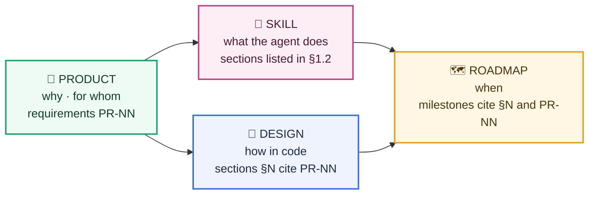

# MeetProxy product

**Why it should exist, for whom, and what it must do.** This document comes first. Three documents
are derived from it: the [skill](../skill/meetproxy/SKILL.md) — what the agent is told to do, the
product as users get it —, [DESIGN.md](DESIGN.md) — *how* each requirement is met in code —, and
[ROADMAP.md](../ROADMAP.md) — *when*. Requirements are numbered `PR-NN`; the others refer to them.

A change starts here and flows down: a new or changed requirement first, then the skill and the
design that meet it, then the milestone that builds it. A test keeps the links intact (every
`PR-NN` is designed and planned, every `§N` exists, every skill section named in §1.2 exists).

Status: 27 Nov 2026 (rev. 6, **skill-first**: the product is an installable skill with small
executable helpers over official tools, not a platform. Rev. 6 adds what exists today (§1.4), route
consent and session ownership (§1.1), a short entry skill with route references loaded on demand
(§1.2), and splits the skill arm of the test into instructions-only and instructions-plus-helpers
(§9); no new requirements). Everything here is a **hypothesis to validate**,
not shipped behaviour or customer research. Savings are claimed only after they are measured (PR-20).

Further changes come from design partners, experiments or concrete implementation constraints — not
from more analysis.

## 1. The promise and the product

> **Better verified GPU experiments. Less babysitting. Same budget.** — on the GPUs you already have.

A target, not a proven claim (PR-20). "Better" is the research outcome — the best verified result of
a campaign — not the number of runs; less babysitting is the second, measured benefit. One reason to
install, one thing to prove. Everything else — one skill, several GPUs, telemetry,
reports — is a means to this, not the pitch. Running a job on a GPU is not unique (provider skills
and multi-cloud tools do it, section 4); an **experiment campaign that comes back with a verified
best result and the evidence for it** is what MeetProxy must be better at than anything else.

### 1.1 The product is one skill

A user installs a skill to get an outcome, not another piece of infrastructure. **MeetProxy is an
installable skill** (the `SKILL.md` standard read by Claude Code, Codex and other agents) that turns
"find a faster correct version of my kernel" into a disciplined experiment campaign, with a few small
executable helpers for what instructions cannot guarantee, and the official provider tools
underneath. It is not a platform: no own reasoning engine, no mandatory database, scheduler, daemon
or hosted service, no reimplementation of what provider tools already do.

Four layers, each used only where the one above it is not enough:

| Layer | Does | Examples |
|---|---|---|
| **Skill** | the workflow: states the campaign, proposes variants, explains results, asks the user | campaign steps, fair-comparison rules, when to stop, what to report |
| **Helpers** | what must hold whether or not the model follows instructions: deadlines, exact source, verified-or-not, records | pinned oracle and recorded measurements, hard local deadlines, approvals, portable JSON/JSONL records, telemetry |
| **Native tools** | GPU access, sign-in, transfer, sessions | the local card, the official Colab CLI and skill, `ssh`; the git mailbox where only it works |
| **Core components** | durable lifecycle, journal, policy broker — **only** for a recurring failure the lower layers could not solve, shown in the skill-first test (§9) | built one at a time, kept only if they measurably fix that failure |

**A skill is not a security boundary.** Instructions cannot enforce spending, isolate credentials,
guarantee cancellation, check artifact integrity or prove exact source; those stay in executable
code, however small. A verification result is never a model's assertion. Same-user execution stays
trusted-code mode.

**Universal means one interface, not unconditional compatibility.** Provider tools, sign-ins,
network access and nested-skill support differ between hosts: the skill says which capability is
missing and never silently switches destination. It does not assume that one host can invoke another
skill; it uses explicit command-line fallbacks.

**Route consent is separate from GPU consent.** Approving "use my Colab" does not approve sending
code through GitHub. Every route that is unavailable is shown with the reason, and using a different
route — the mailbox in particular, which pushes code to the user's repository — needs its own
explicit approval. A failed native route never leads to a silent push or a new session.

**Owned and borrowed sessions are different.** A session the agent acquired is *owned*: the agent
releases it and records the evidence. A runtime the user opened (the mailbox notebook) is
*borrowed*: the agent may stop its runner, but only the user shuts the runtime down. Every result
says which of these holds: *runner stopped*, *session released*, or *cleanup still required by the
user*.

**Paid compute fails closed.** For paid runs MeetProxy uses, in this order, provider-side limits,
a narrowly scoped executable preflight on the supported route, or explicit manual approval per
acquire; if a mandatory safety property is unsupported on a route, that route is not used for paid
compute. A local timeout does not mean a remote job or a paid session ended; a client disconnect is
never reported as a confirmed cancellation. An agent running as the same user can bypass any of
these controls by calling a provider directly; this residual risk, and the residual billing risk,
are stated, not hidden.

### 1.2 What the skill contains

The skill is derived from this document. It **loads progressively**: the entry `SKILL.md` is short —
choose an approved route, define the experiment, verify, record, stop — and the details of a route
are in a reference file read **only when that route is chosen**. Mailbox setup runs only after the
user chose the mailbox, never during skill discovery. Loaded tokens and route-selection errors are
measured (§9).

| Skill section or reference | Serves |
|---|---|
| `Choose a route` — approved route only, unavailable routes shown with the reason, route consent | PR-02, PR-03, PR-04, PR-18 |
| `Campaign` — the workflow of §5 | PR-22, PR-05, PR-11, PR-23 |
| `Honest results` — correctness first, matched comparisons, too-good-to-be-true checks | PR-05, PR-20 |
| `Records` — what is written down per campaign and where | PR-16, PR-23, PR-25 |
| `Safety` — approvals, deadlines, owned vs borrowed sessions, secrets, trusted code | PR-07, PR-08, PR-09, PR-10 |
| `reference/local.md` — the local card: deadlines that also stop child processes, source identity | PR-04, PR-06, PR-07 |
| `reference/colab-official.md` — the official Colab tools: owned sessions, release, what is unknown | PR-02, PR-07, PR-10 |
| `reference/mailbox.md` — today's Colab runner through a git branch | PR-06, PR-10, PR-12, PR-14 |

### 1.3 The skill and its helpers per arm

The skill-first test (§9) separates what instructions achieve from what code adds: **B0** is the
skill alone (instructions, plain files, native execution, safely bounded), **B1** the same skill
with the minimal helpers. A helper is added only for a guarantee a tested claim needs — source
identity (or an explicit *dirty / unverified* mark), exit status, deadline, output and an independent
oracle result, pinned before any comparison. It must not report a verified winner for a wrong
answer, a failed oracle, a stale result, a dirty tree or a timed-out process, and its overhead
against native execution is measured (PR-27).

### 1.4 What exists today

| Route or part | Status |
|---|---|
| Mailbox route (Colab notebook runner through a git branch) | **working and tested**: exact commit, deadlines, telemetry, history, reports |
| Local card, following the skill | **instructions only** — no helper yet; results are as reliable as the agent |
| Official Colab CLI / skill underneath | **instructions only, not yet tried** (spike planned) |
| Helpers for local runs and campaign records (B1) | **not shipped** |
| Core components (journal, lifecycle, policy broker) | **not built**; conditional on evidence (§9) |

Public pages describe these statuses as they are; no unsupported capability is claimed.

## 2. The problem

An AI agent writes GPU code but has no GPU. The user has one — a Colab subscription, a lab server,
the card in their own machine. In repeated experiments (ten kernel variants, a parameter sweep) the
human becomes the middleware: starting runs, watching them, pasting results back, cleaning up paid
sessions. That is most of the work, and it is where results go wrong: the wrong commit ran, timings
came from different GPUs, a faster variant was silently incorrect, a failed idea was tried again a
week later, a session kept billing overnight.

## 3. Who it is for

**Initial segment — repeated CUDA experimenters.**

| | |
|---|---|
| Who | independent researchers and developers optimizing CUDA / PyTorch code |
| Frequency | several experiment sessions a week, many variants each |
| GPU access they already have | **first beta:** a local NVIDIA card and/or a Colab subscription · later (after GO): a lab or own server over SSH |
| Current workflow | an agent (Claude Code, Codex) writes code; the human runs it on the GPU and reports back |
| Switching trigger | a campaign of variants that is too tedious, error-prone or slow to babysit by hand |

**Later, only if the first segment works:** ML engineers spreading independent jobs over their own
machines; occasional users who want "run this on my GPU" (served by Quick Run, PR-04, but not the
reason the product exists).

## 4. Alternatives

Verified on 27 Nov 2026 from public documentation; to be re-checked hands-on before any public
comparison.

| Alternative | What it offers | What MeetProxy must still do better |
|---|---|---|
| **Official Colab CLI + skill** | Colab runtimes, exec, files, SSH, an agent skill | campaigns with correctness, exact source, recovery, memory |
| **Agent running CUDA directly on a local GPU** | Claude Code or Codex compiles and runs on the user's own card with normal scripting and the project's tests; no extra dependency | the strongest local baseline: MeetProxy must beat it on verified outcome or effort, not only on remote cases |
| **Agent + direct SSH** | any Linux host | durable status across disconnects, exact source, verified results |
| **SkyPilot agent skill** | an official agent skill (Claude Code plugin) over 25+ clouds, Kubernetes and Slurm, also existing machines; has shown autoresearch running in parallel on 16 GPUs | strong overlap — not competed with on breadth. Possible edge, to be proven: Colab subscriptions, lower setup friction, the evidence contract (exact source, oracle, matched comparison, memory). **Compared directly in the pilot wherever it supports the same resource and task; not integrated.** |
| **RunPod agent plugin** | official skills + MCP for Claude Code, Codex and ChatGPT | provider-specific; MeetProxy is about campaigns across the user's existing GPUs |
| **Modal auto-research skills** | research-agent skills on Modal GPUs | provider-specific; same as above |
| **Karpathy autoresearch** | the "try, compare, keep or discard" loop on one GPU with one metric | the same loop with correctness checks, exact source, several GPUs and a durable record |
| **Ad hoc script by the agent** | anything, once | a tested contract: exact source, budgets, recovery, artifacts, comparisons |
| **Slurm / Kubernetes / MLflow** | scheduling and tracking at scale | not replaced: SSH and open export into them |

If MeetProxy is not measurably better than the official Colab skill, direct SSH and direct local
execution for the initial segment's campaigns, it does not grow (PR-20).

## 5. Target workflow: an experiment campaign

> *"Find the fastest correct implementation of my CUDA kernel. Use my local GPU and my Colab.
> Budget: $10 and two hours."*

1. The agent states the campaign: objective metric, baseline, correctness oracle, the approved
   GPUs and limits, stop conditions (PR-22).
2. It checks the experiment memory: what was tried before and why it was rejected (PR-23).
3. The user approves the campaign once (PR-07).
4. Independent variants run on the approved GPUs — **sequentially on one GPU** (a valid campaign)
   or concurrently on several when the estimated gain outweighs the extra setup, transfer and
   compilation (PR-11).
5. Incorrect outputs are rejected whatever their speed; timings are compared only within compatible
   environments (PR-05). **Different GPUs screen, one GPU decides:** the reference (target) GPU is
   declared **before** screening and part of the budget and time is reserved for the final
   validation on it. Variants may be screened on several GPU types under a shortlist rule declared in
   advance that keeps architecture-sensitive candidates; finalists and the baseline are re-run on the
   reference GPU, and only that matched benchmark names the winner. Without it the result is a
   winner per GPU type, or "insufficient evidence" — never a global ranking from mixed hardware.
6. The agent proposes the next variants from the results, inside the approved limits; a helper
   records each hypothesis, its lineage and outcome (PR-22, PR-23).
7. On a stop condition: results verified, owned sessions released (PR-07, PR-10).
8. The user gets the best verified variant, the evidence, what was rejected and why, and the total
   cost — compute and agent tokens, actual where known (PR-25). A campaign that finds no improvement
   says so.

**The smallest campaign that tests the promise** (the first beta's scope): one CUDA project with an
existing correctness check, a baseline and 3–5 variants, one or two GPU profiles (local, Colab, or
both), one approval, one round of screening and one matched final benchmark, verified results and
released sessions — then **one follow-up session with a fresh agent context** that must find what
was tried (and allow a justified retest when the GPU or input changed).

The everyday case stays simple: *"run this on my GPU"* → it runs, the exact commit, one line of
result (PR-04).

## 6. Requirements

Priority is for the **first beta** — the smallest campaign above, on local GPU + Colab: **Must**
(without it that campaign fails or is unsafe), **Should** (weakens it if missing), **Could** (later, on
evidence). **Layer** names who delivers it (§1.1): Skill, Helper, Native tool, or Core — the last
only if the skill-first test (§9) shows the lower layers cannot. The list is closed for now: new
needs come from design partners, not from more analysis.

| ID | Requirement | Priority | Layer | How we will know |
|---|---|---|---|---|
| **PR-01** | **The skill is the product.** One installable natural-language skill (`/meetproxy`, `$meetproxy`) is the whole user interface; helpers and the CLI are for the agent. No commands to memorize for the human; installing it adds no infrastructure the user must run. | Must | Skill | a first-time user gets a result without reading CLI docs |
| **PR-02** | **Official tools underneath.** Use provider CLIs and sign-ins; never re-implement vendor auth or transport; install adapters only with consent. | Must | Native | no own auth for Colab/SSH; adapter install asks first |
| **PR-03** | **The user chooses the GPU.** Named profiles; no implicit provider, route or destination switch — a different route needs its own approval; the backend is shown on every result. | Must | Skill + Helper | contract tests: no run on an unapproved profile |
| **PR-04** | **Quick Run.** "Run this on a GPU" with minimal metadata, keeping safety and exact source. | Should | Skill + Native | quick run needs only the script and a profile |
| **PR-05** | **Benchmark Mode.** Correctness oracle — reusing the project's existing tests, reference implementations, fixtures or known exact results where possible —, repeats, compatible environments only; heterogeneous GPUs screen, a matched benchmark on one reference GPU — declared before screening, with budget and time reserved for it — decides; incorrect outputs never "win"; no adequate oracle → no verified-winner claim. | Must | Skill + Helper | an incorrect fast variant is rejected |
| **PR-06** | **Exact source.** Every job runs the commit it was submitted with, or does not run. | Must | Helper | branch moved after submit → submitted commit runs |
| **PR-07** | **Paid compute is safe by default.** Default deny, scoped approvals, time limits, bounded session hold, estimates; fails closed where a mandatory safety property is unsupported; owned sessions released with evidence, borrowed ones left to the user and said so; best-effort vs hard limits disclosed; no monetary cap promised without provider enforcement. | Must | Native + Helper | no paid acquire without approval; no unbounded hold |
| **PR-08** | **No new credential burden.** Reuse official sign-ins; other tokens in the OS keychain; never in chat, config or repo; minimal job environment; same-user limits documented. | Must | Native | tokens never appear in chat or files |
| **PR-09** | **Code stays where it is by default.** Local and private profiles; consent per repository and destination; history-free snapshots. | Must | Skill + Helper | no transfer to a new destination without consent |
| **PR-10** | **Failures are visible and recoverable.** Reconnect, explicit `UNKNOWN`, no silent duplicate runs, partial results kept, a direct-provider escape hatch. | Must | Native; Core if needed | disconnect, crash and interrupted transfer tests |
| **PR-11** | **Parallel independent jobs** across approved GPUs under one approved plan, recommended only when the estimated gain outweighs setup overhead; a single-GPU sequential campaign is equally supported; no distributed training or automatic parallelization of arbitrary code. | Must | Skill + Helper | two jobs on two profiles under one approval; one workload where parallel wins and one where sequential does, by total time and cost |
| **PR-12** | **Few tokens.** Compact structured verdicts and bounded log excerpts; raw evidence on request. | Should | Skill + Helper | measured token use vs direct workflows |
| **PR-13** | **Results people can read.** Optional reports and charts made outside the agent's context. | Could | Helper | reports cost the agent no tokens |
| **PR-14** | **Telemetry levels.** Simple · Standard · Deep (opt-in). | Should | Helper | quick runs default to Simple or Standard |
| **PR-15** | **Works with existing projects unchanged.** | Should | Skill | a representative existing repo runs as is |
| **PR-16** | **No lock-in.** MIT, open protocol, portable CSV/JSON, configurable retention, no mandatory hosted service. | Should | Helper | everything exports; no MeetProxy server needed |
| **PR-17** | **Minutes to first run.** Read-only discovery; ask only for what is missing. **First run** and **first verified experiment** are measured separately; oracle preparation time is reported, not hidden. | Must | Skill | both times measured (targets in section 9) |
| **PR-18** | **Honest support.** Supported means tested; support matrix with smoke tests; unsupported is explicit. | Must | Skill + tests | every listed host/backend has a passing smoke test |
| **PR-19** | **Integrate, don't replace.** SSH and open export first; Slurm/Kubernetes/MLflow integrations only on demand; interactive work handed to provider sessions. | Could | Native | export works into existing tools |
| **PR-20** | **Evidence before claims.** Benefits claimed only after a pre-registered comparison with the official Colab skill, direct SSH, direct local agent execution and SkyPilot wherever they support the same resource and task (and an autoresearch-style loop where relevant); supported and unsupported cases reported separately; all runs published. | Must | Validation | pilot published; decision GO / ITERATE / STOP |
| **PR-21** | **Compute cost per correct result.** Start-up, idle, failures and billing units included; unknowns disclosed; actual spend where available. | Should | Helper | estimate vs actual reported per plan |
| **PR-22** | **Experiment campaigns.** Objective, baseline, oracle, approved resource envelope, variants, stop conditions, final evidence — a first-class object. The agent reasons following the skill; helpers record and enforce. | Must | Skill + Helper | a campaign ends with a best verified result and its evidence |
| **PR-23** | **Experiment memory.** Per project: structured hypothesis identities, variant lineage, workload and hardware context, results, rejection reasons, evidence; likely duplicates surfaced as **suggestions, not bans** (justified retests and new combinations allowed); measured facts kept apart from agent interpretations. | Must | Skill + Helper | a new session finds a rephrased prior hypothesis and its evidence; a changed GPU or input allows an explicit retest |
| **PR-24** | **Resource recommendations.** Suggest which approved profile fits a run (capability, availability, estimated cost per correct result); new profiles only with approval. | Could | Skill | the suggested profile is approved before use |
| **PR-25** | **Total cost includes the agent.** Agent tokens and model cost (where the host reports them) next to GPU billing, storage and failed attempts; unknown parts marked. | Should | Helper | campaign report shows compute and agent cost |
| **PR-26** | **Adoption and retention are measured — with consent.** Time to first run, activation, repeat use at 7 and 30 days, reasons for leaving; opt-in, no data leaves the machine without it. | Should | Validation | design-partner and beta metrics reported with sample sizes |
| **PR-27** | **Low overhead.** Cold-start (staging, transfer) and steady-state overhead measured separately against direct execution; Quick Run stays fast. | Should | Helper | overhead within the target in section 9 |
| **PR-28** | **Portable experiment definitions.** A campaign or run states its requirements (GPU capability, dependencies, data); moving it to another backend validates them first. | Could | Skill + Helper | a run moved between profiles is validated or refused before transfer |
| **PR-29** | **Extensible backends.** A documented backend contract with capability declarations and contract tests, so others can add one. | Could | Core if needed | an external backend passes the contract tests |

## 7. Objections

Plausible reasons not to install MeetProxy. Mapping to requirements is traceability, **not
evidence**: each objection is *unvalidated* until its behavioural check passes with real users.

| # | Objection | Answered by | Behavioural check | Status |
|---|---|---|---|---|
| 01 | Google already has a Colab skill. | PR-22, PR-23, PR-20 | a better verified result at the same budget than the official skill; partners prefer it | unvalidated |
| 02 | My agent already uses SSH. | PR-06, PR-10, PR-22 | fewer interventions than direct SSH on the same campaign | unvalidated |
| 03 | Setup is too complicated. | PR-17 | first useful run within target | unvalidated |
| 04 | I rarely need a GPU. | PR-04 | — (not the initial segment) | out of segment |
| 05 | I do not trust AI with paid compute. | PR-07 | partners approve a paid campaign | unvalidated |
| 06 | I will not give another tool credentials. | PR-08 | partners complete setup without new credentials for Colab/SSH | unvalidated |
| 07 | My code is proprietary. | PR-09 | partners run on local/private profiles only | unvalidated |
| 08 | I already use Slurm, Kubernetes or MLflow. | PR-19 | — | out of segment |
| 09 | I do not want to change my workflow. | PR-15 | a partner's existing repo runs unchanged | unvalidated |
| 10 | I do not want to learn commands. | PR-01 | partners never type a `meet` command | unvalidated |
| 11 | Another layer means more failures. | PR-10, PR-27 | forced-disconnect test passes; overhead within target | unvalidated |
| 12 | A small project might disappear. | PR-16 | — | design constraint |
| 13 | Token savings are unproven. | PR-12, PR-20 | measured in the pilot | unvalidated |
| 14 | Time savings are unproven. | PR-11, PR-20 | measured in the pilot | unvalidated |
| 15 | Money savings are unproven. | PR-21, PR-25 | measured in the pilot | unvalidated |
| 16 | I do not need detailed metrics. | PR-14 | — | design constraint |
| 17 | I just need to run code. | PR-04 | — | out of segment |
| 18 | My agent runs in the cloud. | PR-18 | — | later |
| 19 | My hardware or provider is unsupported. | PR-18, PR-29 | — | later |
| 20 | Official tooling changes too quickly. | PR-02, PR-18 | compatibility tests per pinned CLI version | design constraint |
| 21 | I do not want another history database. | PR-16, PR-23 | partners keep the memory after a week | unvalidated |
| 22 | I need interactive GPU access. | PR-19 | — | out of segment |
| 23 | Claude can just write a script for me. | PR-06, PR-10, PR-05, PR-22 | fewer debugging interventions than an ad hoc script | unvalidated |
| 24 | There is no convincing advantage. | PR-20 | pilot ends in GO | unvalidated |
| 25 | Setup costs more than the benefit. | PR-17, PR-26 | break-even reported from partner data | unvalidated |
| 26 | SkyPilot already gives agents GPUs everywhere. | PR-22, PR-23, PR-20 | a better verified result at the same budget than SkyPilot where both support the resource, or the same result with less effort, time or cost | unvalidated |
| 27 | My agent already runs CUDA on my local GPU. | PR-05, PR-22, PR-23, PR-20 | beats direct local execution on verified outcome, or matches it with less effort, time or cost | unvalidated |
| 28 | I do not want another infrastructure dependency. | PR-01, PR-02, PR-16 | a partner installs the skill and runs a local campaign with no GitHub, notebook, service or new credential | unvalidated |

## 8. Differentiators to prove

| Differentiator | Value | Boundary |
|---|---|---|
| **Evidence-backed campaigns** (lead) | a best *correct* result with evidence (PR-22, PR-05) | the agent reasons, helpers record |
| **Experiment memory** | rejected ideas are not retried blindly (PR-23) | facts apart from interpretations |
| Resources the user already has | local card and Colab subscription in one campaign (lab servers after GO) (PR-11, PR-03) | only tested backends (PR-18) |
| Fault recovery | reattach, keep partial results (PR-10) | resume only via an explicit checkpoint contract |
| Total cost per correct result | compute + agent (PR-21, PR-25) | unknowns disclosed |
| Hardware comparison | throughput, memory, cost across GPU types (PR-05) | never read as an algorithm speed-up |
| Token compression | structured verdicts (PR-12) | raw evidence on demand |
| Compute governance | one policy for destinations, spending, expiry, data (PR-07, PR-09) | same-user trust limits stated |

## 9. Success metrics and starting targets

Proposed starting targets, **not measured outcomes**: definitions and denominators are fixed before
the pilot, and targets are recalibrated with pilot data.

| Metric | Starting target | Definition notes |
|---|---|---|
| **Verified research outcome at a fixed budget and time** (**primary**) | one of two pre-registered routes (below) | best verified improvement; same task, model, oracle, budget and wall-time cap in every arm; a campaign with no improvement reports zero |
| Verified improvement per dollar and per hour | reported | failed attempts and agent cost included |
| Correctness | never worse than baselines | constraint, not a trade-off |
| Manual interventions per campaign | absolute count, ≤ the lowest baseline | pre-registered counting rules (approvals, recoveries); if a baseline is already near zero, this is a constraint, not the goal |
| First run | ≤ 3 min (warm), cold reported separately | provider waiting time reported separately |
| First verified experiment | reported, with oracle preparation time | existing tests reused where possible |
| Agent tokens per campaign | −30% | same model, task and correctness gate |
| Memory in a fresh session | reported | retrieval accuracy, avoidable repeated work, false duplicate suggestions; context-dependent retests still possible |
| Parallel vs sequential | reported | total time and cost (setup included), not GPU time only |
| Steady-state overhead | ≤ 5% vs direct execution | staging and transfer reported separately |
| Design partners | 5, in the skill-first test, before any core component | local GPU and/or Colab users of the initial segment |
| External beta | 20 users | the advertised campaign works on their supported resources |
| 30-day repeat use | ≥ 40% of activated users | sample size reported |

**Skill-first test — before any core component.** On a real CUDA project with an existing
correctness check, the same agent, task, GPU access, oracle and resource envelope in three arms, each
with a cold install and a second session with fresh context:

| Arm | What is tested |
|---|---|
| **A · native tools** | the user's **real** workflow — official provider skill/CLI or direct local execution, project tests, their own notes and scripts; never a deliberately weak baseline |
| **B0 · the skill alone** | the MeetProxy instructions, plain files, native execution (local runs or explicitly bounded native runs) |
| **B1 · the skill + helpers** | the same instructions plus the minimal helpers of §1.3; the mailbox only where needed and approved |
| **C · B1 + one component** | one specific core component, added only after a recurring failure B1 cannot reliably solve — the whole core is never built just to create this arm |

Safety constraints apply in every arm. **Execution tests** use the same model, tests, hardware
access, limits and candidate set in every arm; **open-ended research outcomes** are reported
separately, so a lucky hypothesis is not credited to the tool. Recorded: cold onboarding, verified
outcome, active human minutes, elapsed time, total cost where known, failures, evidence validity,
loaded skill tokens, route-selection errors, unassisted repeat use. Decisions:

- **GO B0** — instructions alone win safely → ship them as the product.
- **GO B1** — the minimal helpers remove a measured blocker and users return → ship that skill.
- **GO C** — only a named component fixes an observed recurring failure → build only that
  component, with its own failure report and acceptance test.
- **STOP or narrow** — the native workflow is enough, the cost of switching dominates, or users do
  not return; the mailbox stays as a specialised tool if it is still useful.

No new backend follows from a documentation-only win. The recruitment targets (5 recruits, ≥ 3
real tasks, ≥ 2 unassisted repeat users) are exploratory signals, not proof of product–market fit,
and no target justifies building the whole framework.

**Two routes to GO**, each with margins and measurement rules fixed before the first run:

1. **Better outcome** — a practically meaningful improvement in verified outcome (at least the
   pre-registered margin) under the same resource envelope; or
2. **Same outcome, less cost** — verified outcome non-inferior within the pre-registered margin,
   with a meaningful reduction (at least the pre-registered margin) in manual interventions, elapsed
   time or total cost.

Correctness never worse, real resource limits and truthful reporting are non-negotiable in both
routes; the deciding metric is named in advance, not picked after the results. Otherwise ITERATE
or STOP; publishing results alone unlocks nothing.

## 10. Reaching users

- **Design partners now** (before more infrastructure): 5 people from the initial segment who use a
  local GPU and/or Colab — never recruited into workflows the beta does not support. Watch
  their real GPU workflow, then run the skill-first test (§9) with them; record interventions,
  objections and whether they repeat it.
- **Acquisition:** a real ColorSplit campaign written up with raw data, a short demo, the free
  skill, a quick start. Channels: CUDA, research and coding-agent communities. Conversion measured
  from visit to first useful run (PR-26).
- **Retention:** repeat use at 7 and 30 days, reasons for abandonment and for switching back.
- **Monetization:** the core stays free and open. Safety, exact source and correctness are never
  paid features. Possible paid value (deep profiling, team workflows) is tested only after demand
  is shown; until then there is no paid tier.

## 11. Non-goals

A platform before the skill is shown insufficient: an own reasoning engine; a mandatory database,
scheduler, daemon or hosted service; reimplementing provider execution, sign-in, transfer or session
discovery merely to unify code; removing a working path (the mailbox) only to match a new
architecture. Competing with multi-cloud orchestrators on breadth; distributed training and tightly coupled
multi-GPU workloads; automatic parallelization of arbitrary code; a general-purpose autonomous
research agent (the agent host reasons following the skill; helpers record and enforce); a hosted MeetProxy service
(until proven demand); a scheduler; universal cloud provisioning; a guaranteed monetary cap without
provider support; protection against malicious code running as the same user.
