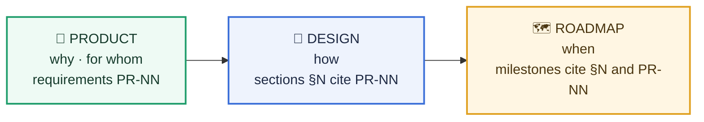

# MeetProxy product

**Why it should exist, for whom, and what it must do.** This document comes first:
[DESIGN.md](DESIGN.md) explains *how* each requirement below is met, [ROADMAP.md](../ROADMAP.md)
*when*. Requirements are numbered `PR-NN`; the design and the roadmap refer to these numbers.

A change starts here and flows down: a new or changed requirement first, then the design that meets
it, then the milestone that builds it. A test keeps the links intact (every `PR-NN` is designed and
planned, every `§N` exists).

Status: 27 Nov 2026. Everything here is a **hypothesis to validate**, not shipped behaviour or
customer research. Claims about savings are made only after they are measured (PR-20).

## 1. The problem

An AI agent writes GPU code but has no GPU. The user has one — a Colab subscription, a rented box,
a university server, the card in their own machine. Today the human becomes the middleware: copying
code, starting runs, watching them, pasting results back, cleaning up paid sessions. With repeated
experiments (ten kernel variants, a parameter sweep) this is most of the work, and it is where
results go wrong: the wrong commit ran, timings came from different GPUs, a faster variant was
silently incorrect, a session kept billing overnight.

## 2. Who it is for

| User | Has | Wants |
|---|---|---|
| **Researcher with repeated GPU experiments** (first target) | a CUDA/PyTorch project, Colab or a lab server, an agent such as Claude Code | the agent to try many variants and come back with the fastest *correct* one, with evidence |
| ML engineer with own or rented machines | SSH access, sometimes several GPUs | independent jobs spread over the machines without babysitting |
| Occasional GPU user | a Colab subscription | "just run this on a GPU" with no setup and no surprises on the bill |

## 3. Alternatives, and where MeetProxy must win

| Alternative | Good at | MeetProxy must add |
|---|---|---|
| Official Colab CLI + its skill | Colab provisioning, exec, files | one entry point for Colab *and* other GPUs; recovery, verified results, comparisons, cleanup |
| Agent + plain SSH | any Linux host | durable job status across disconnects, exact source, verified artifacts, metrics |
| Colab MCP server | notebook in an open browser tab | headless, repeatable runs |
| Ad hoc script written by the agent | anything, once | a tested, portable contract: exact source, budgets, recovery, artifacts, comparisons |
| Slurm / Kubernetes / MLflow | scheduling, tracking at scale | not a replacement: generic SSH and open export into these tools |

If MeetProxy is not measurably better than the first two for repeated experiments, it should not
grow (PR-20, ROADMAP gate).

## 4. Positioning

**Goal statement:** *One skill. Any supported GPU. No human middleware.* "Any" always means the
tested support matrix (PR-18), never more.

MeetProxy is a shared experiment contract **above** official provider tools: discover, approve,
stage, run, observe, recover, compare, release. It is **not** a replacement for provider CLIs, a
universal cloud manager, a scheduler, or a distributed-computing framework. The skill is the
interface; the enforceable contract and its measurable benefit are the product.

## 5. Target workflow

> *"Find the fastest implementation of my CUDA algorithm. You have a $10 compute budget."*

1. The agent sees which GPU profiles the user approved (local, Colab, a lab server).
2. It proposes a plan — variants, GPUs, estimated cost — and the user approves it once.
3. Independent variants run concurrently on the approved GPUs.
4. Incorrect outputs are rejected, whatever their speed.
5. Timings are compared only within compatible environments.
6. Within the approved limits the agent iterates on the best variants.
7. Results are collected and verified; sessions MeetProxy created are released.
8. The user gets the fastest correct variant, the evidence, and the spend (actual where known,
   estimated otherwise). The $10 is a requested budget, not a guaranteed cap where a provider cannot
   enforce one.

The simpler everyday case must stay simple: *"run this on my GPU"* → it runs, the exact commit,
one line of result.

## 6. Requirements

| ID | Requirement | How we will know |
|---|---|---|
| **PR-01** | **One entry point.** A natural-language skill (`/meetproxy`, `$meetproxy`); a CLI for agents and power users. No commands to memorize for the human. | a first-time user gets a result without reading CLI docs |
| **PR-02** | **Official tools underneath.** Use provider CLIs and sign-ins; never re-implement vendor auth or transport; install adapters only with consent. | no own auth for Colab/SSH; adapter install asks first |
| **PR-03** | **The user chooses the GPU.** Named profiles; no implicit provider or destination switch; the backend is shown on every result. | contract tests: no run on an unapproved profile |
| **PR-04** | **Quick Run.** "Run this on a GPU" with minimal metadata and no benchmark machinery, keeping safety and exact source. | quick run needs only the script and a profile |
| **PR-05** | **Benchmark Mode.** Controlled comparisons: correctness oracle, repeats, compatible environments only; incorrect outputs never "win". | an incorrect fast variant is rejected |
| **PR-06** | **Exact source.** Every job runs the commit it was submitted with, or does not run. | branch moved after submit → submitted commit runs |
| **PR-07** | **Paid compute is safe by default.** Default deny, scoped approvals, time limits, bounded session hold, cost estimates; best-effort vs hard limits disclosed; no monetary cap promised without provider enforcement. | no paid acquire without approval; no unbounded hold |
| **PR-08** | **No new credential burden.** Reuse official sign-ins; other tokens in the OS keychain; never in chat, config or repo; minimal job environment; same-user trust limits documented. | tokens never appear in chat or files |
| **PR-09** | **Code stays where it is by default.** Local and private-infrastructure profiles; consent per repository and destination; history-free snapshots. | no transfer to a new destination without consent |
| **PR-10** | **Failures are visible and recoverable.** Reconnect to live jobs, explicit `UNKNOWN`, no silent duplicate runs, partial results preserved, a direct-provider escape hatch. | disconnect, crash and interrupted transfer tests |
| **PR-11** | **Parallel independent jobs.** Run independent jobs concurrently across approved GPUs under one approved plan. No distributed training, no automatic parallelization of arbitrary code. | two jobs on two profiles under one approval |
| **PR-12** | **Few tokens.** Compact structured verdicts and bounded log excerpts for the agent; raw evidence on request. | measured token use vs direct workflows |
| **PR-13** | **Results people can read.** Optional human reports and charts, made outside the agent's context. | reports cost the agent no tokens |
| **PR-14** | **Telemetry levels.** Simple (exit, duration) · Standard (one GPU verdict line) · Deep (kernel profiling, opt-in). | quick runs default to Simple or Standard |
| **PR-15** | **Works with existing projects unchanged.** Existing scripts, builds and layouts; no required source changes. | a representative existing repo runs as is |
| **PR-16** | **No lock-in.** MIT license, versioned open protocol, portable CSV/JSON artifacts, configurable retention, no mandatory hosted service. | everything exports; works without any MeetProxy server |
| **PR-17** | **Minutes to first run.** Read-only discovery of installed tools, sign-ins and GPUs; ask only for what is missing. | time to first useful run is measured |
| **PR-18** | **Honest support.** Supported means tested: a support matrix with smoke tests per host and backend; unsupported is explicit. | every listed host/backend has a passing smoke test |
| **PR-19** | **Integrate, don't replace.** Generic SSH and open export first; Slurm/Kubernetes/MLflow integrations only on demand; interactive work handed to provider sessions without opening ports. | export works into existing tools |
| **PR-20** | **Evidence before claims.** Token, time, cost and reliability benefits are claimed only after a pre-registered comparison against the official skill and direct SSH, with all runs published. | pilot published; decision GO / ITERATE / STOP |
| **PR-21** | **Cost per correct result.** Estimates include start-up, idle, failures and provider billing units; unknowns disclosed; actual spend reported where available. | estimate vs actual reported per plan |

## 7. Objections we must answer

Plausible reasons not to install MeetProxy, each answered by requirements. These are hypotheses;
the answer counts only when its check passes.

| # | Objection | Answered by |
|---|---|---|
| 01 | Google already has a Colab skill. | PR-01, PR-02, PR-11, PR-20 |
| 02 | My agent already uses SSH. | PR-06, PR-10, PR-12 |
| 03 | Setup is too complicated. | PR-17 |
| 04 | I rarely need a GPU. | PR-04 (nothing runs or is acquired until asked) |
| 05 | I do not trust AI with paid compute. | PR-07 |
| 06 | I will not give another tool credentials. | PR-08 |
| 07 | My code is proprietary. | PR-09 |
| 08 | I already use Slurm, Kubernetes or MLflow. | PR-19 |
| 09 | I do not want to change my workflow. | PR-15 |
| 10 | I do not want to learn commands. | PR-01 |
| 11 | Another layer means more failures. | PR-10 |
| 12 | A small open-source project might disappear. | PR-16 |
| 13 | Token savings are unproven. | PR-12, PR-20 |
| 14 | Time savings are unproven. | PR-11, PR-20 |
| 15 | Money savings are unproven. | PR-21, PR-20 |
| 16 | I do not need detailed metrics. | PR-14 |
| 17 | I just need to run code, not reproduce research. | PR-04 |
| 18 | My agent runs in the cloud. | PR-18 (git mailbox where allowed; no host promised without a smoke test) |
| 19 | My hardware or provider is unsupported. | PR-18 (SSH path for Linux hosts; documented backend contract) |
| 20 | Official tooling changes too quickly. | PR-02, PR-18 (pinned versions, compatibility tests, structured failures) |
| 21 | I do not want another history database. | PR-16 |
| 22 | I need interactive GPU access. | PR-19 |
| 23 | Claude can just write a script for me. | PR-06, PR-10, PR-05 |
| 24 | There is no convincing advantage. | PR-20 |
| 25 | Setup costs more than the benefit. | PR-17, PR-20 (onboarding measured; break-even reported) |

## 8. Differentiators to prove

| Differentiator | Value | Boundary |
|---|---|---|
| Universal compute skill | one entry point over official tools (PR-01, PR-02) | only tested backends (PR-18) |
| Multi-provider execution | independent jobs across approved GPUs (PR-11) | no implicit switch (PR-03) |
| Cost per correct result | best approved option proposed with an estimate (PR-21) | unknowns disclosed |
| Fault recovery | reattach, preserve partial results (PR-10) | resume only via an explicit checkpoint contract |
| Autonomous experimentation | agent proposes variants, core validates (PR-05) | within the approved plan |
| Hardware comparison | throughput, memory, cost across GPU types (PR-05) | never read as a pure algorithm speed-up |
| Token compression | structured verdicts (PR-12) | raw evidence on demand |
| Compute governance | one policy for destinations, spending, expiry, data (PR-07, PR-09) | same-user trust limits stated |

## 9. Success metrics

- **Primary:** manual interventions per correct result, versus the official Colab skill and direct
  SSH on the same task (PR-20).
- **Constraints:** correctness never worse; budget and wall time within the approved plan.
- **Secondary:** time to first run (PR-17), tokens per experiment (PR-12), wall time with parallel
  jobs (PR-11), cost per correct result (PR-21), recovery after a forced disconnect (PR-10).
- **Decision:** GO / ITERATE / STOP on the pre-registered threshold; publishing results alone
  unlocks nothing.

## 10. Non-goals

Distributed training and tightly coupled multi-GPU workloads across providers; automatic
parallelization of arbitrary code; a hosted MeetProxy service (until proven demand); a scheduler;
universal cloud provisioning; a guaranteed monetary cap without provider support; protection against
malicious code running as the same user.
