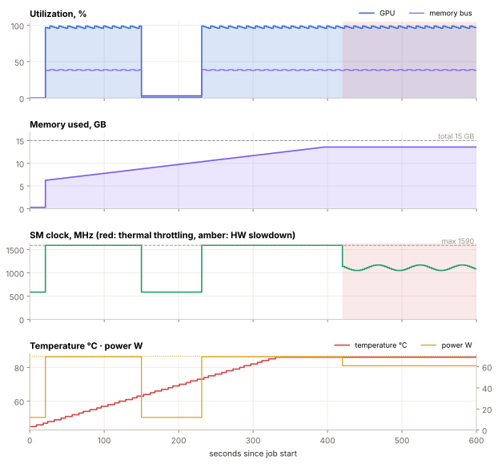

> **Example with made-up data** — this is what `# charts: on` produces after a job. Real reports live in branch `pilot`, `out/<job>/report.md`.

# s03_bench (example)

**✅ exit 0** · 600.0 s · Tesla T4 · 7f3a9c1 tiled kernel (claude/tiling) · 2026-11-23 18:20 UTC

> ⚠️ **GPU:** mem peak 90% · thermal throttle 30% · SM clock unstable ±23%



## GPU

|  |  |
|---|---|
| GPU utilization (avg / max) | 71% / 99% |
| Time GPU was idle | 17% |
| Memory peak | 13.6 of 15 GB |
| SM clock under load | 1402 MHz (±23%), max 1590 |
| Temperature max | 86 °C |
| Power avg / limit | 55 / 70 W |
| Thermal throttling | 30% |
| Power capped | 48% |
| Other GPU processes | 0 |

## Results

| variant | run | ms |
|---|---|---|
| baseline | 1 | 41.5 |
| baseline | 2 | 41.8 |
| baseline | 3 | 42.1 |
| tiled | 1 | 24.2 |
| tiled | 2 | 24.5 |
| tiled | 3 | 24.8 |
| tiled_fp16 | 1 | 14.4 |
| tiled_fp16 | 2 | 14.7 |
| tiled_fp16 | 3 | 15.0 |

## Log (last lines)

```
building...
baseline run 1: 41.5 ms
...
tiled_fp16 run 3: 15.0 ms
gpu WARN: mem peak 90% · thermal throttle 30% · SM clock unstable ±23%
```

---
*Report for humans, made by colab-pilot. Agents: read `.done` and `history.csv` instead; this file is not for you.*
